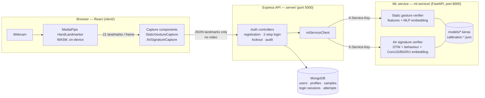
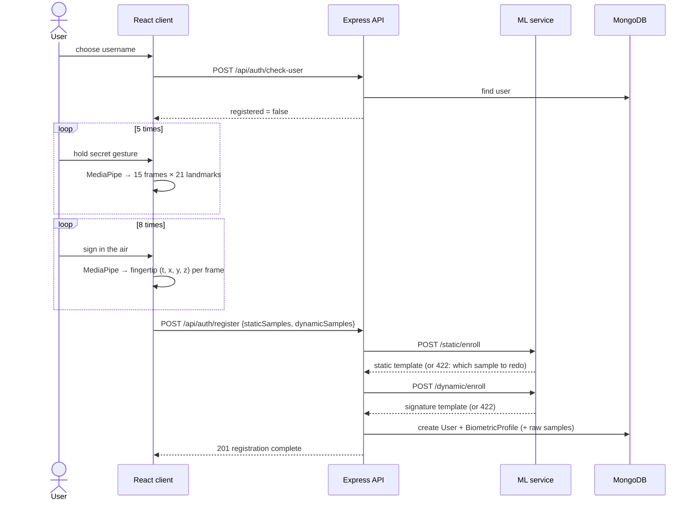
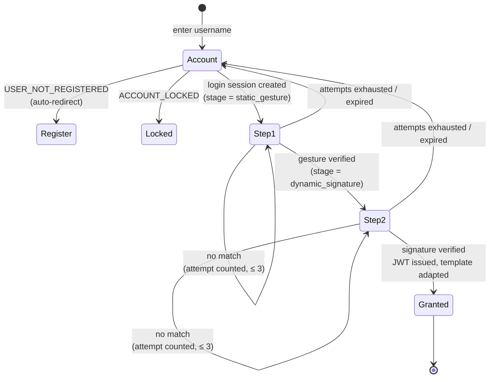

# AirAuth — System Architecture

Two-step, password-less authentication with a webcam:

| Step | Factor | What the user does | What is verified |
|---|---|---|---|
| 1 | **Static hand gesture** (knowledge + weak biometric) | Holds a secret hand pose for ~0.5 s | Pose shape (21 key-points → angles, distances, canonical coordinates) + hand geometry |
| 2 | **Dynamic air signature** (behavioural biometric) | Draws their signature in the air with the index finger | Trajectory shape, speed, rhythm, timing |

Access is granted **only if both steps pass, in order**.

---

## 1. Deployment view (MERN + ML micro-service)



| Tier | Folder | Tech | Responsibility |
|---|---|---|---|
| **M**ongoDB | — | MongoDB 6+/Atlas | Users, biometric templates, raw samples (research), login sessions (TTL), audit log |
| **E**xpress | `server/` | Node 18+, Express 4, Mongoose 8, JWT | Accounts, two-step state machine, attempt limits, lockout, tokens, rate limiting |
| **R**eact | `client/` | React 18, Vite, MediaPipe Tasks Vision | Camera, on-device hand tracking, capture UX, wizards, dashboard |
| **N**ode | `server/` | — | (runtime of the API) |
| ML | `ml-service/` | Python 3.11, FastAPI, NumPy, TensorFlow/Keras 3 | Preprocessing, feature extraction, AI models, scoring, calibration, training pipelines |

**Why a separate Python service?** The models, DTW and feature engineering
live in the Python ecosystem (and build on the original research
preprocessing). Express stays the only public API; the ML service is
reachable only with the shared `X-Service-Key`.

---

## 2. Registration flow



## 3. Login flow (two-step state machine)



```mermaid
sequenceDiagram
    actor U as User
    participant C as React client
    participant A as Express API
    participant M as ML service
    participant D as MongoDB

    C->>A: POST /api/auth/login/start {username}
    A->>D: user + profile exist? locked?
    A->>D: LoginSession {hash(token), stage: static_gesture, expires 5 min}
    A-->>C: loginSessionId

    U->>C: show gesture
    C->>A: POST /login/static-gesture {loginSessionId, sample}
    A->>M: /static/verify {template, sample}
    M-->>A: accepted, score, components
    A->>D: AuthAttempt log; stage → dynamic_signature
    A-->>C: passed → next step

    U->>C: draw air signature
    C->>A: POST /login/air-signature {loginSessionId, sample}
    A->>M: /dynamic/verify {template, sample}
    M-->>A: accepted (+ template_update)
    A->>D: AuthAttempt; adapt template; delete session
    A-->>C: JWT access token → dashboard
```

---

## 4. Data model (MongoDB)

| Collection | Key fields | Notes |
|---|---|---|
| `users` | username (unique), displayName, failedAttempts, lockUntil, lastLoginAt | No password |
| `biometricprofiles` | user, staticTemplate, dynamicTemplate, staticHandedness, dynamicAdaptations | Templates are opaque JSON produced by the ML service; never sent to the browser |
| `biometricsamples` | user, kind (static/dynamic), purpose (enrollment/login), accepted, sample | Raw captures for retraining (`STORE_RAW_SAMPLES`) |
| `loginsessions` | tokenHash, user, stage, attempts, expiresAt (TTL) | Server-side 2-step state |
| `authattempts` | user, step, accepted, reason, score, threshold, matchPercent, ip | Audit log / dashboard history |

---

## 5. Security controls

| Threat | Control |
|---|---|
| Skipping Step 1 | Server-side `LoginSession.stage`; Step 2 endpoint rejects sessions not at `dynamic_signature` |
| Brute force | ≤ 3 attempts per step per session, account lock after 5 consecutive failures (15 min), IP rate limits |
| Replaying stored data | ML rejects probes that are (near-)identical to an enrollment sample (`replay_suspected`) |
| Shoulder-surfing the gesture | Step 2 is a behavioural biometric — copying the shape does not copy speed/rhythm |
| Biometric data leakage | Video never leaves the browser; templates never leave the server; `DELETE /api/users/me` removes everything |
| Direct ML access | ML endpoints require `X-Service-Key`; only Express knows it |
| Token theft | Short-lived JWT (1 h), login-session tokens stored only as SHA-256 hashes |

**Known limitation (documented for the capstone):** landmarks are computed
in the browser, so a malicious client could submit synthetic landmark data.
Production hardening would add server-side liveness checks (e.g. random
challenge gestures) or on-server landmark extraction from video.

---

## 6. Repository layout

```
Capstone V2/
├── Architecture/                 ← these documents
├── client/                       ← React + Vite front-end
│   └── src/{api,components,config,context,lib,pages,styles}
├── server/                       ← Express + MongoDB API
│   ├── src/{config,controllers,middleware,models,routes,services,utils}
│   └── scripts/exportBiometricSamples.js
├── ml-service/                   ← Python AI service
│   ├── airauth/                  ← core library
│   │   ├── common/               (config-free helpers: fusion, metrics, model registry, hand topology)
│   │   ├── static_gesture/       (preprocessing, features, synthetic hands, MLP, verifier)
│   │   ├── dynamic_signature/    (preprocessing, features, DTW, synthetic signatures, Conv1D-BiGRU, verifier)
│   │   └── data/                 (dataset loaders)
│   ├── app/                      ← FastAPI layer (routers, schemas, security)
│   ├── pipelines/                ← train / evaluate / calibrate / run_full_pipeline
│   ├── data/research_signatures/ ← recorded research dataset (3 users × 3 sessions)
│   ├── models/                   ← trained .keras models + calibration JSON
│   ├── reports/                  ← evaluation reports (.md/.json)
│   └── tests/                    ← pytest suite
└── scripts/                      ← setup.ps1, start-dev.ps1
```

<!--
=============================================================================
FILE SUMMARY
-----------------------------------------------------------------------------
01_System_Architecture.md describes the whole AirAuth system: the two
authentication factors, the MERN + Python ML micro-service deployment, the
registration and two-step login sequences, the login state machine, the
MongoDB collections, the security controls (and the known client-side
landmark limitation) and the repository layout.
=============================================================================
-->
