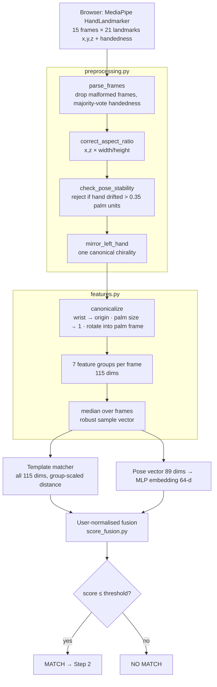

# Step 1 — Static Hand Gesture Model

**Goal:** decide whether the hand pose shown now is the user's registered
secret gesture, shown with the same hand.

Code: `ml-service/airauth/static_gesture/`

---

## 1. Processing pipeline



## 2. Key-point features (115 per frame)

The palm frame: **y** = wrist → middle knuckle, **x** = index knuckle → pinky
knuckle (orthogonalised), **z** = x × y (palm normal). All lengths are in
*palm units* (mean wrist-to-knuckle distance), so features do not depend on
distance to camera, hand position or in-plane rotation.

| Group | Dims | Description | Invariant to | Weight | Scale |
|---|---|---|---|---|---|
| canonical_xy | 40 | x,y of the 20 non-wrist landmarks in the palm frame | position, size, rotation | 1.0 | 0.12 |
| canonical_z | 20 | depth in the palm frame (MediaPipe z is noisy) | position, size, rotation | 0.3 | 0.30 |
| joint_angles | 15 | flexion at every finger joint (0 = straight) | everything | 1.0 | 0.22 rad |
| tip_distances | 10 | all fingertip-to-fingertip distances | position, size, rotation | 1.0 | 0.15 |
| abduction | 4 | spread between adjacent fingers (palm plane) | everything | 0.5 | 0.15 rad |
| orientation | 6 | palm normal + up vector in camera space (thumbs-up ≠ thumbs-down) | position, size | 0.6 | 0.30 |
| hand_geometry | 20 | bone length / palm size — **who** the hand belongs to | pose | 0.4 | 0.10 |

*Scale* = expected natural variation of a genuine repeat; a group's RMS
difference divided by its scale is ≈ 1 for a genuine repeat.

## 3. AI model — pose embedding network

```
pose vector (89) ─ standardise (training mean/std)
  → Dense 256 (no bias) → BatchNorm → ReLU → Dropout 0.1
  → Dense 256 (no bias) → BatchNorm → ReLU → Dropout 0.1
  → Dense 128 → ReLU
  → Dense 64 → UnitNormalization                      = embedding (‖e‖ = 1)

training only:  embedding → CosFace head (s = 30, m = 0.35) → softmax over pose classes
```

* **Why metric learning, not a classifier?** Every user invents their own
  gesture, so there is no fixed class list. CosFace forces a cosine margin
  between *any* two different poses; at inference we only compare cosine
  distances, so it works for gestures never seen in training.
* **Training data:** `synthetic_hand.py`, a forward-kinematics hand model.
  2,048 pose classes = 4 finger states (extended / half / curled / hooked)
  ^4 fingers × 2 spreads × 4 thumb states, each with a class-specific
  offset. Each sample varies the **person** (bone lengths, palm width),
  **viewpoint** (±35° roll/yaw, ±30° pitch), per-capture joint jitter and
  MediaPipe-like noise. 50 % of samples are mirrored (chirality
  augmentation). 80 % of pose classes train the model, 20 % are held out.
* Real captures exported from the app can be added
  (`--collected`), one class per user.

## 4. Verification & decision

For enrollment vectors `E₁…E_N` (N = 5) and probe `P`:

| Component | Raw distance | User reference (leave-one-out) |
|---|---|---|
| template | group-scaled distance(P, mean(E)) | mean over i of distance(Eᵢ, mean(E without i)) |
| embedding | 1 − cos(emb(P), centroid(emb(E))) | same, leave-one-out |

```
effective_ref_c = max(ref_c, floor_c)^0.5 × prior_c^0.5     (shrinkage to population prior)
normalised_c    = raw_c / effective_ref_c
fused           = 0.6 · template + 0.4 · embedding
ACCEPT  ⇔  fused ≤ threshold          (models/static_gesture_calibration.json)
```

Hard rejections before scoring: **wrong hand** (handedness differs from
enrollment) and **replay** (probe identical to a stored sample).
Enrollment rejects a sample whose distance to the others exceeds 2.5
typical variations ("show exactly the same gesture every time").

## 5. Results (`ml-service/reports/static_gesture_evaluation.md`)

Simulated users choosing gestures from the 410 **held-out** pose classes,
5 enrollment captures, 4 genuine probes each.

| Comparison | EER | ROC-AUC |
|---|---|---|
| vs random impostors (other person, own gesture) | **0.1 %** | 1.000 |
| template component alone | 1.2 % | 0.999 |
| embedding component alone | 0.2 % | 1.000 |
| vs shoulder-surfer (other person copies the gesture) | 37.7 % | 0.645 |

Calibrated threshold **3.42** (= min(FAR ≤ 1 % bound, 1.25 × genuine
99th percentile)); at this threshold FAR = 0.1 %, FRR = 0.3 % (synthetic).

**Interpretation.** Step 1 reliably proves *"this person knows the secret
gesture"*. It is deliberately **not** relied on to stop someone who has
seen the gesture — hand geometry alone only weakly separates people (AUC
0.65). That is the job of Step 2. Synthetic results are an upper bound;
re-run `evaluate_static_gesture_model` after collecting real users, and
the calibration will automatically switch to real data.

<!--
=============================================================================
FILE SUMMARY
-----------------------------------------------------------------------------
02_Static_Gesture_Model.md documents Step 1: the preprocessing chain, the
palm-frame canonicalisation and the 115 key-point features in seven groups,
the 89 -> 64 MLP embedding trained with CosFace on synthetic kinematic
hands, the user-normalised fusion and decision rule, hard rejections (wrong
hand, replay), and the evaluation results with their interpretation.
=============================================================================
-->
