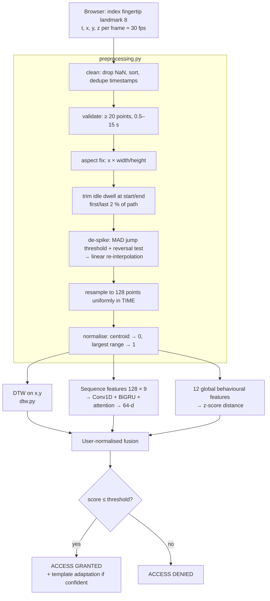

# Step 2 — Dynamic Air-Signature Model

**Goal:** decide whether the signature just drawn in the air was drawn by
the account owner — using *how* it is drawn (speed, rhythm, timing), not
only its shape.

Code: `ml-service/airauth/dynamic_signature/`

---

## 1. Processing pipeline



Resampling **in time** (not arc length) keeps the user's rhythm: fast
strokes become sparse, slow ones dense, so DTW and the network both see
timing. `z` is dropped — the research ablation showed XY-only DTW is best
(EER 14 % vs 31 % with z).

## 2. Features

**Sequence features (per timestep, 9 channels)** — computed on a lightly
smoothed copy so derivatives are stable:

| Channel | Meaning |
|---|---|
| x, y | normalised position (shape) |
| vx, vy | velocity w.r.t. normalised time (direction + rhythm) |
| speed | ‖v‖ |
| sin θ, cos θ | pen direction (continuous, no wrap-around) |
| curvature | dθ/ds, clipped to ±50 (loops, corners) |
| accel | ‖dv/dt‖ (motor dynamics) |

**Global behavioural features (12):** log duration, log path length, log
aspect ratio, speed coefficient of variation, peak/mean speed, pause ratio,
x- and y-direction reversals, start (x, y), end (x, y).

## 3. AI model — signature embedding network

```
input 128 × 9 (standardised per channel)
  → Conv1D 64, k5 → BN → ReLU          local stroke shape / velocity patterns
  → Conv1D 64, k5 → BN → ReLU
  → Bidirectional GRU 64 (sequences)   long-range order and rhythm
  → attention pooling                  Dense(1) → softmax over time → weighted sum
  → Dense 128 → ReLU → Dropout 0.2
  → Dense 64 → UnitNormalization       = embedding

training only: CosFace head (s = 30, m = 0.35) over writer identities
```

* **Synthetic pretraining** (`synthetic_signature.py`): 400 writers + 400
  skilled forgers × 12 renderings. A writer = control polygon (random walk,
  or a closed figure 30 % of the time) through a Catmull-Rom spline, a
  tempo, and a personal rhythm from the **2/3 power law** of human motor
  control (v ∝ curvature^-β) with writer-specific modulation. Each
  rendering adds shape jitter, affine change, tempo/rhythm noise, camera
  frame-rate jitter, tracking noise, spikes and idle dwell.
* **Skilled forgers** copy a writer's shape with their own rhythm and are
  separate classes — the network must learn dynamics, not just shape.
* The real research dataset is **kept out of training** so it can be used
  honestly for evaluation and calibration. `--finetune-real` adds it (and
  web-app exports) once more users exist.
* Inference is compiled to a TensorFlow graph (`tf.function`) — eager
  BiGRU calls take ~1.9 s, the graph ~45 ms.

## 4. Verification & decision

| Component | Raw distance | Weight |
|---|---|---|
| dtw | **min** DTW distance to the enrollment signatures (Sakoe-Chiba band 15 %) | 0.45 |
| embedding | 1 − cos(probe, centroid of enrollment embeddings) | 0.35 |
| global | RMS z-score of the 12 behavioural features (std floored) | 0.20 |

Each component is divided by `sqrt(user_reference × population_prior)`,
where the user reference is the leave-one-out distance among their own
enrollment samples. The fused score is compared to the calibrated
threshold (`models/dynamic_signature_calibration.json`).

**Design decisions backed by the research data** (3 users × 3 sessions):

| Choice | Alternatives tested | Result (EER, 5 → later sessions) |
|---|---|---|
| min DTW to templates | mean of 3 nearest / mean of all | 18 % vs 25–35 % vs 36–49 % |
| partial user normalisation (blend 0.5) | none / full | best or tied in every protocol |
| 8 enrollment signatures | 5 / 10 / 20 (two sessions) | 18 % → 8 % → 3–6 % |

**Template adaptation:** a login accepted with score ≤ 0.75 × threshold is
appended to the template (original enrollment always kept, max 20). This
reproduces the multi-session gain above over time.

**Replay protection:** a probe whose DTW distance to a stored sample is
below 3 % of the user's natural variation is rejected — humans never
reproduce a trajectory exactly.

**Enrollment check:** a sample whose mean DTW to the others exceeds 4× the
median is rejected. On real data the worst genuine sample reached 3.54×,
while an inserted *different* person had a median of only 2.3×. So this is
a safety net for botched captures, not an impostor detector.

## 5. Results (`ml-service/reports/dynamic_signature_evaluation.md`)

Real research dataset — 3 users, 90 signatures, impostors are other users'
own signatures (random forgeries).

| Protocol | DTW | Embedding | Global | **Fused** |
|---|---|---|---|---|
| web registration (8 from session 1 → sessions 2–3) | 13.3 % | 26.7 % | 21.7 % | **8.3 %** (AUC 0.943) |
| multi-session (2 sessions → 3rd, 3 folds) | 14.4 % | 18.9 % | 13.3 % | 14.4 % (AUC 0.899) |

Operating point (threshold 1.253, target FAR ≤ 5 %): FAR 5.0 %, FRR 16.7 %
per attempt (web registration). With 3 attempts per step a genuine user is
locked out of a session with probability ≈ 0.5 %.

Live HTTP check (8-signature enrollment, every later-session signature):
genuine accepted 50/60, impostors accepted 5/120. Verification latency
≈ 140 ms (8 templates) to ≈ 470 ms (20 templates).

Synthetic held-out writers: EER 1.5 %; synthetic skilled forgeries: EER
19.6 %.

**Honest limitations.** Three users is far too few for reliable numbers;
the research "signatures" are simple shapes (circle, square, triangle),
which are much easier to confuse than real names. The embedding shows a
synthetic → real gap (pairwise EER 32 % on real data alone) and adds only
a little today: the best fusion without it reaches 8.7 % EER, with it
8.3 %. Both will improve once real
users register: run `npm run export-samples` and then
`run_full_pipeline --use-collected`.

<!--
=============================================================================
FILE SUMMARY
-----------------------------------------------------------------------------
03_Dynamic_Signature_Model.md documents Step 2: the time-based preprocessing
chain, the 9-channel sequence features and 12 behavioural features, the
Conv1D + BiGRU + attention embedding trained with CosFace on synthetic
writers and skilled forgers, the three-component user-normalised fusion,
the design decisions validated on the research dataset, template
adaptation, replay protection, the enrollment check, and the measured
results with their limitations.
=============================================================================
-->
