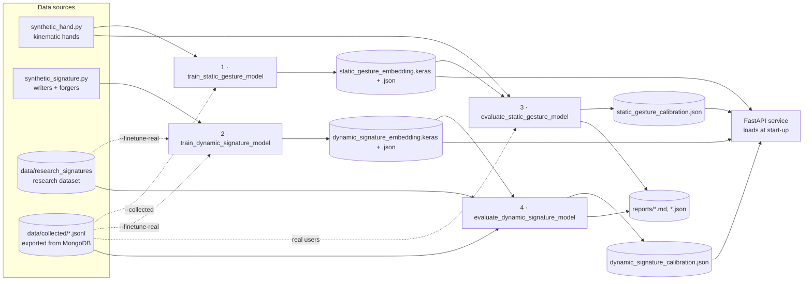
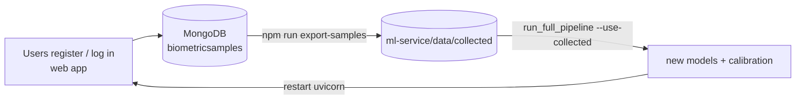

# ML Pipelines — Training, Evaluation, Calibration, Retraining

All pipelines live in `ml-service/pipelines/` and are run from
`ml-service/` with the virtual environment's Python:

```powershell
cd ml-service
.\.venv\Scripts\python.exe -m pipelines.<name> [options]
```

They reuse the **exact production code** (preprocessing, features,
`component_scores`, fusion) so offline metrics match live behaviour.

---

## 1. Pipeline map



`run_full_pipeline` runs 1 → 2 → 3 → 4 in order (evaluation must follow
training: thresholds depend on the exact weights).

## 2. Pipelines

| # | Module | Inputs | Outputs | Default runtime (CPU) |
|---|---|---|---|---|
| 1 | `train_static_gesture_model` | 1,638 synthetic pose classes × 40 | `models/static_gesture_embedding.{keras,json}` | ≈ 4 min |
| 2 | `train_dynamic_signature_model` | 400 writers + 400 forgers × 12 | `models/dynamic_signature_embedding.{keras,json}` | ≈ 7 min |
| 3 | `evaluate_static_gesture_model` | 150 simulated users (held-out poses); real exports if ≥ 2 users | `models/static_gesture_calibration.json`, report | ≈ 1 min |
| 4 | `evaluate_dynamic_signature_model` | research dataset + exports | `models/dynamic_signature_calibration.json`, report | ≈ 2.5 min |
| — | `run_full_pipeline` | — | all of the above | ≈ 15 min |

Useful options:

```text
train_static_gesture_model      --instances 40 --epochs 25 --collected
train_dynamic_signature_model   --writers 400 --renders 12 --epochs 18 --finetune-real
evaluate_static_gesture_model   --users 150 --target-far 0.01 --target-frr 0.01 --genuine-margin 1.25
evaluate_dynamic_signature_model --enroll 8 --target-far 0.05 --apply-best-weights
run_full_pipeline               --quick | --skip-training | --use-collected
```

## 3. What each artefact contains

| File | Content | Used by |
|---|---|---|
| `*_embedding.keras` | embedding network only (no CosFace head) | `model_registry.py` |
| `*_embedding.json` | model version, input mean/std, training size, validation EERs | `model_registry.py`, reports |
| `*_calibration.json` | threshold + policy, fusion weights, reference priors, data source | `config.load_*_calibration()` on every verification |
| `reports/*_evaluation.md` | human-readable metric tables | documentation / capstone report |

Threshold policies:

* **Static:** `min(FAR ≤ 1 % bound, 1.25 × 99th percentile of genuine scores)`
  — anchored on genuine variation, because synthetic impostors are so
  well separated that a FAR-only rule would be far too loose.
* **Dynamic:** loosest threshold with FAR ≤ 5 % on the web-registration
  protocol; falls back to the EER point if that would reject > 50 % of
  genuine attempts.

## 4. Continuous improvement loop (real users)



Only enrollment samples and **accepted** login samples are exported (their
identity label is trustworthy). Session ids are per day, so the dynamic
evaluation automatically gets a realistic multi-session protocol.
Templates store processed features rather than embeddings, so **retraining
never invalidates existing users**; only a change of `*_FEATURE_VERSION`
in `config.py` requires re-registration.

## 5. Tests

```powershell
.\.venv\Scripts\python.exe -m pytest tests -q
```

23 tests: feature invariance, genuine/impostor decisions, wrong hand,
replay, enrollment consistency, capture validation, DTW properties,
template adaptation, API auth / round trips / error format.

<!--
=============================================================================
FILE SUMMARY
-----------------------------------------------------------------------------
04_ML_Pipelines.md explains the ML lifecycle: the data sources (synthetic
hands and signatures, research dataset, MongoDB exports), the four pipelines
and the orchestrator with their inputs, outputs, options and runtimes, the
artefacts written to models/ and reports/, the two threshold policies, the
export -> retrain -> recalibrate loop for real users, and the test suite.
=============================================================================
-->
