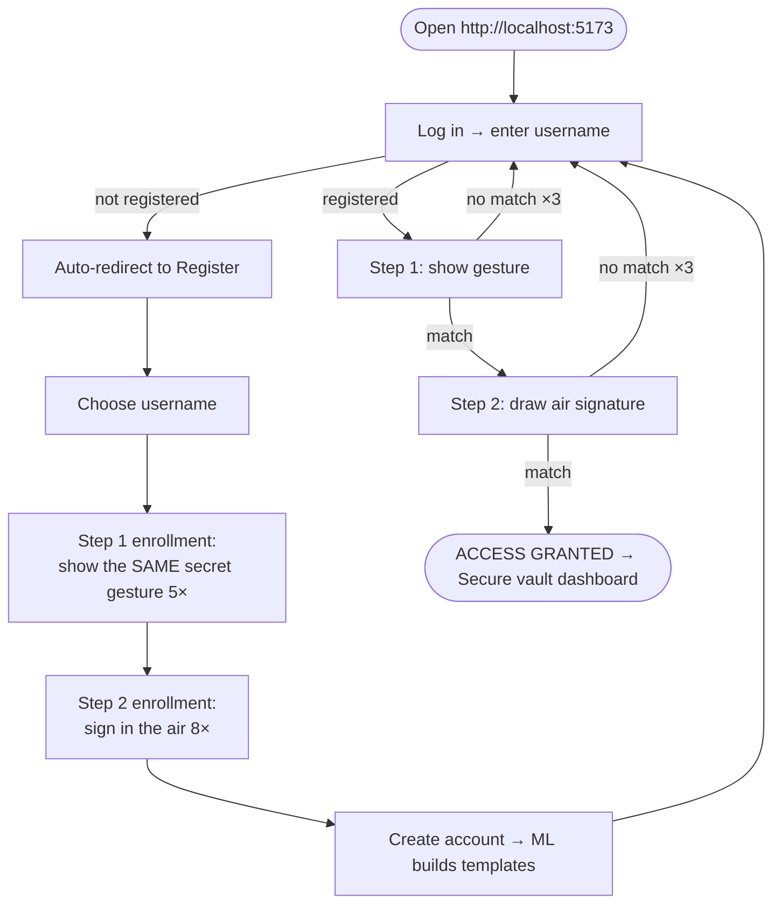

# Project Flow — What To Do, In Order

## A. One-time setup (≈ 15 min)

| # | Task | Command / action |
|---|---|---|
| 1 | Install **Node.js 18+** (not installed on this machine yet) | `winget install OpenJS.NodeJS.LTS` — then open a new terminal |
| 2 | Install / provide **MongoDB** — pick one | `winget install MongoDB.Server` (runs as a Windows service) · or `docker run -d -p 27017:27017 --name airauth-mongo mongo:7` · or a free MongoDB Atlas cluster |
| 3 | Install all dependencies | `powershell -ExecutionPolicy Bypass -File scripts\setup.ps1` |
| 4 | Configure the backend | edit `server\.env` (created from `.env.example`): `MONGODB_URI`, a long random `JWT_SECRET` |
| 5 | (Optional) retrain + recalibrate models | `cd ml-service; .\.venv\Scripts\python.exe -m pipelines.run_full_pipeline` — trained models are already included |

The ML service already has its virtual environment (`ml-service\.venv`)
and trained models in `ml-service\models\`.

## B. Run the system

```powershell
powershell -ExecutionPolicy Bypass -File scripts\start-dev.ps1
```

Or manually, in three terminals:

```powershell
# 1. ML service  (http://127.0.0.1:8000/docs)
cd ml-service; .\.venv\Scripts\python.exe -m uvicorn app.main:app --port 8000

# 2. API         (http://localhost:5000/api/system/health)
cd server; npm run dev

# 3. Web app     (http://localhost:5173)
cd client; npm run dev
```

Start order matters only loosely: the API needs MongoDB at start-up; the
ML service can start any time (the UI status panel shows if it is down).

## C. End-to-end user flow



## D. Capstone demonstration script

1. Home page → status panel shows API / MongoDB / ML service and model versions.
2. **Register** "demo_user": 5 gesture captures (e.g. thumb + pinky out), 8 air signatures.
3. **Log in** as demo_user → gesture ✔ (result card with match % and component scores) → signature ✔ → **ACCESS GRANTED**, dashboard.
4. **Impostor A** (another person) logs in as demo_user with a different gesture → Step 1 rejected.
5. **Impostor B** is shown the gesture (shoulder-surfing) → passes Step 1 → draws the
   signature with their own motion → **Step 2 rejected**. This is the key point of the two-step design.
6. Fail 5 times → account lock (423) is demonstrated.
7. Dashboard → authentication history shows every attempt with scores.
8. Show `ml-service/reports/*.md` for EER / ROC-AUC / FAR / FRR and the architecture docs.

## E. Development roadmap (what remains / next steps)

| Priority | Item | Why |
|---|---|---|
| 1 | **Collect real users** (10–20 people, 2–3 sessions each) through the app; `npm run export-samples`; `run_full_pipeline --use-collected` | All current thresholds come from 3 research users + synthetic data |
| 2 | Collect **skilled forgeries** (people imitating a signature after watching it) | Only random forgeries are measured on real data today |
| 3 | Fine-tune the signature embedding on real data (`--finetune-real`) once ≥ 10 users exist | Closes the synthetic → real gap |
| 4 | Liveness / challenge step (e.g. "draw a random digit first") | Client-side landmarks could be forged by a malicious client |
| 5 | HTTPS deployment (camera access requires a secure origin outside localhost) | Production |
| 6 | Model registry / A-B thresholds per deployment | Operations |

## F. Where everything is

| Need | File |
|---|---|
| System overview, security | `Architecture/01_System_Architecture.md` |
| Step 1 model | `Architecture/02_Static_Gesture_Model.md` |
| Step 2 model | `Architecture/03_Dynamic_Signature_Model.md` |
| Training / calibration | `Architecture/04_ML_Pipelines.md` |
| Original research plan | `Architecture/legacy_research_notes/` |
| Measured metrics | `ml-service/reports/*_evaluation.md` |

<!--
=============================================================================
FILE SUMMARY
-----------------------------------------------------------------------------
05_Project_Flow.md is the practical checklist: one-time setup (Node.js,
MongoDB, dependencies, .env), how to start the three services, the end-to-
end user flow (unregistered users are routed to registration), a scripted
capstone demonstration including impostor and shoulder-surfing scenarios,
the prioritised roadmap of remaining work and an index of the documents.
=============================================================================
-->
