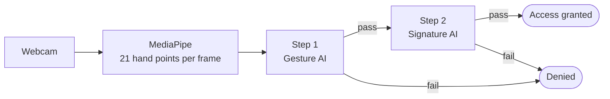
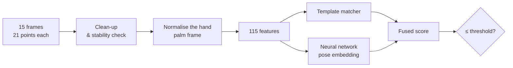
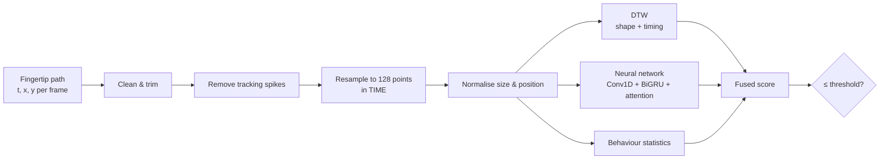

# AirAuth — The AI Explained: What We Used, How It Works, and Why

This document explains, in plain language, every technology and AI
technique inside AirAuth: **what** each part is, **what it does** in the
system, **why we chose it**, and **why it is better than the obvious
alternatives**. All numbers come from the project's own evaluation reports
(`ml-service/reports/`).

---

## Contents

1. [The big picture](#1-the-big-picture)
2. [Seeing the hand — MediaPipe](#2-seeing-the-hand--mediapipe)
3. [Step 1: the static gesture](#3-step-1-the-static-gesture)
4. [Step 2: the air signature](#4-step-2-the-air-signature)
5. [How the models learn — metric learning with CosFace](#5-how-the-models-learn--metric-learning-with-cosface)
6. [Synthetic training data — why and how](#6-synthetic-training-data--why-and-how)
7. [Making the decision — score fusion and thresholds](#7-making-the-decision--score-fusion-and-thresholds)
8. [Security techniques](#8-security-techniques)
9. [How we measure accuracy](#9-how-we-measure-accuracy)
10. [The software stack and why](#10-the-software-stack-and-why)
11. [Summary table — every choice at a glance](#11-summary-table--every-choice-at-a-glance)
12. [Honest limitations](#12-honest-limitations)
13. [Glossary](#13-glossary)

---

## 1. The big picture

AirAuth logs a person in with **two factors**, both captured by an ordinary
webcam:

| Step | Factor | Type of factor | Question it answers |
|---|---|---|---|
| 1 | **Static hand gesture** (a secret hand pose) | Something you *know* (+ a little of who you *are*) | "Does this person know the secret pose?" |
| 2 | **Dynamic air signature** (signing in the air with a finger) | Something you *are* — a behavioural biometric | "Does this person **move** like the account owner?" |



**Why two steps?** Each step covers the other's weakness:

* A gesture is easy to *copy* if someone watches you (shoulder-surfing),
  but it is fast and very reliable at rejecting random people.
* A signature's *motion* (speed, rhythm, pauses) is very hard to copy even
  after watching it, but on its own it has a higher error rate.

Together, an attacker must know the secret **and** move like you.

---

## 2. Seeing the hand — MediaPipe

### What it is
**MediaPipe HandLandmarker** is a pre-trained Google neural network that
finds a hand in an image and returns **21 key-points (landmarks)** — the
wrist plus four points on each finger — each with x, y and a relative depth
z.

```
          8   12  16  20        ← fingertips
          |   |   |   |
          7   11  15  19
      4   6   10  14  18
      |   5---9---13--17        ← knuckles
      3  /
       2/
        1
         \___ 0 (wrist)
```

### What it does in AirAuth
It runs **inside the browser** (WebAssembly, GPU when available) on every
video frame. Only the 21 × 3 numbers are sent to the server — never the
video.

### Why we chose it

| Alternative | Problem | Why MediaPipe is better |
|---|---|---|
| Train our own hand detector (e.g. a CNN on images) | Needs tens of thousands of labelled hand images and a GPU | MediaPipe is already trained on huge datasets and is accurate out of the box |
| Send video to the server and process it there | Slow, expensive, and a **privacy risk** (faces, rooms on camera) | On-device processing: private, no video upload, low bandwidth |
| Depth cameras / Leap Motion / gloves | Special hardware | Works with any laptop webcam |
| OpenPose and similar | Heavy, built for full body, slow on CPU | MediaPipe is lightweight and real-time (~30 fps) in a browser |

**Bonus:** working with key-points instead of raw pixels makes the AI
models tiny and fast, and immune to lighting, skin colour or background —
those were already handled by MediaPipe.

---

## 3. Step 1: the static gesture

### 3.1 What goes on



1. **Capture 15 frames** while the user holds the pose (~0.5 s) and take
   the **median** of each feature over the frames.
   *Why?* One frame can be noisy; the median ignores the odd bad frame.
2. **Stability check** — reject if the hand moved while "holding still".
   *Why?* A moving hand means the pose was not held or tracking failed.
3. **Normalise the hand** (the most important step):
   * move the wrist to the origin → position no longer matters
   * divide by palm size → distance from camera no longer matters
   * rotate into the **palm's own coordinate frame** → tilting/rotating
     the hand no longer matters
   * mirror left hands → one consistent layout

   *Why?* The same gesture must look identical to the AI whether your hand
   is near or far, left or right in the picture, or slightly tilted.

### 3.2 The 115 features — and why each group exists

| Group | Count | What it measures | Why it helps |
|---|---|---|---|
| Canonical x, y | 40 | Where each point is relative to the palm | The overall shape of the pose |
| Canonical z | 20 | Depth of each point | Fingers bent towards/away from camera (low weight: depth is noisy) |
| **Joint angles** | 15 | How bent each finger joint is | The single best description of a pose — completely independent of hand size and position |
| Fingertip distances | 10 | Distances between all fingertip pairs | Captures "touching" gestures (e.g. OK sign) |
| Abduction angles | 4 | Spread between neighbouring fingers | Separates "fingers together" from "fingers spread" |
| Orientation | 6 | Which way the palm faces / points | Distinguishes thumbs-up from thumbs-down (same shape, different direction) |
| **Hand geometry** | 20 | Bone lengths ÷ palm size | Your finger proportions — a weak *biometric* (whose hand it is) |

**Why hand-crafted features instead of feeding raw points to a network?**
Raw coordinates change completely when you move your hand; the network
would have to learn all those invariances from a lot of data. Engineered
features encode the invariances directly, so the system works with only
**5 enrollment samples** per user.

### 3.3 Model A — the template matcher
Compares the probe's features with the average of the user's 5 enrollment
samples, group by group, each group scaled by how much it naturally varies
(e.g. joint angles normally vary ~12°).

*Why keep a simple, non-neural matcher?* It is transparent, needs no
training, works for any gesture, and acts as a safety net if the neural
model is unavailable.

### 3.4 Model B — the pose embedding network (MLP)

```
89 pose features
 → Dense 256 → BatchNorm → ReLU → Dropout 0.1
 → Dense 256 → BatchNorm → ReLU → Dropout 0.1
 → Dense 128 → ReLU
 → Dense 64  → Unit-length normalisation   = "embedding"
```
*131,520 parameters · trained on 65,520 synthetic samples of 1,638 pose classes.*

**What it does:** turns a pose into a 64-number "fingerprint" (embedding).
Same pose → nearby fingerprints; different pose → far apart. We compare
fingerprints with **cosine distance**.

**Why an MLP (multi-layer perceptron)?**

| Alternative | Why not |
|---|---|
| CNN on images | Needs images and far more data; MediaPipe already did the "vision" part |
| Graph neural network on the hand skeleton | More complex; with good engineered features an MLP reaches EER 0.07 % on unseen poses — little room left to gain |
| Classical classifier (SVM, Random Forest) | A classifier needs a **fixed list of classes**; every user invents their own gesture, so there is no fixed list |
| Just the template matcher | Works, but the network learned *which differences matter* (e.g. ignore small depth noise, care about a curled finger), and halves the error (1.2 % → 0.1 % EER fused) |

**BatchNorm** keeps training stable; **Dropout** prevents memorising the
training poses; **unit-length normalisation** makes cosine distance the
natural comparison.

### 3.5 Results

| Test (150 simulated users, gestures never seen in training) | Error (EER) |
|---|---|
| Template matcher alone | 1.2 % |
| Neural embedding alone | 0.2 % |
| **Both fused** | **0.1 %** |
| Someone who *saw and copies* your gesture | 37.7 % (expected — that is Step 2's job) |

---

## 4. Step 2: the air signature

### 4.1 What goes on



### 4.2 Preprocessing — and why each step matters

| Step | What | Why |
|---|---|---|
| Clean | Drop broken points, sort by time | Camera data is never perfect |
| Trim idle | Remove the still periods at start/end | The recorder waits for your finger to rest; that pause is not part of the signature |
| **Spike removal (MAD test)** | Detect sudden jumps that immediately reverse, replace by interpolation | MediaPipe occasionally "jumps" for one frame; a genuine fast stroke keeps going, a glitch comes back — so we only fix glitches and keep real speed |
| **Resample in time to 128 points** | Equal time steps | Every signature becomes the same length *and* the spacing of points still encodes **speed** (fast strokes → points far apart). Resampling by distance would throw the rhythm away |
| Normalise | Centre and scale to size 1 | Signing bigger/smaller or further left/right must not matter |
| Drop z (depth) | Use only x, y | Measured: depth is noisy — XY-only gave 14 % error vs 31 % with depth |

### 4.3 Features

**9 values per time step** (for the neural network): position (x, y),
velocity (vx, vy), speed, direction as sin/cos, curvature, acceleration.
*Why sin/cos for direction?* An angle jumps from 359° to 0°; sin/cos is
smooth, so the network isn't confused.

**12 behaviour statistics** (one set per signature): duration, path
length, width/height ratio, speed variability, peak speed, pause ratio,
number of left/right and up/down reversals, start and end points.
*Why?* These describe your **habits** — how long you take, where you
pause — which an imitator rarely reproduces.

### 4.4 Model A — DTW (Dynamic Time Warping)

**What:** an algorithm that aligns two sequences that may be locally
faster or slower, then measures how different they are.

```
Your enrollment:  ●──●──●────●──●──●
New attempt:      ●─●──●──●──●───●       DTW stretches/compresses time
                    ↕  ↕  ↕  ↕  ↕         to match corresponding points
```

**Why DTW?**

| Alternative | Problem | DTW advantage |
|---|---|---|
| Point-by-point (Euclidean) comparison | If you sign 10 % slower in one part, every later point is "wrong" | DTW tolerates natural tempo changes |
| Comparing summary numbers only | Loses the shape | DTW compares the full trajectory |
| Deep model only | Needs lots of real data we don't have yet | DTW needs **no training** and works from day one |

Design choices measured on the real dataset:
* compare against the **closest** enrollment signature (min) — error 18 %
  vs 25–35 % (mean of 3 nearest) vs 36–49 % (mean of all), with 5 samples;
* a **Sakoe-Chiba band** (15 %) forbids absurd alignments and speeds it up;
* **batched DTW** — we compute many comparisons at once with NumPy, cutting
  190 comparisons from ~1 s to 0.18 s.

### 4.5 Model B — the signature embedding network

```
128 time steps × 9 features
 → Conv1D 64 (kernel 5) → BatchNorm → ReLU
 → Conv1D 64 (kernel 5) → BatchNorm → ReLU
 → Bidirectional GRU (64)
 → Attention pooling
 → Dense 128 → ReLU → Dropout 0.2
 → Dense 64  → Unit-length normalisation    = "signature fingerprint"
```
*98,689 parameters · trained on 9,600 synthetic signatures of 800 identities.*

Each layer has a job:

| Layer | Job | Why this layer |
|---|---|---|
| **Conv1D** (1-D convolution) | Detects short local patterns: a hook, a sharp corner, a quick flick | Convolutions are the standard, efficient way to find local patterns anywhere in a sequence |
| **Bidirectional GRU** | Reads the whole signature forwards *and* backwards, remembering order and rhythm | A recurrent network models *time*; "bidirectional" lets each moment see what came before and after. GRU is lighter and trains faster than LSTM with similar accuracy |
| **Attention pooling** | Learns which moments of the signature are most identifying and weights them more | Better than just taking the last step (which forgets the beginning) or a plain average (which treats boring and distinctive parts equally) |
| Dense + normalise | Compresses to a 64-number fingerprint | Compare by cosine distance, like Step 1 |

**Why this hybrid (CNN + RNN + attention) instead of…**

| Alternative | Why not |
|---|---|
| LSTM only (the original research baseline) | Used the last time step only and was trained as a 3-class classifier — it cannot verify *new* users |
| Transformer | Needs much more data; for 128-step sequences a GRU is accurate and far cheaper |
| Pure CNN | Weaker at long-range timing/rhythm |
| Siamese network on pairs | Same idea (compare two signatures), but CosFace training (section 5) is more stable and data-efficient |

### 4.6 Model C — behaviour statistics
Compares the 12 statistics with the user's enrollment average using
z-scores ("how many standard deviations away"), with minimum spreads so a
user who happened to be very consistent at enrollment is not rejected for
a tiny difference.

### 4.7 Why three models instead of one?
They make **different kinds of mistakes**: DTW is strong on shape, the
statistics on habits, the network on learned patterns. Combining them
(see section 7) reduced the error on real data:

| Method (8 enrollment signatures, tested on later sessions) | Error (EER) |
|---|---|
| DTW alone | 13.3 % |
| Behaviour statistics alone | 21.7 % |
| Neural network alone | 26.7 % |
| **All three fused** | **8.3 %** |

---

## 5. How the models learn — metric learning with CosFace

### The problem
A normal classifier learns a fixed set of classes ("cat", "dog"). But in
authentication **every new user is a new class** the model has never
seen. We cannot retrain the model whenever someone registers.

### The solution: learn a *similarity space* (metric learning)
We train the network so that samples of the **same** identity land close
together and **different** identities land far apart. At login we don't
ask "which class?" — we ask "**how close is this to the user's enrollment
samples?**". That works for anyone, including users who registered after
training.

### Why CosFace specifically
During training only, a **CosFace** head is attached:

```
logit = 30 × ( cos(angle to own class) − 0.35 )      for the true class
logit = 30 ×   cos(angle to other class)             for other classes
```

The **margin 0.35** forces each class to be clearly separated, not just
barely. After training the head is thrown away; only the embedding network
is kept.

| Alternative | Drawback | CosFace advantage |
|---|---|---|
| Plain softmax classifier | Classes separated, but without a safety margin — new users blur together | Margin → well-separated, compact clusters |
| Triplet loss / Siamese pairs | Needs careful selection of "hard" pairs; slow, unstable training | Uses all classes at once in every batch; stable and fast |
| ArcFace | Very similar; equally valid | CosFace is simpler to implement and tune |

CosFace is the same family of methods used in modern **face recognition**,
which faces exactly the same "verify people never seen in training"
problem.

---

## 6. Synthetic training data — why and how

### Why
Deep networks need many identities. We had **3 real users** — far too few.
Collecting hundreds of people was not possible for the prototype. So we
**generate realistic artificial data**, and keep the real recordings
separate for honest testing.

### Synthetic hands (Step 1)
A **forward-kinematics hand model**: a skeleton with realistic bone
lengths whose joints are bent by chosen angles.

* **2,048 pose classes** = 4 states per finger (extended, half, curled,
  hooked) × 2 spreads × 4 thumb positions
* every sample varies the **person** (bone lengths, palm width), the
  **viewing angle** (±35°), joint jitter and camera noise
* 50 % are mirrored so left and right hands are covered
* **20 % of pose classes are held out** — the model is tested only on
  gestures it never saw

### Synthetic signatures (Step 2)
* a "writer" = random pen path (or a closed shape), a tempo, and a
  personal **rhythm** based on the **2/3 power law** from motor-control
  research (people naturally slow down in tight curves) plus individual
  speed variations
* each repetition adds natural variation, camera frame-rate jitter,
  tracking noise and glitches
* **skilled forgers**: copy a writer's *shape* but draw it with their own
  rhythm. They count as different people, which **forces the network to
  learn motion, not just shape**

### Why this is better than training on our 3 real users
A network trained on 3 people learns to tell *those 3* apart and nothing
else. Synthetic data gives it **800–1,638 identities**, so it learns the
general skill of comparing gestures/signatures. The real data stays
untouched for an unbiased evaluation. When real users register, their
data can be added (`run_full_pipeline --use-collected`).

---

## 7. Making the decision — score fusion and thresholds

### 7.1 Personal normalisation
Some people sign very consistently, others vary a lot. A raw distance of
0.05 might be "normal" for one person and "suspicious" for another. So
every distance is divided by **that user's own natural variation**
(measured between their enrollment samples, leaving one out at a time),
blended 50/50 with a population average:

```
normalised = raw distance / √( user's variation × population average )
```

*Why blend?* With only 5–8 enrollment samples, the user's own estimate is
noisy. Blending ("shrinkage") was the most robust option on real data.

### 7.2 Fusion
```
Step 1:  score = 0.6 × template  + 0.4 × embedding
Step 2:  score = 0.45 × DTW + 0.35 × embedding + 0.20 × behaviour
```
If the neural model is missing, its weight is redistributed automatically
— the system degrades gracefully instead of failing.

### 7.3 Thresholds (calibrated, not guessed)
The accept/reject threshold is **computed from data** by the evaluation
pipelines, not picked by hand:

| Step | Rule | Value |
|---|---|---|
| 1 | strictest of: false-accept ≤ 1 %, or 1.25 × the score that 99 % of genuine attempts reach | 3.42 |
| 2 | false-accept rate ≤ 5 % on real signatures | 1.25 |

The UI shows a **match %**: 50 % = exactly at the threshold.

### 7.4 Template adaptation
When you log in with a **confident** signature match, that signature is
added to your profile (original enrollment always kept, up to 20).
*Why?* People's signing drifts over days. On real data, more and
multi-session samples cut the error from ~18 % (5 samples) to 3–6 % (20
samples from two sessions).

---

## 8. Security techniques

| Technique | What it stops |
|---|---|
| Two ordered steps, enforced on the server | Skipping the gesture step |
| Wrong-hand check | Using the other hand |
| **Replay detection** | Re-sending a recorded sample — humans never repeat a movement *exactly*, so a near-perfect copy is rejected |
| 3 attempts per step, lock after 5 failures, rate limits | Brute-force guessing |
| Video stays in the browser; templates stay on the server | Leaking biometric data |
| Shared service key | Anyone calling the AI service directly |
| Short-lived JWT tokens, hashed session tokens | Stolen-token misuse |

---

## 9. How we measure accuracy

| Metric | Meaning | Good value |
|---|---|---|
| **FAR** — False Acceptance Rate | % of impostors wrongly let in | Low (security) |
| **FRR** — False Rejection Rate | % of genuine users wrongly rejected | Low (convenience) |
| **EER** — Equal Error Rate | The point where FAR = FRR; one number to compare systems | Lower is better |
| **ROC-AUC** | Probability a genuine attempt scores better than an impostor (1.0 = perfect) | Closer to 1 |

**Why not "accuracy"?** In authentication impostors and genuine users are
not balanced, and letting in an impostor is far worse than asking someone
to retry. FAR/FRR/EER are the industry standard for biometrics.

**Fair testing:** enroll on early sessions, test on **later sessions**
(people sign differently on different days), and test the AI on gestures
and writers it **never saw** during training.

---

## 10. The software stack and why

| Layer | Technology | Why it was chosen |
|---|---|---|
| Hand tracking | MediaPipe Tasks Vision (WASM) | Accurate, real-time, runs in the browser, private |
| Front-end | React 18 + Vite | Component-based UI for the multi-step wizards; Vite = instant dev server |
| Back-end API | Node.js + Express | The "E/N" of MERN; simple, fast REST API with rich middleware (security headers, rate limiting) |
| Database | MongoDB + Mongoose | The "M" of MERN; stores variable-shaped JSON (templates, raw samples) naturally; TTL index auto-deletes expired login sessions |
| Auth tokens | JSON Web Tokens | Stateless, standard |
| AI service | Python + FastAPI | Python is the language of ML; FastAPI is fast, typed and auto-documents the API (`/docs`) |
| Numerical core | NumPy | Preprocessing, features, DTW and metrics — no heavy dependencies needed |
| Deep learning | TensorFlow / Keras 3 | Mature, runs on CPU, saves models in one file; inference compiled to a graph (`tf.function`) → 45 ms instead of 1.9 s |
| Testing | pytest + end-to-end API script | 23 automated ML tests; 19 full-stack checks |

**Why a separate Python service instead of doing ML in Node.js?** The ML
ecosystem (TensorFlow, NumPy) is in Python, and the original research code
was Python. Keeping ML in its own service also means it can be retrained,
scaled or replaced without touching the website.

---

## 11. Summary table — every choice at a glance

| Component | What we used | Why it's the better choice |
|---|---|---|
| Hand detection | MediaPipe (21 landmarks) | Pre-trained, real-time, private, any webcam |
| Gesture representation | 115 engineered, normalised features | Built-in invariance → works with only 5 samples |
| Gesture AI | MLP embedding + template matcher | Handles gestures never seen in training; matcher as safety net |
| Signature preprocessing | Spike removal + time resampling | Fixes glitches without destroying speed/rhythm |
| Signature shape/timing | DTW (min over templates, banded, batched) | Works with zero training, tolerant to tempo changes, fast |
| Signature AI | Conv1D + BiGRU + attention | Local stroke patterns + rhythm + focus on distinctive parts, small enough for CPU |
| Behaviour | 12 statistics with floored z-scores | Captures habits imitators miss |
| Training method | CosFace metric learning | Verifies brand-new users without retraining |
| Training data | Synthetic hands, writers and forgers | Thousands of identities; real data kept for honest testing |
| Decision | Personal normalisation + weighted fusion | Fair across consistent and inconsistent users; models cover each other's mistakes |
| Threshold | Calibrated from data | Defensible, reproducible security level |
| Over time | Template adaptation | Follows natural drift; error drops as samples grow |

---

## 12. Honest limitations

* **Small real dataset:** only 3 real users, who drew simple shapes
  (circle, square, triangle). Real names are more distinctive, but the
  numbers need confirming with 10–20+ real users.
* **Synthetic → real gap:** the signature network is excellent on
  synthetic writers (1.5 % EER) but weaker on real data alone (32 %
  pairwise). It still helps the fused result slightly (8.7 % → 8.3 %), and
  will improve when fine-tuned on real users.
* **Static gesture can be copied:** by design, Step 1 is a knowledge
  factor; Step 2 provides the biometric protection.
* **Skilled forgeries on real data are not yet measured** — only on
  synthetic forgers (19.6 % EER).
* **Client-side landmarks:** a malicious program could send fake
  landmarks; production would add liveness challenges.

---

## 13. Glossary

| Term | Meaning |
|---|---|
| Landmark / key-point | One of the 21 tracked points on the hand |
| Embedding | A short list of numbers (here 64) that summarises a sample; similar samples → similar embeddings |
| Cosine distance | How different the *directions* of two embeddings are (0 = identical) |
| Metric learning | Training a model to produce embeddings where distance = dissimilarity |
| CosFace | A metric-learning loss that adds a safety margin between classes |
| DTW | Dynamic Time Warping — compares sequences while allowing local speed differences |
| GRU / BiGRU | A recurrent neural network layer that reads sequences step by step; "Bi" = both directions |
| Conv1D | A convolution that slides along a sequence to detect local patterns |
| Attention pooling | A learned weighted average that focuses on the most useful time steps |
| MLP | Multi-layer perceptron — a stack of fully connected layers |
| Enrollment | Registering your gesture/signature samples |
| Template | The stored processed version of your enrollment samples |
| FAR / FRR / EER | False accept rate / false reject rate / equal error rate |
| Calibration | Choosing the decision threshold from measured data |

<!--
=============================================================================
FILE SUMMARY
-----------------------------------------------------------------------------
06_AI_Models_Explained.md is the plain-language guide to all AI in AirAuth:
MediaPipe hand tracking, the Step-1 gesture pipeline (normalisation, 115
features, template matcher, MLP embedding), the Step-2 signature pipeline
(preprocessing, DTW, Conv1D + BiGRU + attention network, behaviour
statistics), CosFace metric learning, synthetic training data, personal
normalisation, fusion, calibrated thresholds and template adaptation,
security techniques, evaluation metrics and the software stack. For every
choice it explains what it does, why it was used and why it beats the
alternatives, followed by results, limitations and a glossary.
=============================================================================
-->
