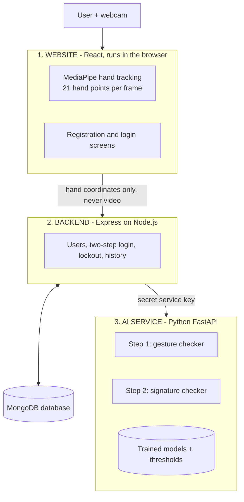
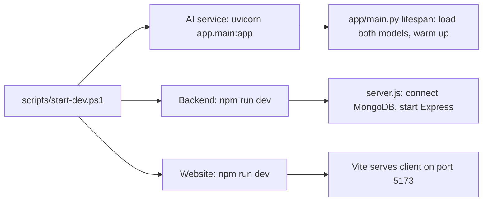
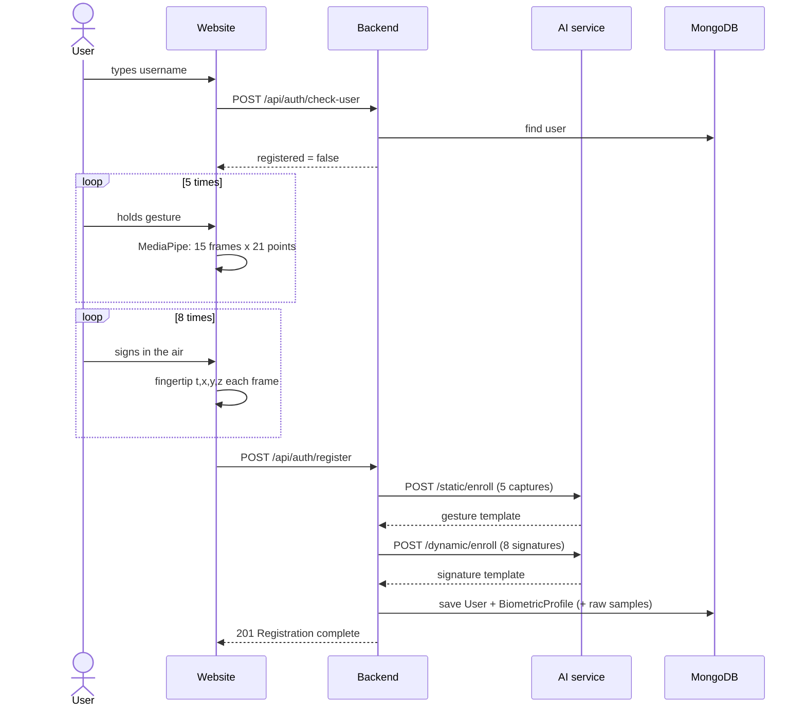
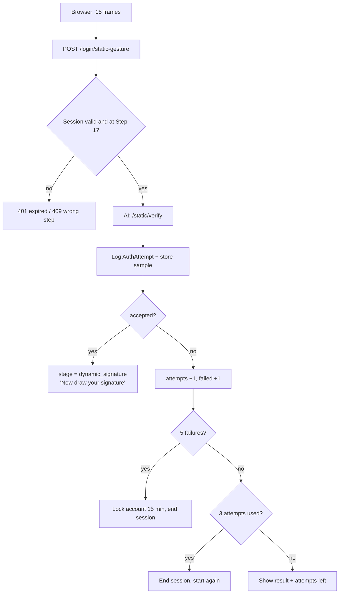
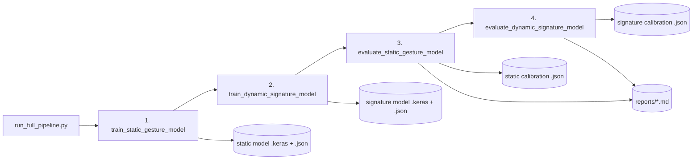

# AirAuth — The Complete Project Guide

**Two-Step Air Authentication: Static Hand Gesture + Dynamic Air Signature**

*A study guide: every feature, every file, every flow — explained so you can present it.*

---

## How to read this guide

| If you have… | Read |
|---|---|
| 5 minutes | Part 1 (the project in 60 seconds) and Part 17 (likely questions) |
| 30 minutes | Parts 1–6 (what it does and how a login flows) |
| 2 hours | Everything, including Part 13 (every file explained) |

Words in **bold** are terms your guide may use. Part 19 is a glossary of every technical word.

---

# Part 1 — The project in 60 seconds

AirAuth lets a person log in **without a password**, using only a normal webcam, in **two steps**:

1. **Static hand gesture** — the user holds a secret hand pose (for example thumb + little finger out). This is *something you know*.
2. **Dynamic air signature** — the user signs their name in the air with their index finger. This is *something you are*: everyone moves with their own speed and rhythm.

Access is granted **only if both steps pass, in that order**. A user who is not registered is automatically sent to registration, where both the gesture and the signature are recorded.

It is built as a **MERN website** (MongoDB, Express, React, Node.js) plus a **Python AI service** that holds the machine-learning models.

The most important privacy point: **video never leaves the user's browser**. The browser turns each video frame into 21 hand coordinates, and only those numbers are sent to the server.

---

# Part 2 — Where the project started (before this work)

The team already had a research prototype called `Air-Auth_Sign`:

* a **desktop app** (Python + OpenCV + MediaPipe) that recorded air signatures from the webcam,
* a **dataset of 90 air signatures**: 3 people × 3 recording sessions × 10 signatures,
* experiments showing that **DTW** (a shape-matching method) worked best using only the x and y position (error 14.4%) and that adding depth made it worse (30.8%).

What did **not** exist: the hand-gesture step, any AI model usable for new users, a website, user accounts, a database, or security features.

During the clean-up, the old research code was removed and **only the 90 recorded signatures were kept**, moved to `ml-service/data/research_signatures/`. The original research plan documents are kept in `Architecture/legacy_research_notes/`.

---

# Part 3 — The big picture

## 3.1 The three programs



| Program | Folder | Language / framework | Port | Its job |
|---|---|---|---|---|
| Website | `client/` | React 18 + Vite, MediaPipe | 5173 | Camera, hand tracking, all screens |
| Backend | `server/` | Node.js, Express 4, Mongoose 8 | 5000 | Accounts, login rules, security, database |
| AI service | `ml-service/` | Python 3.11, FastAPI, NumPy, TensorFlow/Keras 3 | 8000 | Cleans hand data, extracts features, runs models, decides |
| Database | — | MongoDB | 27017 | Stores users, biometric profiles, history |

## 3.2 Why three programs instead of one?

* The AI tools (TensorFlow, NumPy) live in **Python**; websites are best built with **JavaScript**. Each part uses the right language.
* The browser **only talks to the backend**. The AI service can only be called with a secret key, so nobody can attack it directly.
* The AI can be **retrained or replaced without touching the website**.

---

# Part 4 — All features (what the system can do)

## 4.1 Features the user sees

| Feature | Where | Details |
|---|---|---|
| Home page with system status | `HomePage.jsx`, `SystemStatus.jsx` | Shows if API, database and AI service are running, and which model versions are loaded |
| Username check | Login / Register pages | Tells whether a username is already registered |
| Automatic redirect to registration | `LoginPage.jsx` | Unknown username → message → redirected to Register after 4 seconds with the username filled in |
| Registration wizard (4 steps) | `RegisterPage.jsx` | Account → 5 gesture captures → 8 air signatures → create account |
| Gesture capture with countdown | `StaticGestureCapture.jsx` | 3-second countdown, then 15 frames collected while the user holds still; progress bar; "hand detected" indicator |
| Air-signature capture | `AirSignatureCapture.jsx` | 3-second countdown, live ink trail drawn over the video, auto-stop when the finger rests 1 second, Done button or Space bar |
| Signature thumbnails | `SamplePreview.jsx` | Small drawings of each recorded signature; "Remove last" button |
| Re-capture of rejected samples | `RegisterPage.jsx` | If the AI rejects one sample, only that sample is removed and the user is sent back to redo it |
| Two-step login | `LoginPage.jsx` | Username → gesture → air signature → ACCESS GRANTED |
| Result cards | `ResultCard.jsx` | MATCH / NO MATCH, match %, score vs threshold, each AI component's score |
| Attempts left | `LoginPage.jsx` | After a failure shows how many tries remain (3 per step) |
| Account lockout message | `LoginPage.jsx` | After 5 failures in a row, locked for 15 minutes |
| Secure dashboard ("vault") | `DashboardPage.jsx` | Last login, registration date, hand used, number of stored samples, adaptations |
| Login history | `DashboardPage.jsx` | Every attempt with time, step, result, match %, reason |
| Delete my account and data | `DashboardPage.jsx` | Two-click confirmation, removes everything |
| Log out | `Layout.jsx` | Clears the login token |

## 4.2 Features behind the scenes

| Feature | Where | Details |
|---|---|---|
| On-device hand tracking | `handLandmarker.js` | MediaPipe runs in the browser (graphics card if available, otherwise CPU) |
| Two-step state machine | `loginController.js`, `LoginSession.js` | Server remembers which step each login is on; Step 2 refused until Step 1 passes |
| Attempt limits and lockout | `loginController.js` | 3 attempts per step per login; account locked 15 min after 5 consecutive failures |
| Rate limiting | `rateLimiters.js` | 100 auth requests per 15 min per IP; 30 verifications per 5 min per IP |
| Login tokens (JWT) | `tokenService.js` | Issued only after both steps; valid 1 hour |
| Hashed session tokens | `tokenService.js` | Login-session tokens are stored only as SHA-256 hashes |
| Auto-expiring login sessions | `LoginSession.js` | MongoDB deletes them after 5 minutes (TTL index) |
| Audit log | `AuthAttempt.js` | Every verification attempt is recorded |
| Raw sample storage for research | `biometricSampleStore.js` | Optional (`STORE_RAW_SAMPLES`); lets models be retrained on real users |
| Replay detection | both verifiers | A sample identical or nearly identical to a stored one is rejected |
| Wrong-hand detection | gesture verifier | Using the other hand than at registration is rejected |
| Capture quality checks | preprocessing files | Too few frames, hand moved, too short, too fast, too small → clear retry message |
| Template adaptation | signature verifier | Confident logins are added to the signature profile (up to 20) |
| Graceful degradation | `model_registry.py` | If a neural model is missing, the simpler checks still work |
| Model warm-up | `app/main.py` | Models are loaded and compiled at start-up so the first login is fast |
| Data export for retraining | `exportBiometricSamples.js` | Copies real samples from MongoDB to the AI training folder |
| One-command training | `run_full_pipeline.py` | Trains, evaluates and calibrates both models |

---

# Part 5 — Execution flows (what happens, step by step, and which file runs)

## 5.1 Starting the system



1. `scripts/start-dev.ps1` reloads PATH (so Node is found) and opens three windows.
2. **AI service:** `app/main.py` starts. Its *lifespan* function asks `model_registry.py` to load both `.keras` models and run one dummy prediction, so TensorFlow compiles them now instead of during the first login (this took the first call from ~6 s to ~45 ms).
3. **Backend:** `server.js` → `config/database.js` connects to MongoDB (gives up after 8 s with a clear message) → `app.js` builds Express with security headers, CORS, JSON limit 5 MB, routes and error handler → listens on port 5000.
4. **Website:** Vite serves the React app; `vite.config.js` forwards every `/api` call to port 5000.

## 5.2 Opening the home page

1. `main.jsx` mounts `App.jsx` inside `AuthProvider` (login state) and the router.
2. `HomePage.jsx` renders; `SystemStatus.jsx` calls `GET /api/system/health`.
3. Backend `systemController.js` reports API = ok, MongoDB state, and calls the AI service `GET /health` (`health_router.py`), which returns model versions and thresholds.

## 5.3 Registration flow



Detailed steps:

1. **Account step** (`RegisterPage.jsx`): user types a username. `authApi.checkUser` → `registrationController.checkUser` → `validators.normaliseUsername` (lower-case, 3–32 letters/digits/`._-`) → looks up `User`. If already registered, an error is shown.
2. **Gesture step:** `StaticGestureCapture.jsx` shows the camera (`CameraStage.jsx`).
   * User clicks "Capture gesture" → 3-second countdown.
   * The component collects **15 frames** in which a hand is detected (timeout 4 s). Each frame = 21 points `[x, y, z]` + "Left"/"Right" + confidence.
   * The sample `{frames, width, height}` is stored in page memory. Repeated 5 times.
3. **Signature step:** `AirSignatureCapture.jsx`.
   * Countdown 3 s, then every frame the **index fingertip (landmark 8)** is recorded as `[time, x, y, z]`. The ink trail is drawn live.
   * Recording stops automatically when the finger stays within a small circle for 1 second, or the hand disappears for 0.7 s after drawing, or after 12 s, or when the user presses Done/Space.
   * Too short (< 15 points or < 0.8 s or no real movement) → rejected locally.
   * User reviews and clicks "Use this signature". Repeated 8 times.
4. **Finish:** `POST /api/auth/register` with all samples → `registrationController.register`:
   1. validates username and array sizes (3–15 gestures, 3–25 signatures),
   2. refuses if the username is already registered (409),
   3. calls the AI: `/static/enroll` → `static_gesture/verifier.enroll`,
   4. calls the AI: `/dynamic/enroll` → `dynamic_signature/verifier.enroll`,
   5. creates `User` and `BiometricProfile` (if the profile fails to save, the new user is deleted again),
   6. stores raw samples in `BiometricSample` (if enabled),
   7. returns "Registration complete".
5. **If the AI rejects a capture** (e.g. "Gesture sample 3 does not match the others"), the AI returns HTTP 422 with the sample number. The backend adds which step it was, the website removes just that sample and sends the user back to that step.

## 5.4 Login — start

1. User types the username in `LoginPage.jsx` → `POST /api/auth/login/start` → `loginController.startLogin`.
2. If the user does not exist or has no biometric profile → **404 USER_NOT_REGISTERED** → the website shows "not registered" and redirects to Register in 4 seconds.
3. If the account is locked → **423 ACCOUNT_LOCKED** with the unlock time.
4. Otherwise a random 64-character token is created (`tokenService.createOpaqueToken`). Only its **SHA-256 hash** is saved in a new `LoginSession` document with `stage = static_gesture` and an expiry 5 minutes ahead. The plain token goes to the browser.

## 5.5 Login — Step 1 (gesture)



Inside the AI service (`static_gesture/verifier.verify`):
1. checks the stored template's version,
2. cleans the capture and extracts the 115 measurements (Part 6),
3. **wrong hand?** → reject with reason `wrong_hand`,
4. **exact copy of a stored sample?** → reject with `replay_suspected`,
5. computes the template score and the neural-network score, combines them,
6. accepts if the combined score ≤ **3.42**.

## 5.6 Login — Step 2 (air signature)

1. `POST /api/auth/login/air-signature` → `loginController.verifyAirSignature`. The session **must** be at `dynamic_signature`; otherwise **409 WRONG_STEP** — this is what makes skipping Step 1 impossible.
2. AI `dynamic_signature/verifier.verify`: cleans the path, compares with DTW + behaviour statistics + neural network, checks for replay, combines, accepts if score ≤ **1.25**.
3. On success the backend:
   * saves the **adapted template** if the AI sent one (confident match → signature added to profile),
   * resets failed attempts, records `lastLoginAt`,
   * deletes the login session,
   * issues a **JWT** (valid 1 hour) — the browser stores it in `sessionStorage` (`AuthContext.jsx`),
   * the website shows **ACCESS GRANTED** with both result cards and opens the dashboard after 2.5 s.
4. On failure: same attempt/lockout logic as Step 1.

## 5.7 Dashboard, logout and delete

* `DashboardPage.jsx` calls `GET /api/users/me` and `GET /api/users/me/attempts` with the JWT. `requireAuth.js` checks the token. Templates are **never** returned — only counts and dates (`toSummaryJSON`).
* **Delete**: `DELETE /api/users/me` removes the user, profile, raw samples, attempt history and open sessions.
* **Log out** simply clears the token in the browser.

## 5.8 What happens on errors

| Situation | HTTP code / error | What the user sees |
|---|---|---|
| Username format wrong | 400 `INVALID_USERNAME` | "Username must be 3–32 characters…" |
| Not registered | 404 `USER_NOT_REGISTERED` | Redirect to registration |
| Username taken | 409 `USERNAME_TAKEN` | "Already registered, please log in" |
| Session expired (5 min) | 401 `LOGIN_SESSION_EXPIRED` | Start again |
| Trying Step 2 first | 409 `WRONG_STEP` | Start again |
| Account locked | 423 `ACCOUNT_LOCKED` | Unlock time |
| Bad capture (too short, hand moved…) | 422 `CAPTURE_REJECTED` | Specific message; **does not count as a failed attempt** |
| AI service down | 503 `ML_SERVICE_UNAVAILABLE` | "Is ml-service running?" |
| Too many requests | 429 `RATE_LIMITED` | "Slow down" |
| Login token invalid/expired | 401 | Back to login |

## 5.9 Training flow (offline, by the team)



1. **Train gesture model** (~4 min): generate 65,520 synthetic hands of 1,638 pose classes → features → train the network 25 epochs → test on 410 unseen poses → save.
2. **Train signature model** (~7 min): generate 9,600 synthetic signatures of 400 writers + 400 forgers → train 18 epochs → test on unseen writers, forgers, and the real dataset → save.
3. **Evaluate gesture** (~1 min): 150 simulated users → error rates → choose threshold → write calibration file.
4. **Evaluate signature** (~2.5 min): real research dataset → error rates → choose threshold → write calibration file.

The AI service reads the calibration files on every verification, so new thresholds take effect immediately.

## 5.10 Retraining with real users (the improvement loop)

1. Users register and log in through the website; raw samples are stored in MongoDB.
2. `cd server; npm run export-samples` → `exportBiometricSamples.js` writes enrollment samples and **accepted** login samples (trustworthy labels) to `ml-service/data/collected/`.
3. `python -m pipelines.run_full_pipeline --use-collected` retrains on the real data and recalibrates.
4. Restart the AI service. Existing users keep working because templates store processed data, not model outputs.

---

# Part 6 — Step 1 in depth: the static gesture

## 6.1 Cleaning the capture (`static_gesture/preprocessing.py`)

| Step | Function | What and why |
|---|---|---|
| 1 | `parse_frames` | Converts JSON into a 3-D array (frames × 21 × 3); drops broken frames; takes the most common Left/Right label. Fewer than 5 good frames → `too_few_frames` |
| 2 | `correct_aspect_ratio` | MediaPipe measures x as a fraction of width and y of height; for a 16:9 camera this distorts the hand. Multiplying x (and z) by width/height fixes it |
| 3 | `check_pose_stability` | Wrist, middle knuckle, index tip and thumb tip must not drift more than 0.35 palm-widths during capture → otherwise `unstable_pose` |
| 4 | `mirror_left_hand` | Left hands are flipped so both hands share one layout |

## 6.2 The 115 measurements (`static_gesture/features.py`)

First every hand is **canonicalised**: wrist moved to (0,0,0), everything divided by palm size, then rotated so that "up" is wrist→middle knuckle and "across" is index knuckle→little-finger knuckle. After this, the same pose gives the same numbers regardless of hand size, distance or tilt.

| Group | Count | What it measures | Weight | Typical genuine variation |
|---|---|---|---|---|
| Canonical x, y | 40 | Position of the 20 non-wrist points in palm coordinates | 1.0 | 0.12 |
| Canonical z | 20 | Depth of each point (noisy) | 0.3 | 0.30 |
| Joint angles | 15 | Bend of every finger joint (0 = straight) | 1.0 | 0.22 rad (~12.6°) |
| Fingertip distances | 10 | Distance between every pair of fingertips | 1.0 | 0.15 |
| Abduction | 4 | Spread between neighbouring fingers | 0.5 | 0.15 rad |
| Orientation | 6 | Which way the palm faces and points (thumbs-up ≠ thumbs-down) | 0.6 | 0.30 |
| Hand geometry | 20 | Bone length ÷ palm size — **whose** hand it is | 0.4 | 0.10 |

Each measurement is computed for all 15 frames and the **median** is kept (ignores the odd bad frame).

## 6.3 Model A — template matcher

Compares the new gesture with the **average** of the 5 enrollment captures. For each group: difference ÷ typical variation, squared, averaged, square-rooted; then the 7 groups are combined using the weights above. A score of about 1 means "as different as a normal repeat".

## 6.4 Model B — the pose neural network (`static_gesture/embedding_model.py`)

```
89 pose numbers (groups 1–5)
 → Dense 256 → BatchNorm → ReLU → Dropout 10%
 → Dense 256 → BatchNorm → ReLU → Dropout 10%
 → Dense 128 → ReLU
 → Dense 64 → normalise to length 1   = the "fingerprint" (embedding)
```

* **131,520 parameters.** Input 89 numbers, output 64 numbers.
* Two fingerprints are compared with **cosine distance** (0 = identical).
* Trained on synthetic hands with **CosFace** (Part 8).

## 6.5 Registration checks (`verifier.enroll`)

* at least 3 captures (website sends 5),
* all with the same hand → otherwise `mixed_handedness`,
* each capture compared with the average of the others; if one is more than 2.5 "typical variations" away → `inconsistent_enrollment` naming that sample.

The saved **template**: version, hand (Left/Right), and the 5 × 115 measurements.

## 6.6 The decision

```
template score   = distance(new, average of enrolled) ÷ user's own variation*
embedding score  = cosine distance(new, centre of enrolled) ÷ user's own variation*
combined         = 0.6 × template + 0.4 × embedding
ACCEPT if combined ≤ 3.42
```
\*"User's own variation" is measured by comparing each enrollment sample with the others, blended 50/50 with a population average (Part 9).

---

# Part 7 — Step 2 in depth: the air signature

## 7.1 Cleaning the path (`dynamic_signature/preprocessing.py`)

| Step | Function | What and why |
|---|---|---|
| 1 | `parse_points` | Keep time, x, y; drop broken points; sort by time; remove duplicate times |
| 2 | `validate` | At least 20 points; duration 0.5–15 s (`too_short`, `too_fast`, `too_slow`) |
| 3 | `correct_aspect_ratio` | Same width/height fix as Step 1 |
| 4 | `trim_idle` | Removes the still part at the start and end (first/last 2% of the path) — the recorder waits for the finger to rest |
| 5 | `correct_spikes` | Finds sudden jumps (bigger than median + 6 × MAD) that **immediately come back** — tracking glitches — and replaces them by interpolation. Real fast strokes keep going, so they are not touched |
| 6 | size check | Drawing smaller than 4% of the image → `too_small` |
| 7 | `resample_by_time` | Exactly **128 points equally spaced in time**. Because the spacing is by time, fast parts have points far apart — **speed is preserved** |
| 8 | `normalise` | Centre to (0,0), scale so the largest side = 1 → position and size don't matter |

Depth (z) is dropped: experiments showed it makes matching worse.

## 7.2 Features (`dynamic_signature/features.py`)

**9 values per point** (for the neural network): x, y, speed in x, speed in y, total speed, direction as sin and cos, curvature (how sharply it turns), acceleration.

**12 behaviour statistics** (one set per signature): duration, path length, width/height ratio, speed variability, peak speed, pause ratio, left/right reversals, up/down reversals, start x, start y, end x, end y.

## 7.3 Model A — DTW (`dynamic_signature/dtw.py`)

**Dynamic Time Warping** lines up two paths even if one was drawn faster in some parts, then measures how far apart they are.

* Uses a **Sakoe–Chiba band** of 15%: point 10 can only be matched to points near position 10, preventing absurd matches.
* Compares the new signature with **each** enrolled signature and keeps the **smallest** distance (experiments: best choice).
* **Batched**: many comparisons are computed together with NumPy. 190 comparisons dropped from ~1 s to 0.18 s with identical results.

## 7.4 Model B — the signature neural network (`dynamic_signature/embedding_model.py`)

```
128 points × 9 values
 → Conv1D 64 filters (window 5) → BatchNorm → ReLU     finds short stroke patterns
 → Conv1D 64 filters (window 5) → BatchNorm → ReLU
 → Bidirectional GRU 64                                reads the whole signature both ways (order + rhythm)
 → Attention pooling                                   learns which moments matter most
 → Dense 128 → ReLU → Dropout 20%
 → Dense 64 → normalise to length 1                   = signature fingerprint
```

* **98,689 parameters.**
* Compared by cosine distance to the centre of the enrolled fingerprints.
* Compiled with `tf.function` for speed (1.9 s → ~45 ms per call).

## 7.5 Model C — behaviour statistics

Each of the 12 statistics is compared with the user's enrollment average in "number of standard deviations" (z-score), with a minimum allowed spread so that a very consistent user isn't rejected for tiny differences. The root-mean-square of the 12 z-scores is the score.

## 7.6 Registration checks and template

* at least 3 signatures (website sends 8),
* a sample whose average DTW distance to the others is more than **4×** the median is rejected as a bad capture (on real data genuine samples reached 3.5×, so 4 is safe).

Template: version, `enrolled_count`, 8 normalised paths (128 × 2), durations, 8 × 12 statistics.

## 7.7 The decision

```
combined = 0.45 × DTW + 0.35 × neural network + 0.20 × behaviour   (each ÷ user's own variation)
ACCEPT if combined ≤ 1.25
```

Before that, **replay check**: if the new path is almost identical (closer than 3% of the user's natural variation) to a stored one → `replay_suspected`. Humans never repeat a movement exactly.

## 7.8 Template adaptation

If accepted **confidently** (score ≤ 0.75 × threshold), the new signature is added to the profile. The original 8 are always kept; the profile is capped at 20 (oldest added one dropped). Why: people's signing drifts over days, and the data showed more samples from more sessions sharply reduce errors.

---

# Part 8 — Synthetic training (why and how)

## 8.1 The problem
Neural networks need many different people to learn from. We had **no gesture data** at all and **only 3 people's signatures**. A network trained on 3 people only learns to tell those 3 apart.

## 8.2 The solution: generate realistic artificial data

**Synthetic hands** (`static_gesture/synthetic_hand.py`)
* A 3-D skeleton hand whose joints bend like a puppet's.
* Each finger: extended, half-bent, curled or hooked; fingers together or spread; thumb in 4 positions → **2,048 gestures**.
* Each copy changes the **person** (finger lengths, palm width), the **camera angle** (±35°), small joint wobble and camera noise.
* 1,638 gestures used for training, **410 hidden** for testing.

**Synthetic signatures** (`dynamic_signature/synthetic_signature.py`)
* A "writer" = a random pen path (or a closed shape) + a tempo + a personal rhythm based on the **2/3 power law** (people slow down on tight curves).
* Every repetition varies shape, size, angle, speed, camera frame-rate and adds noise and glitches.
* **Forgers** copy a writer's shape with their own rhythm — counted as different people, so the network must learn *how* you move, not only *what* you draw.

## 8.3 How the networks learn — CosFace (`common/margin_head.py`)
During training a temporary **CosFace head** asks the network to classify which pose/writer each sample is, **with a safety margin** (0.35) between classes. After training the head is thrown away; only the fingerprint network is kept. Result: similar samples get similar fingerprints even for **people/gestures never seen in training**. This is the same idea used in face recognition.

## 8.4 Honest result
* Gesture network on 410 unseen poses: **0.07% error** (synthetic).
* Signature network: unseen synthetic writers **1.5%**, forgers **19.6%**, real people alone **32%** — the "synthetic-to-real gap".
* Real data was **never** used for training, only for testing. Fix planned: retrain with real users in CP2.

---

# Part 9 — Scores, thresholds and calibration

## 9.1 Personal normalisation (`common/score_fusion.py`)
Some people sign consistently, some don't. So each raw distance is divided by an **effective reference**:

```
user reference     = average distance between the user's own enrollment samples (leave-one-out)
effective          = √( max(user reference, floor) × population prior )
normalised score   = raw distance ÷ effective
```
The 50/50 blend ("shrinkage") was the most robust choice because with only 5–8 samples the user's own estimate is noisy.

## 9.2 Match percentage shown in the UI
`match % = 100 × (1 − score ÷ (2 × threshold))`, clipped to 0–100. **50% = exactly at the threshold.**

## 9.3 How thresholds were chosen (not guessed)

| Step | Rule | Result |
|---|---|---|
| Gesture | The stricter of: (a) false-accept ≤ 1%, (b) 1.25 × the score 99% of genuine attempts stay under | 3.42 (FAR 0.1%, FRR 0.3% on synthetic) |
| Signature | Loosest threshold with false-accept ≤ 5% on the real dataset | 1.25 (FAR 5.0%, FRR 16.7%) |

They are stored in `models/*_calibration.json` and reloaded on every verification.

---

# Part 10 — Security

| Threat | Protection | File |
|---|---|---|
| Skipping Step 1 | Server-side session stage | `loginController.js`, `LoginSession.js` |
| Guessing repeatedly | 3 attempts/step, lock after 5, rate limits | `loginController.js`, `rateLimiters.js` |
| Replaying recorded data | Near-duplicate rejection | both `verifier.py` files |
| Copying the gesture | Step 2 behavioural biometric | design |
| Stealing biometric data | No video uploaded; templates never sent to browser; delete option | `verificationResult.js`, `userController.js` |
| Calling the AI directly | Secret `X-Service-Key`, constant-time compare | `app/security.py` |
| Bad/huge input | Pydantic schemas, size limits, username regex | `schemas.py`, `validators.js` |
| Stolen session token | Only hashes stored; JWT 1 h | `tokenService.js` |
| Misconfiguration | helmet headers, CORS limited, secrets in `.env`, refuses default secret in production | `app.js`, `env.js` |

**Known limitation:** hand points are computed in the browser, so a malicious program could send fake points. A future "liveness challenge" (e.g. draw a random shape) would address this.

---

# Part 11 — Database and APIs

## 11.1 MongoDB collections

| Collection | Model file | Key fields |
|---|---|---|
| users | `User.js` | username (unique), displayName, status, failedAttempts, lockUntil, lastLoginAt |
| biometricprofiles | `BiometricProfile.js` | user, staticTemplate, dynamicTemplate, staticHandedness, feature versions, enrollmentReport, dynamicAdaptations |
| biometricsamples | `BiometricSample.js` | user, kind (static/dynamic), purpose (enrollment/login), accepted, score, raw sample |
| loginsessions | `LoginSession.js` | tokenHash, user, stage, attempts per step, expiresAt (auto-deleted) |
| authattempts | `AuthAttempt.js` | user, step, accepted, reason, score, threshold, matchPercent, model version, IP |

## 11.2 Backend API (called by the website)

| Method + path | Purpose | Auth |
|---|---|---|
| GET `/api/system/health` | Status of API, DB, AI service | none |
| POST `/api/auth/check-user` | Is the username registered? | none |
| POST `/api/auth/register` | Create account with gestures + signatures | none |
| POST `/api/auth/login/start` | Begin login, get session token | none |
| POST `/api/auth/login/static-gesture` | Step 1 | session token |
| POST `/api/auth/login/air-signature` | Step 2 → JWT | session token (Step 1 passed) |
| GET `/api/users/me` | Profile summary | JWT |
| GET `/api/users/me/attempts` | Login history | JWT |
| DELETE `/api/users/me` | Delete everything | JWT |

## 11.3 AI service API (called only by the backend)

| Method + path | Purpose |
|---|---|
| GET `/health` | Models loaded, versions, thresholds |
| POST `/static/enroll` | Build gesture template |
| POST `/static/verify` | Check a gesture |
| POST `/dynamic/enroll` | Build signature template |
| POST `/dynamic/verify` | Check a signature (+ adapted template) |

Interactive documentation is available at `http://127.0.0.1:8000/docs` when the AI service runs.

---

# Part 12 — Key settings (numbers you may be asked about)

| Setting | Value | File |
|---|---|---|
| Gesture captures at registration | 5 | `captureConfig.js` |
| Frames per gesture capture | 15 | `captureConfig.js` |
| Signatures at registration | 8 | `captureConfig.js`, `config.py` |
| Signature auto-stop | finger still 1.0 s / hand lost 0.7 s / max 12 s | `captureConfig.js` |
| Signature length after resampling | 128 points | `config.py` |
| DTW band | 15% | `config.py` |
| Gesture threshold | 3.42 | `static_gesture_calibration.json` |
| Signature threshold | 1.25 | `dynamic_signature_calibration.json` |
| Gesture weights | template 0.6 / network 0.4 | `config.py` |
| Signature weights | DTW 0.45 / network 0.35 / behaviour 0.20 | `config.py` |
| Max signatures in profile | 20 | `config.py` |
| Adaptation only if score ≤ | 0.75 × threshold | `config.py` |
| Login session lifetime | 5 min | `.env` |
| Attempts per step | 3 | `.env` |
| Lockout | after 5 failures, for 15 min | `.env` |
| JWT lifetime | 1 hour | `.env` |
| Rate limits | 100 / 15 min (auth), 30 / 5 min (verify) | `rateLimiters.js` |

---

# Part 13 — Every file explained

## 13.1 Project root

| File / folder | What it does |
|---|---|
| `README.md` | Front page: what AirAuth is, folder layout, quick start, results, links to docs |
| `SETUP.md` | Step-by-step installation and troubleshooting guide for Windows |
| `.gitignore` | Tells Git to ignore `node_modules`, `.venv`, `.env` secrets, build output and collected biometric data |
| `AirAuth_Complete_Documentation.pdf` / `New PDF.pdf` | Combined PDF of diary content + all docs (identical copies) |
| `Guide/` | This study guide (Markdown + PDF) |
| `Research_Diary/` | Diary content for weeks 7–9 and pages 47/49/51 (Markdown + PDF) |
| `scripts/setup.ps1` | One-time install: Python venv + requirements, `server/.env`, npm install for server and client |
| `scripts/start-dev.ps1` | Starts AI service, backend and website in three windows |

## 13.2 `Architecture/` — documentation

| File | Content |
|---|---|
| `01_System_Architecture.md` | Deployment view, registration & login diagrams, database, security, repository layout |
| `02_Static_Gesture_Model.md` | Step 1 pipeline, features, network, decision, results |
| `03_Dynamic_Signature_Model.md` | Step 2 pipeline, features, DTW, network, design experiments, results |
| `04_ML_Pipelines.md` | Training/evaluation/calibration pipelines and the retraining loop |
| `05_Project_Flow.md` | Setup checklist, run order, demo script, roadmap |
| `06_AI_Models_Explained.md` | Plain-language explanation of every AI choice and why it beats alternatives |
| `legacy_research_notes/*.txt` | The team's original architecture plan from the research phase |

## 13.3 `client/` — the website (React)

| File | What it does |
|---|---|
| `package.json` | Lists dependencies (React, React Router, MediaPipe Tasks Vision 0.10.14, Vite) and scripts `dev`/`build` |
| `package-lock.json` | Exact installed versions (auto-generated) |
| `vite.config.js` | Dev server on port 5173; forwards `/api` to the backend on 5000 |
| `index.html` | The single HTML page React draws into |
| `.env.example` | Optional `VITE_API_URL` for a deployed build |
| `src/main.jsx` | Entry point: mounts the app with router and login state |
| `src/App.jsx` | Routes: `/`, `/register`, `/login`, `/dashboard` (protected) |
| `src/config/captureConfig.js` | All capture settings: MediaPipe URLs, camera size, sample counts, countdowns, auto-stop rules |
| `src/lib/handLandmarker.js` | Loads MediaPipe once (GPU, falls back to CPU) and converts its output to 21 × [x,y,z] + hand label |
| `src/lib/canvasDrawing.js` | Draws the hand skeleton, the signature ink trail and the small signature thumbnails |
| `src/api/apiClient.js` | Single function for all HTTP calls; turns server errors into readable errors with codes |
| `src/api/authApi.js` | One function per backend endpoint |
| `src/context/AuthContext.jsx` | Keeps the login token and user in memory + sessionStorage; `signIn` / `signOut` |
| `src/components/CameraStage.jsx` | Starts camera + MediaPipe, mirrors the view, runs detection on every frame, draws the skeleton, stops the camera on exit |
| `src/components/StaticGestureCapture.jsx` | Step 1 capture: countdown, collects 15 frames, progress bar, timeout |
| `src/components/AirSignatureCapture.jsx` | Step 2 capture: countdown, records fingertip, live ink, auto-stop rules, review / redo, Space bar |
| `src/components/StepIndicator.jsx` | The progress steps bar in the wizards |
| `src/components/ResultCard.jsx` | Shows MATCH/NO MATCH, match % bar, score vs threshold, component scores |
| `src/components/SamplePreview.jsx` | Numbered slots with hand icons / signature thumbnails; "Remove last" |
| `src/components/SystemStatus.jsx` | Green/red dots for API, MongoDB, AI service and model versions |
| `src/components/Layout.jsx` | Top bar (brand, Log in / Register or name + Log out) and footer |
| `src/components/ProtectedRoute.jsx` | Sends visitors without a login token to `/login` |
| `src/pages/HomePage.jsx` | Landing page explaining the two steps and privacy |
| `src/pages/RegisterPage.jsx` | 4-step registration wizard, handles rejected samples |
| `src/pages/LoginPage.jsx` | Two-step login, redirect for unregistered users, attempts, lockout, ACCESS GRANTED screen |
| `src/pages/DashboardPage.jsx` | Secure vault: profile stats, login history, delete account |
| `src/styles/global.css` | All styling: dark theme, camera overlay, result cards, tables |

## 13.4 `server/` — the backend (Express + MongoDB)

| File | What it does |
|---|---|
| `package.json` | Dependencies (express, mongoose, jsonwebtoken, helmet, cors, express-rate-limit, morgan, dotenv) and scripts `start`, `dev`, `export-samples` |
| `.env.example` / `.env` | Settings: port, MongoDB address, JWT secret, AI service URL/key, lockout rules (`.env` holds the real secret — never share it) |
| `src/server.js` | Entry point: connect to MongoDB, start the app |
| `src/app.js` | Builds the Express app: security headers, CORS, JSON limit, logging, routes, error handling |
| `src/config/env.js` | Reads `.env` into one settings object with defaults; refuses the default secret in production |
| `src/config/database.js` | Connects to MongoDB; reports connection state |
| `src/models/User.js` | User account schema; `isLocked()`; public view |
| `src/models/BiometricProfile.js` | Stores the gesture and signature templates; summary view without templates |
| `src/models/BiometricSample.js` | Raw captures for retraining |
| `src/models/LoginSession.js` | In-progress login: hashed token, stage, attempts, auto-expiry |
| `src/models/AuthAttempt.js` | Audit log of every verification |
| `src/routes/authRoutes.js` | `/api/auth/*` endpoints with rate limits |
| `src/routes/userRoutes.js` | `/api/users/*` endpoints (JWT required) |
| `src/routes/systemRoutes.js` | `/api/system/health` |
| `src/controllers/registrationController.js` | `checkUser` and `register` (calls AI enroll, saves user + profile) |
| `src/controllers/loginController.js` | The two-step state machine, attempt limits, lockout, JWT, template adaptation |
| `src/controllers/userController.js` | Profile, history, delete account |
| `src/controllers/systemController.js` | Combined health check |
| `src/controllers/verificationResult.js` | Strips templates/raw distances before sending results to the browser; user-friendly reason messages |
| `src/services/mlServiceClient.js` | Only code that calls the AI service: adds the secret key, 30 s timeout, maps AI errors to API errors |
| `src/services/tokenService.js` | Creates/checks JWTs; creates random session tokens and their SHA-256 hashes |
| `src/services/biometricSampleStore.js` | Saves raw samples (best-effort, never blocks login) |
| `src/middleware/requireAuth.js` | Checks the JWT and loads the user |
| `src/middleware/rateLimiters.js` | Per-IP request limits |
| `src/middleware/errorHandler.js` | Turns every error into `{ error: { code, message, details } }` |
| `src/utils/AppError.js` | The error class with HTTP status + code |
| `src/utils/asyncHandler.js` | Lets async route handlers report errors properly |
| `src/utils/validators.js` | Username rules and request-shape checks |
| `scripts/exportBiometricSamples.js` | Exports trustworthy raw samples from MongoDB to the AI training folder |

## 13.5 `ml-service/` — the AI service (Python)

**Core library `airauth/`**

| File | What it does |
|---|---|
| `config.py` | Every AI setting in one place (paths, thresholds, weights, limits); loads calibration files |
| `common/hand_landmarks.py` | The 21-point hand skeleton: finger chains, joints, bones |
| `common/errors.py` | `BiometricInputError` — "please retry" errors with a code |
| `common/metrics.py` | FAR, FRR, EER, ROC-AUC, threshold selection |
| `common/score_fusion.py` | Personal normalisation, combining scores, match % |
| `common/model_registry.py` | Loads the two neural networks once, compiles them, returns fingerprints; works without them if missing |
| `common/margin_head.py` | CosFace training head (training only) |
| `data/dataset_loader.py` | Reads the research signatures and exported real samples in the same format the API receives |
| `static_gesture/preprocessing.py` | Cleans a gesture capture (Part 6.1) |
| `static_gesture/features.py` | Palm coordinates and the 115 measurements (Part 6.2) |
| `static_gesture/synthetic_hand.py` | Computer-generated hands for training/testing (Part 8) |
| `static_gesture/embedding_model.py` | The gesture neural network definition (Part 6.4) |
| `static_gesture/verifier.py` | Gesture enroll + verify, wrong-hand and replay checks (Parts 6.5–6.6) |
| `dynamic_signature/preprocessing.py` | Cleans a signature path (Part 7.1) |
| `dynamic_signature/features.py` | 9 per-point values and 12 behaviour statistics (Part 7.2) |
| `dynamic_signature/dtw.py` | Batched DTW (Part 7.3) |
| `dynamic_signature/synthetic_signature.py` | Computer-generated writers and forgers (Part 8) |
| `dynamic_signature/embedding_model.py` | The signature neural network definition (Part 7.4) |
| `dynamic_signature/verifier.py` | Signature enroll + verify, replay check, adaptation (Parts 7.6–7.8) |
| `__init__.py` files | Mark folders as Python packages |

**Web layer `app/`**

| File | What it does |
|---|---|
| `main.py` | Creates the FastAPI app, warms up models, converts capture errors into HTTP 422 |
| `schemas.py` | Shape and size rules for every request (max 120 frames, max 3,000 points…) |
| `security.py` | Checks the secret service key |
| `routers/health_router.py` | `GET /health` |
| `routers/static_gesture_router.py` | `/static/enroll`, `/static/verify` |
| `routers/dynamic_signature_router.py` | `/dynamic/enroll`, `/dynamic/verify` |

**Pipelines `pipelines/`**

| File | What it does |
|---|---|
| `pipeline_utils.py` | Shared helpers: logging, random seeds, CosFace training loop, embedding metrics |
| `train_static_gesture_model.py` | Pipeline 1: trains the gesture network on synthetic hands |
| `train_dynamic_signature_model.py` | Pipeline 2: trains the signature network on synthetic writers + forgers |
| `evaluate_static_gesture_model.py` | Pipeline 3: tests Step 1, chooses its threshold |
| `evaluate_dynamic_signature_model.py` | Pipeline 4: tests Step 2 on real data, chooses its threshold |
| `run_full_pipeline.py` | Runs 1→2→3→4; options `--quick`, `--skip-training`, `--use-collected` |

**Data, models, reports, tests**

| File / folder | What it is |
|---|---|
| `data/research_signatures/U00x/S0x/*.csv` | The 90 real signatures (time, x, y, z per frame) |
| `models/static_gesture_embedding.keras` + `.json` | Trained gesture network + its version, input scaling, training metrics |
| `models/dynamic_signature_embedding.keras` + `.json` | Trained signature network + metadata |
| `models/*_calibration.json` | Live thresholds, weights, population priors |
| `reports/*_evaluation.md` / `.json` | Measured error rates (readable + machine form) |
| `requirements.txt` | Python packages: FastAPI, uvicorn, pydantic, NumPy, TensorFlow, pytest, httpx, matplotlib |
| `tests/conftest.py` | Shared test helpers (synthetic users) |
| `tests/test_static_gesture.py` | 9 tests for Step 1 |
| `tests/test_dynamic_signature.py` | 8 tests for Step 2 |
| `tests/test_api.py` | 6 tests for the AI web layer |
| `.venv/` | Python virtual environment (installed packages; not committed) |

---

# Part 14 — Results and experiments

## 14.1 Design experiments (on the real dataset)

| ID | Question | Result | Decision |
|---|---|---|---|
| EXP-01 | Use depth (z) in DTW? | x,y 14.4% vs with z 30.8% | Drop z |
| EXP-02 | Compare to closest / 3 closest / all enrolled? | 18–22% / 25–35% / 27–49% | Closest |
| EXP-03 | How many enrollment signatures? | 5 → ~20%, 10 → 8–12%, 20 → 3–6% | 8 + adaptation |
| EXP-04 | Gesture template matcher alone | 1.2% | Keep, plus network |
| EXP-05 | DTW + behaviour (no network) | 8.7% | Fuse |
| EXP-06 | Speed per verification | 140–470 ms | Under 1 s target |
| EXP-07 | Gesture vs copier | 37.7% | Expected; Step 2 covers |

## 14.2 Final evaluation

| Test | Result |
|---|---|
| Gesture vs random other people (150 simulated users, unseen gestures) | **EER 0.1%**, ROC-AUC 1.000 |
| Signature, real data, 8-sample registration, later sessions | **EER 8.3%**, ROC-AUC 0.943 |
| Signature components alone | DTW 13.3%, network 26.7%, behaviour 21.7% |
| Signature, multi-session protocol | EER 14.4% (matches the original research's 14.4%) |
| Live HTTP check, all 3 real users | 50/60 genuine accepted, 5/120 impostors accepted |
| Automated AI tests | 23/23 pass |
| Full-system tests (website API + DB + AI) | 19/19 pass |

---

# Part 15 — Problems found during development and how they were fixed

| # | Problem | Cause | Fix | Effect |
|---|---|---|---|---|
| 1 | Synthetic test hands failed the stability check | Generator moved the hand every frame | Fixed generator; check was correct | Tests valid |
| 2 | Signature error 28% with first design | Averaging DTW, full normalisation, 5 samples | Experiments → min DTW, 50/50 blend, 8 samples | Error 8.3% |
| 3 | Signature network took 1.9 s per call | Eager mode of the recurrent layer | Compiled with `tf.function` + warm-up | ~45 ms |
| 4 | DTW too slow with big profiles | One pair at a time in Python | Batched DTW | 190 pairs: 1 s → 0.18 s, identical results |
| 5 | Gesture threshold too loose (7.6) | Synthetic impostors very far → FAR rule too generous | Anchor on genuine variation | Threshold 3.42 |
| 6 | A real user's genuine registration rejected | Consistency limit 2.5× too strict for real people | Measured real data, limit → 4× | Real users register |
| 7 | Camera could stay on after leaving a page | React StrictMode double-mount | Stop camera if unmounted while starting | Camera released |
| 8 | `npm` not recognised | Node installed after VS Code opened | Scripts reload PATH | Scripts work |

---

# Part 16 — Honest limitations and next steps

**Limitations**
1. Only **3 real users**, who drew simple shapes. Numbers need confirming with 10–20 people.
2. **Synthetic-to-real gap** in the signature network (helps only 8.7% → 8.3% now).
3. Gesture can be **copied by an observer** (by design, Step 2 stops them).
4. **Skilled forgeries** not yet tested on real people.
5. Hand points come from the browser → a malicious client could fake them (needs liveness check).
6. The webcam screens were built and compiled but **not yet tested with a real camera**.

**Next steps (CP2)**
1. Collect 10–20 real users over several days.
2. Retrain with `--use-collected` and re-measure.
3. Record skilled forgeries.
4. Add a liveness challenge.
5. HTTPS deployment.

---

# Part 17 — Questions your guide may ask (with answers)

**Q: Why two steps and not just the signature?**
A: They cover each other's weakness. The gesture is quick and blocks random people almost perfectly (0.1% error) but can be copied by someone watching. The signature's motion is hard to copy but has a higher error alone. Together an attacker must know the secret *and* move like you.

**Q: Why not just use a CNN on the video?**
A: It would need thousands of labelled people and a GPU, it would upload video (privacy problem), and it would be slow. MediaPipe already solves "find the hand"; we work on 21 points, which makes models tiny and private.

**Q: How can you train a network with only 3 users?**
A: We don't train on them. We train on thousands of synthetic hands and writers, using metric learning (CosFace) so the network learns to compare, not to recognise fixed people. The 3 real users are used only for testing.

**Q: What is DTW and why use it?**
A: Dynamic Time Warping aligns two paths even if one was drawn faster in places. It needs no training and was the best method in our research (14.4% → 8.3% when combined with behaviour and the network).

**Q: What is EER?**
A: Equal Error Rate — the point where the false-accept rate equals the false-reject rate. Lower is better. It's the standard single number for comparing biometric systems.

**Q: How did you pick the threshold?**
A: From data. For the signature: the loosest value that keeps impostor acceptance ≤ 5% on real recordings (1.25). For the gesture: the stricter of FAR ≤ 1% and 1.25 × the 99th-percentile genuine score (3.42).

**Q: What if a user's signature changes over time?**
A: Template adaptation — confident logins are added to the profile (up to 20, originals always kept). Our data showed more samples from more sessions cut errors from ~20% to 3–6%.

**Q: What stops someone from replaying a recorded signature?**
A: Humans never repeat a movement exactly; if a submitted path is almost identical to a stored one, it's rejected as a replay. Plus attempt limits, lockout and rate limiting.

**Q: Is the data private?**
A: Video never leaves the browser; only coordinates are sent. Templates are never sent back to the browser. Users can delete everything. Exported research data uses random IDs. This follows the DPDP Act principles.

**Q: What happens if the AI model file is missing?**
A: The system still works using the non-neural checks (template matcher, DTW, behaviour) — the weights are automatically redistributed.

**Q: How do you know the code works?**
A: 23 automated AI tests, 19 full-stack end-to-end checks, and a live HTTP check with the real recordings (50/60 genuine accepted, 5/120 impostors accepted).

**Q: What's novel?**
A: The combination of a static gesture factor and a dynamic air-signature factor in one web system, with on-device hand tracking, synthetic pretraining including skilled-forger classes, per-user score normalisation and template adaptation — all evaluated with standard biometric metrics.

**Q: What are the weaknesses?**
A: Small real dataset, synthetic-to-real gap, skilled forgeries untested on real people, and client-side landmarks. Each has a plan in CP2.

**Q: Did you use AI tools?**
A: Be honest: yes — Claude (Anthropic) was used to help design, write and test code and documentation; the team reviewed, ran and verified the results. Record this in the diary's section 5.3.

---

# Part 18 — How to run and test (cheat sheet)

```powershell
# one time
powershell -ExecutionPolicy Bypass -File scripts\setup.ps1

# every time
powershell -ExecutionPolicy Bypass -File scripts\start-dev.ps1
# open http://localhost:5173

# AI tests
cd ml-service; .\.venv\Scripts\python.exe -m pytest tests -q        # 23 passed

# retrain + recalibrate everything
.\.venv\Scripts\python.exe -m pipelines.run_full_pipeline

# export real users' data, then retrain on it
cd ..\server; npm run export-samples
cd ..\ml-service; .\.venv\Scripts\python.exe -m pipelines.run_full_pipeline --use-collected
```

---

# Part 19 — Glossary

| Term | Meaning |
|---|---|
| Landmark / key-point | One of the 21 tracked points on the hand |
| MediaPipe | Google's pre-trained hand-tracking model |
| Canonicalise | Convert the hand to palm coordinates so size/position/tilt don't matter |
| Feature | A measured number describing a sample (e.g. a joint angle) |
| Template | The stored processed version of a user's enrollment samples |
| Enrollment | Registration — recording the samples |
| Embedding / fingerprint | A list of 64 numbers summarising a sample; similar samples → similar lists |
| Cosine distance | How different two embeddings' directions are (0 = same) |
| Metric learning | Training a network so that distance = dissimilarity |
| CosFace | A metric-learning method that adds a safety margin between classes |
| MLP | Multi-layer perceptron — stacked fully connected layers |
| Conv1D | A layer that slides along a sequence finding short patterns |
| GRU / BiGRU | A recurrent layer that reads a sequence step by step; Bi = both directions |
| Attention pooling | A learned weighted average focusing on the most useful moments |
| DTW | Dynamic Time Warping — sequence comparison tolerant to speed changes |
| Sakoe–Chiba band | Limit on how far DTW may stretch time |
| MAD | Median Absolute Deviation — a robust measure of spread used to detect glitches |
| Resampling | Re-spacing a path to a fixed number of points |
| Synthetic data | Realistic artificial data generated by a program |
| Synthetic-to-real gap | Performance drop when a model trained on synthetic data meets real data |
| FAR / FRR | False Acceptance Rate / False Rejection Rate |
| EER | Equal Error Rate, where FAR = FRR |
| ROC-AUC | Probability a genuine attempt scores better than an impostor (1 = perfect) |
| Threshold / calibration | The accept/reject cut-off, chosen from measured data |
| Template adaptation | Adding confident logins to the stored profile |
| Replay attack | Re-sending previously recorded data |
| JWT | JSON Web Token — the signed login token |
| Rate limiting | Limiting how many requests one address can make |
| TTL index | MongoDB feature that deletes documents after a time |
| MERN | MongoDB, Express, React, Node.js |
| FastAPI | Python web framework used for the AI service |

<!--
=============================================================================
FILE SUMMARY
-----------------------------------------------------------------------------
AirAuth_Project_Guide.md is the complete study guide for presenting the
project: the idea, the starting point, architecture, every feature, every
execution flow (start-up, registration, both login steps, errors, training,
retraining), deep dives into both authentication steps, synthetic training,
scoring and calibration, security, database and APIs, key settings, a
description of every file, results, problems fixed, limitations, likely
guide questions with answers, a run cheat-sheet and a glossary.
=============================================================================
-->
