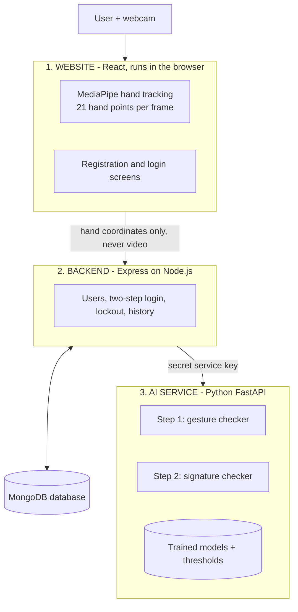
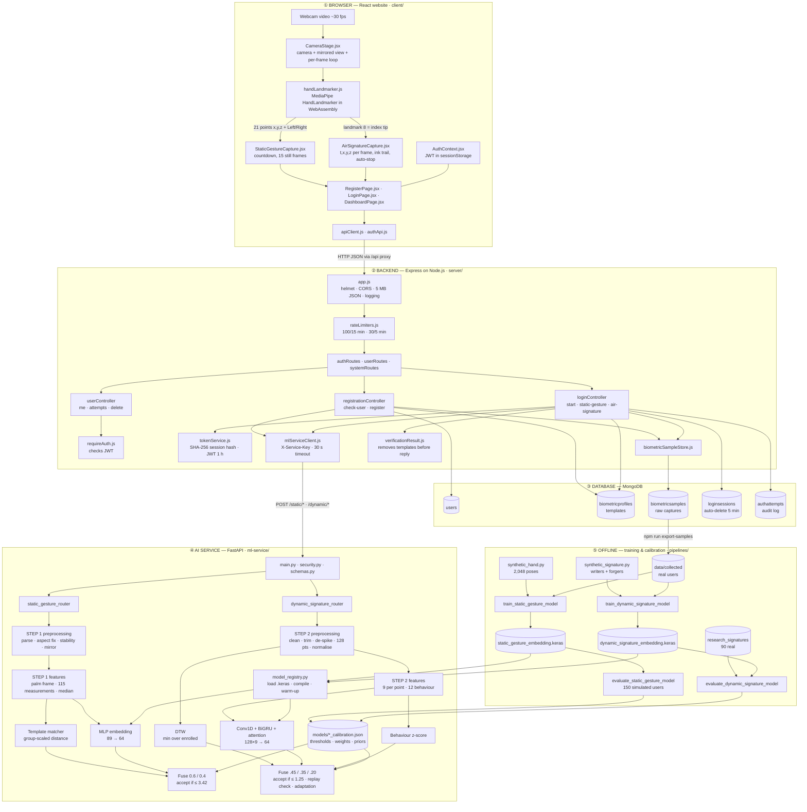
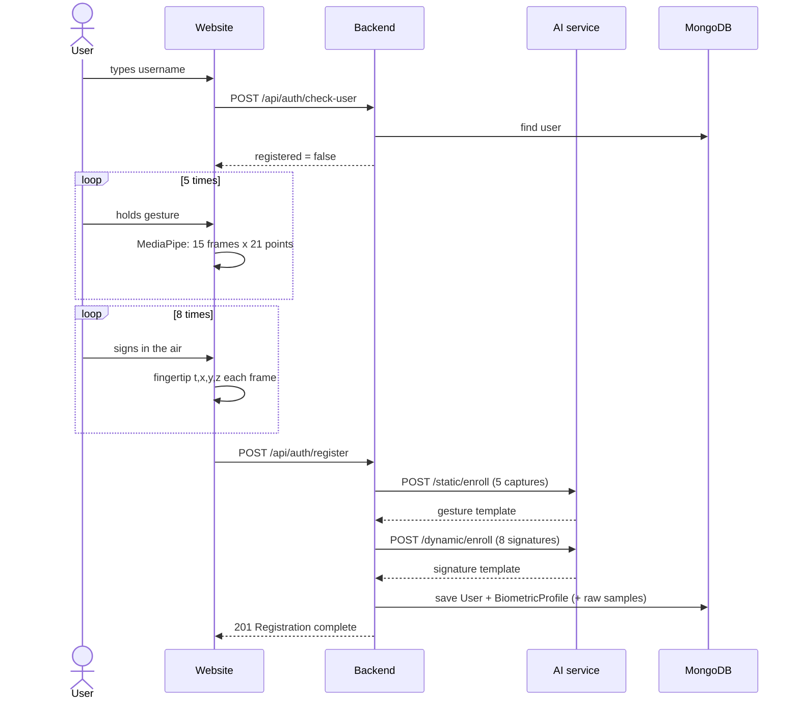
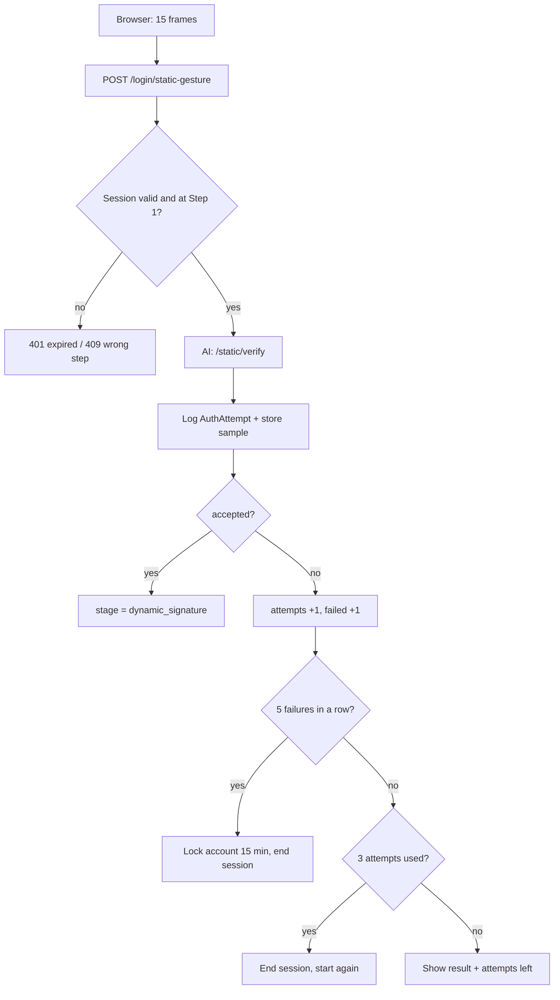
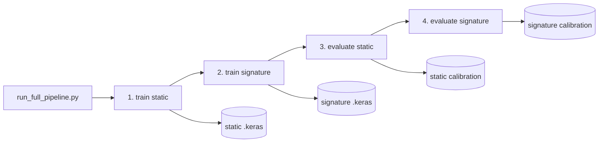
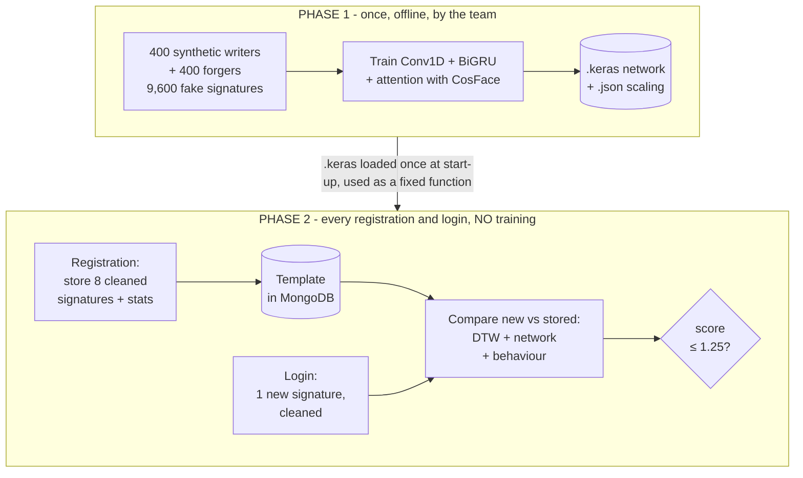
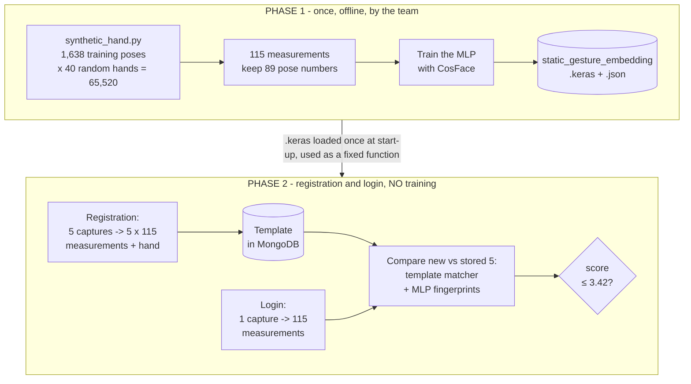

# AirAuth — The Complete Project Guide

**Two-Step Air Authentication: Static Hand Gesture + Dynamic Air Signature**

*A study guide: every feature, every file, every flow — with every term and formula explained where it first appears.*

---

## How to read this guide

| If you have… | Read |
|---|---|
| 5 minutes | Part 1 (the project in 60 seconds) and Part 17 (likely questions) |
| 30 minutes | Parts 1–5 (what it does, the big architecture, how a login flows) |
| 2 hours | Everything |

**How explanations are shown:**

> **What is …?** — a yellow box like this defines a new term the first time it appears.

```
Formula boxes like this show the exact maths, followed by a small worked example.
```

Part 19 at the end is only a quick index of terms — the full explanations are in the text where each term is used.

---

# Part 1 — The project in 60 seconds

AirAuth lets a person log in **without a password**, using only a normal webcam, in **two steps**.

> **What is authentication?** Proving you are who you claim to be. *Identification* asks "who is this?"; *authentication (verification)* asks "is this really user X?". AirAuth does verification: the user types a username, then proves it.

> **What is an authentication factor?** A type of proof. The three classic types are: **something you know** (password, PIN, secret gesture), **something you have** (phone, card) and **something you are** (fingerprint, face, signature style). Using two different types is called **two-factor / multi-factor authentication**.

1. **Static hand gesture** — the user holds a secret hand pose (for example thumb + little finger out). This is *something you know*.
2. **Dynamic air signature** — the user signs their name in the air with their index finger. This is *something you are*.

> **What is a biometric?** A measurable characteristic of a person used to recognise them. **Physical** biometrics measure the body (fingerprint, face). **Behavioural** biometrics measure how you do something (typing rhythm, gait, signature). The air signature is behavioural: two people can draw the same shape, but not with the same speed, rhythm and pauses.

> **"Static" vs "dynamic":** *static* = a pose held still (one shape); *dynamic* = a movement over time (a path with timing).

Access is granted **only if both steps pass, in that order**. A user who is not registered is automatically sent to registration, where both the gesture and the signature are recorded.

It is built as a **MERN website** plus a **Python AI service**.

> **What is MERN?** A popular set of four technologies for websites: **M**ongoDB (database), **E**xpress (backend web framework), **R**eact (frontend user interface), **N**ode.js (runs JavaScript on the server).

The most important privacy point: **video never leaves the user's browser**. The browser turns each video frame into 21 hand coordinates, and only those numbers are sent to the server.

> **What is a video frame and fps?** A video is a fast sequence of still images called *frames*. **fps** (frames per second) is how many per second — a webcam gives about 24–30 fps, so one frame every ~33–40 ms.

---

# Part 2 — Where the project started

The team already had a research prototype called `Air-Auth_Sign`:

* a **desktop app** (Python + OpenCV + MediaPipe) that recorded air signatures from the webcam,
* a **dataset of 90 air signatures**: 3 people × 3 recording **sessions** × 10 signatures,
* experiments showing that **DTW** worked best using only the x and y position (error 14.4%) and that adding depth made it worse (30.8%).

> **What is a dataset?** A collection of recorded examples used to build and test a system. Here, each example is one air signature: a list of rows `time, x, y, z`.

> **What is a session?** One recording sitting (e.g. one day). Recording on different days matters because people sign slightly differently each day; testing on a *later* session than the one used for registration is the honest way to measure accuracy.

> **What is DTW?** *Dynamic Time Warping* — a method for comparing two sequences that may be drawn at different speeds. Fully explained with a worked example in Part 7.3.

What did **not** exist: the hand-gesture step, an AI model usable for new users, a website, user accounts, a database, or security features.

During clean-up, the old research code was removed and **only the 90 recorded signatures were kept**, in `ml-service/data/research_signatures/`. The original research plan is kept in `Architecture/legacy_research_notes/`.

---

# Part 3 — The big picture

## 3.1 The three programs



> **Frontend vs backend.** The **frontend** is what runs on the user's device (the website in the browser). The **backend** runs on a server: it stores data and enforces rules the user cannot tamper with.

> **What is an API?** *Application Programming Interface* — a defined way for one program to ask another for something. Here the website calls the backend's API with **HTTP requests** (e.g. `POST /api/auth/login/start`), and the backend calls the AI service's API.

> **What is HTTP and JSON?** **HTTP** is the protocol browsers and servers use to talk (methods like `GET` = read, `POST` = send/create, `DELETE` = remove). **JSON** is the text format used for the data, e.g. `{"username": "ayesha"}`.

> **What is a port?** A number identifying which program on a computer receives a request: website 5173, backend 5000, AI service 8000, MongoDB 27017.

| Program | Folder | Language / framework | Port | Its job |
|---|---|---|---|---|
| Website | `client/` | React 18 + Vite, MediaPipe | 5173 | Camera, hand tracking, all screens |
| Backend | `server/` | Node.js, Express 4, Mongoose 8 | 5000 | Accounts, login rules, security, database |
| AI service | `ml-service/` | Python 3.11, FastAPI, NumPy, TensorFlow/Keras 3 | 8000 | Cleans hand data, extracts features, runs models, decides |
| Database | — | MongoDB | 27017 | Stores users, biometric profiles, history |

> **The tools named above:**
> **React** — a JavaScript library for building interactive web pages from reusable *components*. **Vite** — the tool that serves/builds the React app during development. **Node.js** — runs JavaScript outside the browser (on the server). **Express** — a small framework for writing web APIs in Node.js. **MongoDB** — a database that stores *documents* (JSON-like records) instead of tables. **Mongoose** — a library that defines the shape of MongoDB documents in JavaScript. **Python** — the main language for machine learning. **FastAPI** — a Python framework for web APIs. **NumPy** — fast maths on arrays of numbers. **TensorFlow / Keras** — libraries for building and running neural networks. **MediaPipe** — Google's pre-trained hand-tracking model (Part 4).

## 3.2 Why three programs instead of one?

* The AI tools live in **Python**; websites are best built with **JavaScript**. Each part uses the right language.
* The browser **only talks to the backend**. The AI service can only be called with a secret key, so nobody can attack it directly.
* The AI can be **retrained or replaced without touching the website**.

> **What is a microservice?** A small independent program that does one job and talks to others over an API. The AI service is a microservice.

---

## 3.3 The complete architecture — everything in one picture

The diagram on the next page shows **every part of the system and how data flows between them**: the five layers (browser, backend, database, AI service, offline training), the important files in each, and the arrows for every message.



### Walking through the big picture, layer by layer

**① Browser (website).** The webcam feeds `CameraStage.jsx`, which runs a loop once per new video frame. Each frame goes to MediaPipe (`handLandmarker.js`), which returns 21 hand points. For Step 1, `StaticGestureCapture.jsx` collects 15 frames of the held pose; for Step 2, `AirSignatureCapture.jsx` records only the index fingertip (point number 8) with a timestamp, draws the ink trail and stops automatically. The pages send these numbers through `apiClient.js`. After a successful login, `AuthContext.jsx` keeps the login token.

**② Backend.** Every request passes security headers, the CORS check and the rate limiter, then reaches a *route* and a *controller*. `registrationController` creates accounts; `loginController` runs the two-step state machine; `userController` serves the dashboard (only with a valid token). Whenever a biometric decision is needed, the controller calls the AI service through `mlServiceClient.js`, adding the secret key. Before replying to the browser, `verificationResult.js` removes anything secret.

**③ Database.** Five collections: accounts, biometric templates, raw samples (for retraining), in-progress logins (auto-deleted after 5 minutes) and the audit log of every attempt.

**④ AI service.** Two pipelines, one per step. Each pipeline *cleans* the data, *measures* it (features), *compares* it in several independent ways, *fuses* the scores and *decides* against a threshold read from the calibration file. `model_registry.py` keeps the two neural networks loaded in memory.

**⑤ Offline training.** Not part of a login — the team runs it. Synthetic generators produce training data, the training pipelines create the `.keras` network files, and the evaluation pipelines measure accuracy and write the calibration files the live service uses. Real users' samples can be exported from MongoDB and fed back in to retrain.

---

# Part 4 — All features

## 4.1 Features the user sees

| Feature | Where | Details |
|---|---|---|
| Home page with system status | `HomePage.jsx`, `SystemStatus.jsx` | Shows if API, database and AI service are running, and which model versions are loaded |
| Username check | Login / Register pages | Tells whether a username is already registered |
| Automatic redirect to registration | `LoginPage.jsx` | Unknown username → message → redirected to Register after 4 seconds with the username filled in |
| Registration wizard (4 steps) | `RegisterPage.jsx` | Account → 5 gesture captures → 8 air signatures → create account |
| Gesture capture with countdown | `StaticGestureCapture.jsx` | 3-second countdown, then 15 frames collected while the user holds still; progress bar; "hand detected" indicator |
| Air-signature capture | `AirSignatureCapture.jsx` | 3-second countdown, live ink trail, auto-stop when the finger rests 1 second, Done button or Space bar |
| Signature thumbnails | `SamplePreview.jsx` | Small drawings of each recorded signature; "Remove last" |
| Re-capture of rejected samples | `RegisterPage.jsx` | If the AI rejects one sample, only that sample is removed and the user redoes it |
| Two-step login | `LoginPage.jsx` | Username → gesture → air signature → ACCESS GRANTED |
| Result cards | `ResultCard.jsx` | MATCH / NO MATCH, match %, score vs threshold, each AI component's score |
| Attempts left | `LoginPage.jsx` | After a failure shows tries remaining (3 per step) |
| Lockout message | `LoginPage.jsx` | After 5 failures in a row, locked for 15 minutes |
| Secure dashboard ("vault") | `DashboardPage.jsx` | Last login, registration date, hand used, stored samples, adaptations |
| Login history | `DashboardPage.jsx` | Every attempt with time, step, result, match %, reason |
| Delete my account and data | `DashboardPage.jsx` | Two-click confirmation, removes everything |
| Log out | `Layout.jsx` | Clears the login token |

> **What is MediaPipe Hand Landmarker?** A neural network trained by Google on large hand-image datasets. Given one video frame, it finds the hand and returns **21 landmarks** (key-points): the wrist (0) and four points on each finger, ending at the fingertips (4 = thumb, 8 = index, 12 = middle, 16 = ring, 20 = little finger). Each landmark has **x** and **y** (position as a fraction of the image width/height, 0 to 1) and **z** (relative depth; less reliable). It also says whether the hand is "Left" or "Right".

```
          8   12  16  20        ← fingertips
          |   |   |   |
          7   11  15  19
      4   6   10  14  18
      |   5---9---13--17        ← knuckles (MCP joints)
      3  /
       2/
        1
         \___ 0 (wrist)
```

## 4.2 Features behind the scenes

| Feature | Where | Details |
|---|---|---|
| On-device hand tracking | `handLandmarker.js` | MediaPipe runs inside the browser |
| Two-step state machine | `loginController.js`, `LoginSession.js` | Server remembers each login's step; Step 2 refused until Step 1 passes |
| Attempt limits and lockout | `loginController.js` | 3 attempts per step; locked 15 min after 5 consecutive failures |
| Rate limiting | `rateLimiters.js` | 100 auth requests / 15 min / IP; 30 verifications / 5 min / IP |
| Login tokens (JWT) | `tokenService.js` | Issued only after both steps; valid 1 hour |
| Hashed session tokens | `tokenService.js` | Only SHA-256 hashes are stored |
| Auto-expiring login sessions | `LoginSession.js` | Deleted after 5 minutes (TTL index) |
| Audit log | `AuthAttempt.js` | Every verification is recorded |
| Raw sample storage | `biometricSampleStore.js` | Optional, for retraining |
| Replay detection | both verifiers | Near-identical copies of stored samples rejected |
| Wrong-hand detection | gesture verifier | Other hand than at registration rejected |
| Capture quality checks | preprocessing files | Clear retry messages |
| Template adaptation | signature verifier | Confident logins added to the profile (max 20) |
| Graceful degradation | `model_registry.py` | Works without the neural networks if needed |
| Model warm-up | `app/main.py` | Models compiled at start-up |
| Data export | `exportBiometricSamples.js` | Real samples → training folder |
| One-command training | `run_full_pipeline.py` | Train + evaluate + calibrate |

> **What is WebAssembly (WASM)?** A way to run fast, compiled code inside a web browser. MediaPipe uses it so hand tracking runs at video speed on the user's own computer (using the graphics card if available, otherwise the CPU).

> **What is a state machine?** A system that is always in exactly one *state* and moves between states only by allowed *transitions*. A login is in state `static_gesture`, can move to `dynamic_signature` only when the gesture passes, and finishes only when the signature passes.

> **What is a JWT?** A *JSON Web Token*: a small piece of text the server gives the browser after login, like a signed visitor pass. It contains the user ID and an expiry time, and is **signed** with a secret key so it cannot be forged or edited. The browser sends it with each dashboard request; the server checks the signature.

> **What is a hash (SHA-256)?** A one-way function that turns any text into a fixed 64-character fingerprint. The same input always gives the same hash, but you cannot reverse it. We store only the hash of each login-session token: even if the database leaked, the real tokens could not be recovered.

> **What is a TTL index?** *Time To Live*: a MongoDB rule that automatically deletes a document after a set time. Used so abandoned logins vanish after 5 minutes.

> **What is rate limiting?** Limiting how many requests one address (IP) can make in a time window, to stop automated guessing.

> **What is an audit log?** A permanent record of every security-relevant event (who tried, when, result) for review.

> **What is a replay attack?** Recording a valid input (e.g. someone's signature data) and sending it again later to impersonate them.

---

# Part 5 — Execution flows (what happens, step by step, and which file runs)

## 5.1 Starting the system

1. `scripts/start-dev.ps1` reloads PATH (so Node is found) and opens three windows.
2. **AI service:** `app/main.py` starts. Its *lifespan* function asks `model_registry.py` to load both `.keras` models and run one dummy prediction, so TensorFlow compiles them now instead of during the first login (first call ~6 s → later calls ~45 ms).
3. **Backend:** `server.js` → `config/database.js` connects to MongoDB (gives up after 8 s with a clear message) → `app.js` builds Express with security headers, CORS, JSON limit 5 MB, routes and error handler → listens on 5000.
4. **Website:** Vite serves the React app; `vite.config.js` forwards every `/api` call to port 5000.

> **What is a proxy?** A middle-man that forwards requests. Vite's proxy lets the browser call `/api/...` on the website's own address while the request actually goes to the backend.

## 5.2 Opening the home page

1. `main.jsx` mounts `App.jsx` inside `AuthProvider` (login state) and the router.
2. `HomePage.jsx` renders; `SystemStatus.jsx` calls `GET /api/system/health`.
3. `systemController.js` reports API status, MongoDB state, and the AI service's `GET /health` (model versions and thresholds).

## 5.3 Registration flow



> **What is enrollment?** Registration of biometric samples. The system processes the samples into a **template** — the stored reference that future logins are compared against.

1. **Account step** (`RegisterPage.jsx`): `authApi.checkUser` → `registrationController.checkUser` → `validators.normaliseUsername` (lower-case, 3–32 characters from letters, digits, `.`, `_`, `-`). If already registered, an error is shown.
2. **Gesture step:** `StaticGestureCapture.jsx`: "Capture gesture" → 3-s countdown → collects **15 frames** that contain a hand (timeout 4 s). Each frame = 21 × `[x, y, z]` + Left/Right + confidence. Repeated 5 times.
3. **Signature step:** `AirSignatureCapture.jsx`: 3-s countdown → every frame records the index fingertip `[time, x, y, z]` and draws the ink. Recording stops when the finger stays inside a circle of radius 0.012 (1.2% of the image) for 1 s, or the hand disappears 0.7 s after drawing, or 12 s pass, or the user presses Done/Space. Too short (< 15 points, < 0.8 s, or moved less than 5% of the image) → rejected immediately. Repeated 8 times.
4. **Finish:** `POST /api/auth/register` → `registrationController.register`: validates sizes (3–15 gestures, 3–25 signatures) → refuses a taken username (409) → AI `/static/enroll` → AI `/dynamic/enroll` → creates `User` + `BiometricProfile` (removes the user again if the profile fails) → stores raw samples → "Registration complete".
5. **If the AI rejects one capture**, it answers **HTTP 422** with the sample number; the backend adds which step; the website removes only that sample and returns the user to that step.

> **What is an HTTP status code?** A 3-digit number in every reply. **2xx** = success (200 OK, 201 Created). **4xx** = the request has a problem (400 bad input, 401 not logged in, 404 not found, 409 conflict, 422 data understood but unusable, 423 locked, 429 too many requests). **5xx** = server problem (502/503 = the AI service failed or is down).

## 5.4 Login — start

1. `LoginPage.jsx` → `POST /api/auth/login/start` → `loginController.startLogin`.
2. Not registered → **404 USER_NOT_REGISTERED** → redirect to Register in 4 seconds.
3. Locked → **423 ACCOUNT_LOCKED** with unlock time.
4. Otherwise a random 64-character token is generated; only its SHA-256 hash is saved in a `LoginSession` with `stage = static_gesture`, expiring in 5 minutes. The plain token goes to the browser.

## 5.5 Login — Step 1 (gesture)



Inside the AI (`static_gesture/verifier.verify`): version check → clean + measure (Part 6) → wrong hand? reject → exact copy of a stored sample? reject → compute the two scores → combine → accept if ≤ **3.42**.

## 5.6 Login — Step 2 (air signature)

1. `POST /api/auth/login/air-signature` → `loginController.verifyAirSignature`. The session **must** be at `dynamic_signature`, otherwise **409 WRONG_STEP** — this is what makes skipping Step 1 impossible.
2. AI `dynamic_signature/verifier.verify` (Part 7): clean → DTW + behaviour + neural network → replay check → combine → accept if ≤ **1.25**.
3. On success: save the adapted template (if sent) → reset failure count → record `lastLoginAt` → delete the session → issue a **JWT** (1 hour) → browser stores it (`AuthContext.jsx`) → ACCESS GRANTED → dashboard after 2.5 s.
4. On failure: same limits as Step 1.

## 5.7 Dashboard, logout and delete

* `GET /api/users/me` and `/me/attempts` with the JWT; `requireAuth.js` checks it. Templates are never returned — only counts and dates.
* `DELETE /api/users/me` removes user, profile, raw samples, history and open sessions.
* Log out clears the token in the browser.

## 5.8 What happens on errors

| Situation | Code | What the user sees |
|---|---|---|
| Username format wrong | 400 `INVALID_USERNAME` | "Username must be 3–32 characters…" |
| Not registered | 404 `USER_NOT_REGISTERED` | Redirect to registration |
| Username taken | 409 `USERNAME_TAKEN` | "Already registered, please log in" |
| Session expired (5 min) | 401 `LOGIN_SESSION_EXPIRED` | Start again |
| Trying Step 2 first | 409 `WRONG_STEP` | Start again |
| Account locked | 423 `ACCOUNT_LOCKED` | Unlock time |
| Bad capture | 422 `CAPTURE_REJECTED` | Specific message; **not counted as a failed attempt** |
| AI service down | 503 `ML_SERVICE_UNAVAILABLE` | "Is ml-service running?" |
| Too many requests | 429 `RATE_LIMITED` | "Slow down" |
| Login token invalid | 401 | Back to login |

## 5.9 Training flow (offline)



1. **Train gesture network** (~4 min) on synthetic hands. 2. **Train signature network** (~7 min) on synthetic signatures. 3. **Evaluate gesture** (~1 min) on 150 simulated users → threshold. 4. **Evaluate signature** (~2.5 min) on the real dataset → threshold. Details in Part 8.

> **What is calibration?** Choosing the decision **threshold** (the accept/reject cut-off) from measured data instead of guessing. The live service reads these values on every verification.

## 5.10 Retraining with real users

1. Users register/log in; raw samples are stored in MongoDB.
2. `npm run export-samples` → `exportBiometricSamples.js` writes enrollment samples and **accepted** login samples to `ml-service/data/collected/` (only these have trustworthy labels — a rejected login might be an impostor).
3. `python -m pipelines.run_full_pipeline --use-collected` retrains and recalibrates.
4. Restart the AI service. Existing users keep working because templates store processed measurements, not network outputs.

---

# Part 6 — Step 1 in depth: the static gesture

## 6.1 Cleaning the capture (`static_gesture/preprocessing.py`)

**Step 1 — parse.** Converts the JSON into an array of shape (frames × 21 × 3), drops broken frames and takes the most common Left/Right label (a **majority vote**). Fewer than 5 good frames → `too_few_frames`.

> **What is an array / shape?** A grid of numbers. Shape (15 × 21 × 3) means 15 frames, each with 21 points, each with 3 numbers (x, y, z).

**Step 2 — aspect-ratio correction.** MediaPipe gives x as a fraction of the image *width* and y as a fraction of the *height*. On a 16:9 camera a circle would look like a squashed ellipse. Fix:

```
x' = x × (W / H)        z' = z × (W / H)        y' = y
```
*Example:* 1280×720 camera → W/H = 1.778. A point at x = 0.5 becomes 0.889; now one unit sideways equals one unit up-down.

**Step 3 — stability check.** The hand must stay still while the gesture is captured.

> **What is palm size?** Our unit of length: the average distance from the wrist to the four knuckles. Measuring in "palm units" makes everything independent of how big the hand looks.

```
palm_size = ( |p5 − p0| + |p9 − p0| + |p13 − p0| + |p17 − p0| ) / 4

drift = max over frames and anchors of | anchor_in_frame − median_anchor | / palm_size
reject if drift > 0.35
```
Anchors: wrist (0), middle knuckle (9), index tip (8), thumb tip (4).

> **What is Euclidean distance |a − b|?** The straight-line distance: for 2-D points √((x₁−x₂)² + (y₁−y₂)²); for 3-D add (z₁−z₂)². *Example:* (0,0) to (3,4) → √(9+16) = 5.

> **What is the median?** The middle value after sorting. Unlike the average it ignores extreme values. *Example:* [2, 3, 3, 4, 50] → median 3, average 12.4.

*Example:* palm size 0.2; the index tip wanders 0.09 from its median position → drift = 0.45 > 0.35 → "Your hand moved".

**Step 4 — mirror left hands.** For a "Left" hand: `x → −x`, so both hands share one layout before measuring.

## 6.2 Turning a hand into numbers: canonicalisation

> **What is a vector?** An arrow with direction and length, written as a list of numbers, e.g. v = (3, 4, 0). Its length is |v| = √(3² + 4² + 0²) = 5. A **unit vector** has length 1: v / |v| = (0.6, 0.8, 0).

> **Dot product.** a · b = a₁b₁ + a₂b₂ + a₃b₃ = |a||b| cos(angle between them). It tells how much two arrows point the same way. *Example:* (1,0,0)·(0.6,0.8,0) = 0.6.

> **Cross product.** a × b is a third arrow perpendicular to both a and b. Used to build the palm's "out of the palm" direction.

We build the hand's own coordinate axes (the **palm frame**):

```
y_axis = unit( knuckle9 − wrist0 )                       "up" the hand
across = knuckle17 − knuckle5                            index knuckle → little-finger knuckle
x_axis = unit( across − (across · y_axis) · y_axis )     remove any "up" part (Gram–Schmidt)
z_axis = x_axis × y_axis                                 out of the palm

canonical point  q = R · ( p − wrist0 ) / palm_size      where R has rows x_axis, y_axis, z_axis
```

> **What is canonicalisation?** Putting every hand into the same standard position: wrist at (0,0,0), size 1, "up" pointing up. After this, the same pose gives the same numbers whether the hand is near or far, left or right in the picture, or tilted.

> **What is a rotation matrix (R)?** A 3×3 table of numbers that turns points around without stretching them. Multiplying by R re-expresses each point in the palm's own axes.

## 6.3 The 115 measurements (`static_gesture/features.py`)

> **What is a feature?** A number that describes something useful about a sample. A **feature vector** is the list of all features — here 115 numbers per hand.

| Group | Count | What it measures | Weight | Typical genuine variation (scale) |
|---|---|---|---|---|
| Canonical x, y | 40 | Position of the 20 non-wrist points in palm coordinates | 1.0 | 0.12 |
| Canonical z | 20 | Depth of each point (noisy) | 0.3 | 0.30 |
| Joint angles | 15 | Bend of every finger joint | 1.0 | 0.22 rad (~12.6°) |
| Fingertip distances | 10 | Distance between every pair of fingertips | 1.0 | 0.15 |
| Abduction | 4 | Spread between neighbouring fingers | 0.5 | 0.15 rad |
| Orientation | 6 | Which way the palm faces and points | 0.6 | 0.30 |
| Hand geometry | 20 | Bone length ÷ palm size | 0.4 | 0.10 |

**Joint flexion angle** (how bent a joint is), for three points a – b – c along a finger, measured at b:

```
inner_angle = arccos( ((a − b) · (c − b)) / (|a − b| · |c − b|) )
flexion     = 180° − inner_angle          0° = straight,  90° = right-angle bend
```
*Example:* straight finger → a, b, c in a line → inner angle 180° → flexion 0°. Finger bent at a right angle → inner 90° → flexion 90°. In our tests a curled finger measured 80–100°, a straight one 0–15°.

> **What is a radian?** Another unit for angles: 180° = π ≈ 3.14 radians, so 1 rad ≈ 57.3°. The 0.22 rad scale ≈ 12.6°.

**Fingertip distances:** every pair of the 5 tips → 5×4/2 = **10** distances, in palm units (small when fingertips touch, e.g. the OK sign).

**Abduction:** the angle between neighbouring fingers' directions, projected flat onto the palm (thumb–index, index–middle, middle–ring, ring–little).

**Orientation:** the z_axis (palm normal) and y_axis expressed in camera coordinates → 6 numbers. They separate thumbs-up from thumbs-down, which have the same shape.

**Hand geometry:** the 20 bone lengths divided by palm size — these depend on *whose* hand it is, not on the pose (a weak biometric).

**Combining 15 frames:** each of the 115 features is computed per frame, and the **median** over frames is kept.

## 6.4 Model A — the template matcher

Compares the new gesture f with the **average** μ of the 5 enrolled feature vectors:

```
for each group g:   d_g = √( mean over features in g of ( (f − μ) / scale_g )² )
template distance   = Σ_g weight_g × d_g  /  Σ_g weight_g
```

> **Why divide by scale?** It converts each difference into "how many *normal* variations away". A joint-angle difference of 0.22 rad counts as 1.0, a canonical-xy difference of 0.12 counts as 1.0 — so groups with different units can be added fairly. This is the idea of **normalisation**.

*Example (two groups only):* joint angles differ on average by 0.11 rad → d = 0.11/0.22 = 0.5 (weight 1.0); orientation differs by 0.6 → d = 0.6/0.30 = 2.0 (weight 0.6). Distance = (1.0×0.5 + 0.6×2.0)/(1.0+0.6) = 1.7/1.6 = 1.06.

In our sanity test: the same pose repeated ≈ 0.6; a different pose ≈ 3.0.

## 6.5 Model B — the pose neural network (`static_gesture/embedding_model.py`)

> **What is a neural network?** A function built from layers of simple maths operations with many adjustable numbers (**parameters** or **weights**). **Training** adjusts these numbers using examples so that the output becomes useful. Our gesture network has **131,520 parameters**.

> **What is an embedding (fingerprint)?** The network's output: a short list of numbers (here **64**) summarising the input, arranged so that similar inputs give similar lists.

```
89 pose numbers (feature groups 1–5)
 → Dense 256 → BatchNorm → ReLU → Dropout 10%
 → Dense 256 → BatchNorm → ReLU → Dropout 10%
 → Dense 128 → ReLU
 → Dense 64  → UnitNormalization          = 64-number fingerprint, length 1
```

> **Dense (fully connected) layer.** Every output is a weighted sum of all inputs plus a bias:
> `y = W·x + b`. A Dense 256 layer on 89 inputs has 89×256 weights + 256 biases.

> **ReLU** (*Rectified Linear Unit*): `ReLU(x) = max(0, x)` — negative values become 0. This simple bend lets the network learn non-straight-line relationships. *Example:* ReLU(−2) = 0, ReLU(3) = 3.

> **BatchNorm** (*Batch Normalisation*): re-centres and re-scales the numbers flowing through a layer so training stays stable: `y = γ · (x − mean) / std + β`, where γ and β are learned.

> **Dropout 10%.** During training, 10% of values are randomly set to 0 each step, so the network cannot rely on any single value — this reduces **overfitting**.

> **What is overfitting?** Memorising the training examples instead of learning the general pattern — like a student memorising past exam answers. It looks perfect on training data and fails on new data.

> **UnitNormalization.** Divides the output by its length so every fingerprint has length 1: `e = v / |v|`. This makes cosine comparison natural.

> **Standardisation of the input.** Before entering the network, each of the 89 numbers is rescaled using the training-data mean and standard deviation: `x' = (x − mean) / std`, so all inputs have a similar range. These means/stds are saved in the model's `.json` file.

> **What is standard deviation (std)?** How spread out values are around their average: `std = √( mean of (x − average)² )`. *Example:* [2, 4, 4, 4, 5, 5, 7, 9] → average 5, std 2.

**Comparing fingerprints — cosine distance:**

```
cosine similarity  cos(a, b) = (a · b) / (|a| |b|)          (= a · b when both have length 1)
cosine distance               = 1 − cos(a, b)               0 = identical direction, 2 = opposite
```
*Example:* a = (1, 0), b = (0.8, 0.6) → cos = 0.8 → distance 0.2.

The probe is compared with the **centroid** (average, then re-normalised to length 1) of the 5 enrolled fingerprints.

> **Important:** this MLP is **not** trained on the user's gesture. It is trained once, offline, on synthetic hands (Part 8.4), saved as `static_gesture_embedding.keras` and only *used* at registration and login. Part 8.12 explains what it learns and exactly how it is applied to the stored 5 captures and the new one.

## 6.6 Registration checks (`verifier.enroll`)

* At least 3 captures (website sends 5); all the same hand, else `mixed_handedness`.
* **Consistency check:** each capture is compared with the average of the *other* captures using the template distance; if any is > **2.5**, it is rejected as `inconsistent_enrollment` ("Gesture sample 3 does not match the others").

Saved template: version, hand (Left/Right), and the 5 × 115 measurements.

## 6.7 The decision

**Leave-one-out reference** — how much this user naturally varies:

> **What is leave-one-out?** Take each enrollment sample in turn, compare it with the others (leaving it out), and average the results. It estimates how different a *genuine* new attempt is likely to be, using only the registration data.

```
template_ref  = average over i of  distance( sample_i , average of the other samples )
embedding_ref = average over i of  cosine distance( fingerprint_i , centroid of the others )
```

Each raw score is divided by an *effective reference* (explained with a full worked example in Part 9.1), then:

```
combined = 0.6 × template_score + 0.4 × embedding_score
ACCEPT  if  combined ≤ 3.42
```

Hard rejections before scoring: **wrong hand**, and **replay** (any stored sample whose 115 numbers all differ from the probe by less than 0.000001 — a live hand can never reproduce numbers that exactly).

---

# Part 7 — Step 2 in depth: the air signature

## 7.1 Cleaning the path (`dynamic_signature/preprocessing.py`)

**1. Parse:** keep time, x, y; drop broken rows; sort by time; remove duplicate times.

**2. Validate:** ≥ 20 points; duration 0.5–15 s (`too_short`, `too_fast`, `too_slow`).

**3. Aspect fix:** `x' = x × W/H` (as in 6.1).

**4. Trim idle:** remove the still parts at the beginning and end.

```
cumulative path c_k = sum of step lengths up to point k ;  total = c_last
keep points from where c_k first reaches 2% of total, to where it reaches 98%
```
Why: the recorder waits for the finger to rest before stopping; that pause is not part of the signature.

**5. Remove tracking glitches (spikes).**

> **What is MAD?** *Median Absolute Deviation*, a robust measure of spread: `MAD = median( |d_i − median(d)| )`. Unlike standard deviation, one huge glitch barely changes it — which is exactly why it's used to *detect* glitches.

```
d_i        = distance between point i−1 and point i          (step lengths)
threshold  = median(d) + 6 × MAD(d)
a point i is a spike if  (in_step > threshold or out_step > threshold)
                    and  skip / (in_step + out_step) < 0.5
   where in_step = |p_i − p_(i−1)|, out_step = |p_(i+1) − p_i|, skip = |p_(i+1) − p_(i−1)|
spikes are replaced by linear interpolation
```
*Worked example:* steps = [2, 3, 2, 4, 3, 30]. Median = 3; deviations |d − 3| = [1, 0, 1, 1, 0, 27] → MAD = 1 → threshold = 3 + 6×1 = **9**. A step of 30 exceeds it. If the next step is 29 straight back and the skip distance is only 2: ratio = 2/(30+29) = 0.03 < 0.5 → it went out and came back → **glitch**, fixed. A genuine fast stroke keeps going (skip ≈ in + out, ratio ≈ 1) → kept.

> **What is linear interpolation?** Filling a missing value on the straight line between its neighbours: `value(t) = v₀ + (v₁ − v₀) × (t − t₀)/(t₁ − t₀)`. *Example:* x = 0.40 at t = 1.0 s and 0.50 at t = 1.2 s → at t = 1.1 s, x = 0.45.

**6. Size check:** largest side < 4% of the image → `too_small`.

**7. Resample to 128 points, equally spaced in time.**

> **What is resampling?** Converting a recording to a fixed number of points. Signatures arrive with different numbers of frames (e.g. 84 or 108); after resampling every signature has exactly 128 points, so they can be compared and fed to the network.

```
new times  t_k = t_start + k × (t_end − t_start) / 127      k = 0 … 127
x(t_k), y(t_k) found by linear interpolation
```
Because the spacing is in *time*, a fast stroke produces points far apart and a slow stroke points close together — **speed information is preserved**.

**8. Normalise position and size:**

```
x' = x − mean(x),  y' = y − mean(y)            centre at (0, 0)
scale = max( range(x'), range(y') )
x'' = x' / scale,  y'' = y' / scale            largest side = 1
```
*Example:* drawing 0.30 wide and 0.18 tall → divide by 0.30 → now 1.0 × 0.6.

Depth (z) is dropped — experiments showed it makes matching worse (14.4% vs 30.8% error).

## 7.2 Features (`dynamic_signature/features.py`)

First the path is lightly **smoothed** (only for computing speeds): each point becomes `0.25 × previous + 0.5 × itself + 0.25 × next`, applied twice. Time is treated as running from 0 to 1 over the 128 points (Δt = 1/127).

**9 values per point:**

```
vx_i = (x_(i+1) − x_(i−1)) / (2 Δt)           velocity (central difference)
vy_i = (y_(i+1) − y_(i−1)) / (2 Δt)
speed_i = √(vx_i² + vy_i²)
direction θ_i = atan2(vy_i, vx_i)              angle of motion
stored as sin θ_i and cos θ_i
curvature_i = (change in θ) / (distance moved)   clipped to ±50
acceleration_i = |change in velocity| / Δt
```
plus x and y themselves → 9 numbers per point → a 128 × 9 table.

> **What is velocity / speed?** Velocity is how fast and in which direction position changes; speed is just how fast (its length). *Example:* moving 0.02 right and 0.01 up per step → speed √(0.02² + 0.01²) = 0.022 per step.

> **Why sin and cos instead of the angle?** An angle jumps from 359° to 0° even though the direction barely changed. sin/cos change smoothly, so the network isn't confused.

> **What is atan2?** The function that gives the angle of an arrow (vx, vy), correctly in all four directions. *Example:* atan2(1, 1) = 45°.

> **What is curvature?** How sharply the path turns: big for tight loops and corners, ~0 for straight lines.

**12 behaviour statistics (one set per signature):**

| Statistic | Formula |
|---|---|
| log duration | ln(seconds) |
| log path length | ln( Σ |p_(i+1) − p_i| ) |
| log aspect ratio | ln( width / height ) |
| speed variability | std(speed) / mean(speed) |
| peak speed ratio | max(speed) / mean(speed) |
| pause ratio | fraction of points with speed < 0.15 × mean speed |
| x reversals | number of times horizontal direction flips |
| y reversals | number of times vertical direction flips |
| start x, start y, end x, end y | first and last normalised positions |

> **Why logarithms (ln)?** They turn ratios into differences: signing 2× slower changes ln(duration) by the same amount whether the signature took 2 s or 4 s.

## 7.3 Model A — DTW (`dynamic_signature/dtw.py`)

> **What is DTW?** *Dynamic Time Warping* finds the best way to line up two sequences, allowing one to be locally faster or slower, and reports how different they are after this best alignment. Comparing point 1 with point 1, point 2 with point 2, etc. would fail as soon as someone signs part of the signature a bit slower.

```
cost(i, j) = | a_i − b_j |                               distance between point i of A and point j of B
D(i, j)    = cost(i, j) + min( D(i−1, j−1),  D(i−1, j),  D(i, j−1) )
                           match both      stretch B     stretch A
DTW(A, B)  = D(n, m) / (n + m)                           normalised by length
```

**Worked example** (1-D for simplicity): A = [1, 2, 3], B = [1, 1, 2, 3] (B is the same movement, just slower at the start).

| D | b=1 | b=1 | b=2 | b=3 |
|---|---|---|---|---|
| a=1 | 0 | 0 | 1 | 3 |
| a=2 | 1 | 1 | 0 | 1 |
| a=3 | 3 | 3 | 1 | **0** |

The final cell is **0** → DTW says these are the same signature drawn at a different speed. A point-by-point comparison would have said they are different.

> **What is a Sakoe–Chiba band?** A limit on how far DTW may stretch time: point i can only be matched with points within ±15% of the length (|i − j| ≤ 20 for 128 points). This prevents absurd alignments and makes it faster.

* The new signature is compared with **every** enrolled signature and the **smallest** distance is used (experiments: best choice — 18–22% error vs 27–49% when averaging all).
* **Batched DTW:** many comparisons are computed at once with NumPy arrays; 190 comparisons went from ~1 s to 0.18 s with identical results.

## 7.4 Model B — the signature neural network (`dynamic_signature/embedding_model.py`)

```
128 points × 9 values
 → Conv1D 64 filters, window 5 → BatchNorm → ReLU
 → Conv1D 64 filters, window 5 → BatchNorm → ReLU
 → Bidirectional GRU, 64 units each direction
 → Attention pooling
 → Dense 128 → ReLU → Dropout 20%
 → Dense 64 → UnitNormalization            = 64-number fingerprint
```
*98,689 parameters.*

> **What is Conv1D (1-D convolution)?** A small window (here 5 points wide) slides along the sequence; at each position it computes a weighted sum of the 5 points × 9 values: `out_t = Σ_(k=0..4) W_k · x_(t+k−2) + b`. Each of the 64 *filters* learns to detect one short pattern — a hook, a sharp corner, a quick flick — wherever it appears.

> **What is a GRU?** A *Gated Recurrent Unit* reads the sequence one step at a time and keeps a running **memory** h. At each step two *gates* decide what to keep and what to update:
> ```
> z_t = σ(W_z x_t + U_z h_(t−1))          update gate (how much to change memory)
> r_t = σ(W_r x_t + U_r h_(t−1))          reset gate (how much past to use)
> h̃_t = tanh(W x_t + U (r_t ⊙ h_(t−1)))   candidate new memory
> h_t = (1 − z_t) ⊙ h_(t−1) + z_t ⊙ h̃_t     new memory
> ```
> σ (sigmoid) squashes numbers to 0–1 (like a dimmer switch); tanh squashes to −1…1; ⊙ multiplies element by element. **Bidirectional** = one GRU reads forwards and another backwards, so every moment "knows" what came before and after. This captures the **order and rhythm** of the signature.

> **What is attention pooling?** We need one summary of 128 time steps. Instead of a plain average, the network learns a score for each step, turns the scores into weights with **softmax**, and takes a weighted average:
> ```
> score_t  = w · h_t + b
> α_t      = e^(score_t) / Σ_k e^(score_k)          (softmax: weights sum to 1)
> summary  = Σ_t α_t · h_t
> ```
> *Softmax example:* scores [1, 2, 0] → e¹=2.72, e²=7.39, e⁰=1 → sum 11.11 → weights [0.24, 0.67, 0.09]. The most distinctive moments of the signature get the most weight.

> **What is `tf.function`?** A TensorFlow feature that converts the network into a pre-compiled graph. Without it, the GRU took ~1.9 s per check; with it ~45 ms.

The probe fingerprint is compared by cosine distance with the centroid of the enrolled fingerprints (as in 6.5).

> **Important:** this network is **not** trained on the user's signatures. It is trained once, offline, on synthetic writers (Part 8), saved as a `.keras` file and only *used* at registration and login. Part 8.11 walks through exactly what happens to it at each login.

## 7.5 Model C — behaviour statistics

> **What is a z-score?** "How many standard deviations from the average": `z = (value − average) / std`. z = 0 is perfectly typical; |z| = 3 is very unusual.

```
for each of the 12 statistics:
    z = ( probe − enrolled_mean ) / √( enrolled_std² + floor² )
behaviour distance = √( mean of z² over the 12 statistics )        (root-mean-square)
```
The **floor** is a minimum allowed spread (e.g. 0.12 for log-duration), so a user who signed with almost identical timing at registration isn't rejected for a tiny change.

*Example:* enrolled log-durations average 1.386 (= 4.0 s) with std 0.05; floor 0.12 → effective spread √(0.05² + 0.12²) = 0.13. The probe takes 5.0 s → ln 5 = 1.609 → z = (1.609 − 1.386)/0.13 = **1.72**.

## 7.6 Registration checks and template

* ≥ 3 signatures (website sends 8).
* **Consistency:** for each sample, its average DTW distance to the others ÷ the median of those averages; if > **4**, rejected as a bad capture. (On real data genuine samples reached 3.54×, so 4 is safe; this check is a safety net, not an impostor detector.)

Template: version, `enrolled_count`, the 8 normalised paths (128 × 2 numbers each), durations, 8 × 12 statistics.

## 7.7 The decision

```
combined = 0.45 × DTW_score + 0.35 × network_score + 0.20 × behaviour_score
ACCEPT  if  combined ≤ 1.25
```
(each score already divided by the user's effective reference — worked example in Part 9.1).

**Replay check** first:
```
reject if  min DTW(probe, any enrolled) < 0.03 × max(user's DTW reference, 0.02)
```
i.e. closer than 3% of this user's natural variation — humans never repeat a movement that exactly.

## 7.8 Template adaptation

```
if accepted and combined ≤ 0.75 × threshold (= 0.94):
    append this signature to the template
    keep the original 8 always; cap at 20 (drop the oldest *added* one)
```
Why: people's signing drifts over days. On real data: 5 samples → ~20% error, 10 → 8–12%, 20 from two sessions → 3–6%.

---

# Part 8 — Synthetic training, in full detail

## 8.1 What is synthetic data?

> **Synthetic data** is realistic artificial data produced by a computer program instead of being recorded from real people. A good analogy is a **flight simulator**: pilots learn general flying skills in a simulator before flying real planes. Our networks learn the general skill of *comparing hands and signatures* from simulated ones.

## 8.2 Why we needed it

A neural network needs **many different identities** to learn from:

* **Gestures:** there is **no public dataset** of personal secret gestures — every user invents their own. We had **zero** examples.
* **Signatures:** we had **3 people**. A network trained on 3 people learns only "which of these 3 is it?" — it would **overfit** and be useless for a 4th person.

Collecting hundreds of volunteers wasn't possible in the first semester, so we built generators.

## 8.3 The key idea: learn to *compare*, not to *recognise*

We are **not** teaching the network who our users are. We teach it a *skill*: "these two samples are the same gesture/writer, those two are different". This is called **metric learning**.

> **What is metric learning?** Training a network so that the **distance** between its outputs reflects real similarity: same class → close fingerprints, different classes → far apart. Because it learns a general notion of similarity, it works for people and gestures it **never saw** in training — exactly what authentication needs, since every new user is new.

Because the skill is general, we can learn it from thousands of *artificial* identities and then apply it to real users.

---

## 8.4 Synthetic hands — `static_gesture/synthetic_hand.py`

### 8.4.1 The hand model (forward kinematics)

> **What is forward kinematics?** Computing where the end of a jointed chain ends up when you know each joint's angle — the same maths used for robot arms and animated characters. We know the bone lengths and joint angles; we compute where each of the 21 landmarks is.

The model uses palm length = 1. Knuckle (MCP) positions on the palm:

| Finger | Knuckle position (x, y) | Bone lengths (proximal, middle, distal) |
|---|---|---|
| Index | (−0.30, 0.95) | 0.48, 0.28, 0.22 |
| Middle | (−0.08, 1.00) | 0.53, 0.32, 0.23 |
| Ring | (0.13, 0.93) | 0.50, 0.30, 0.22 |
| Little | (0.32, 0.82) | 0.40, 0.22, 0.20 |
| Thumb (base at (−0.20, 0.18, 0.06)) | — | 0.42, 0.32, 0.26 |

Each finger is a chain. Starting at the knuckle with direction d (pointing "up", turned sideways by the finger's spread angle), each bone is placed by bending around the finger's side axis by the **sum of all joint angles so far**:

```
p_(k+1) = p_k + L_k × Rot(side_axis, θ_1 + … + θ_k) · d
```

> **What is a rotation (Rodrigues' formula)?** Turning a vector by angle θ around an axis k (unit vector):
> `R = I + sin θ · K + (1 − cos θ) · K²`, where K is the "cross-product matrix" of k. *Plain meaning:* it's the standard formula to rotate any arrow around any axis.

*Example:* an index finger "curled" with joint angles 80°, 100°, 60°: the first bone is bent 80°, the second 80+100 = 180° (pointing back down), the third 240° — the fingertip ends up tucked near the palm.

### 8.4.2 What makes one gesture different from another (the 2,048 classes)

| Part | States | Joint angles in degrees (MCP, PIP, DIP) |
|---|---|---|
| Each of 4 fingers | **extended** | 5, 5, 3 |
| | **half** | 40, 45, 25 |
| | **curled** | 80, 100, 60 |
| | **hooked** | 5, 90, 60 |
| Spread (all fingers) | **together** | abduction 4°, 0°, −3°, −6° |
| | **spread** | 15°, 2°, −10°, −20° |
| Thumb | **out**, **side**, **across**, **tucked** | own direction + bends (5,5), (5,5), (35,30), (55,65) |

```
number of gestures = 4⁴ (fingers) × 2 (spread) × 4 (thumb) = 256 × 8 = 2,048
```
Each gesture class also gets a fixed random **class offset** (about ±6° on every joint), so classes aren't perfectly identical templates — more like real people's versions of a pose.

### 8.4.3 What changes between copies of the same gesture (realistic variation)

> **Notation:** `N(μ, σ)` = a random number from a **normal (bell-curve) distribution** with average μ and spread σ — most values within ±σ, few beyond ±2σ. `U(a, b)` = a **uniform** random number, equally likely anywhere between a and b.

| What varies | How | Why |
|---|---|---|
| **Person: palm width** | × N(1, 0.06) | Different hands |
| **Person: finger lengths** | each finger × N(1, 0.06), each bone × N(1, 0.04) | Different hands |
| **Joint wobble** | each angle + N(0, 5°) | Nobody holds a pose exactly the same |
| **Viewing angle** | roll U(±35°), pitch U(±30°), yaw U(±35°) | Hand tilted towards/away from camera |
| **Position & size in image** | size U(0.15, 0.30), centre U(0.35, 0.65) | Hand anywhere in the frame, near or far |
| **Tracking noise** | x, y + N(0, 0.0015); z + N(0, 0.004) | MediaPipe jitter (depth is noisier) |
| **Mirror augmentation** | 50% of samples flipped (left/right hand) | Works for both hands |

> **What is data augmentation?** Creating extra varied training examples by applying realistic changes (rotating, resizing, mirroring, adding noise) so the network learns to ignore those changes.

The viewing angle is applied with an **Euler rotation**: `R = R_z(roll) · R_x(pitch) · R_y(yaw)` — three turns around the three axes, one after another. The hand is then placed into image coordinates: `x = centre_x + size·x`, `y = centre_y − size·y`, `z = size·(z − z_wrist)` (this mimics MediaPipe's output format).

### 8.4.4 How the training set is built

```
2,048 gestures  →  shuffled, split by gesture:  1,638 training  /  410 held out (20%)
training:   1,638 gestures × 40 copies = 65,520 samples
validation:   410 gestures × 10 copies =  4,100 samples   (never seen in training)
each sample:  render hand → production feature extractor → 89 pose numbers → 50% mirrored
```

> **Held-out (validation/test) data.** Data kept away from training and used only to test. Splitting **by gesture** (not by sample) means the test gestures are completely new to the network — the honest way to check it learned *general* comparison.

---

## 8.5 Synthetic signatures — `dynamic_signature/synthetic_signature.py`

### 8.5.1 A writer's "shape"

* **70% of writers:** a random walk of 5–13 **control points**. Each step turns by a random angle N(0, 1.3 rad ≈ 75°) and moves U(0.25, 0.8) — this makes squiggles and loops.
* **30% of writers:** a **closed figure** — 3–7 points around a circle with radius U(0.6, 1.0), returning to the start (like the circles, squares and triangles in our real data).
* The control points are joined into a smooth curve with a **Catmull–Rom spline**.

> **What is a Catmull–Rom spline?** A smooth curve that passes exactly through every control point. Between points P1 and P2 (using neighbours P0 and P3), for t from 0 to 1:
> `C(t) = 0.5 × [ 2P1 + (−P0 + P2)t + (2P0 − 5P1 + 4P2 − P3)t² + (−P0 + 3P1 − 3P2 + P3)t³ ]`
> *Plain meaning:* it draws a natural-looking pen stroke through the dots.

### 8.5.2 A writer's "rhythm" — the 2/3 power law

> **What is the 2/3 power law?** A well-known finding from human motor-control research: when people draw or write, they **slow down on tight curves and speed up on straight parts**, following roughly `speed = K × curvature^(−1/3)`. It is one of the most reliable regularities of human movement, so building it in makes synthetic writing move like a person.

Our speed formula along the path (s from 0 to 1):

```
speed(s) = (curvature(s) + 0.5)^(−β)  ×  max( 0.15,  1 + Σ_(k=1..3) a_k · sin(2π f_k s + φ_k) )

β   ~ U(0.15, 0.40)       each writer's power-law strength   (1/3 ≈ 0.33 is the textbook value)
a_k ~ U(0, 0.45)          strength of personal speed-ups/slow-downs
f_k ~ U(1, 7)             how often they happen along the signature
φ_k ~ U(0, 2π)            where they happen
duration ~ U(1.5, 4.5) s  each writer's tempo
time for each small step = step length / speed     → then scaled to the duration
```
*Example:* with β = 0.33, a tight loop (curvature 10) gives (10.5)^−0.33 ≈ 0.46, a straight part (curvature 0) gives (0.5)^−0.33 ≈ 1.26 → the pen moves ~2.7× faster on the straight part. The sine terms then add this writer's personal rhythm on top.

### 8.5.3 Variation every time a writer signs

| What varies | How |
|---|---|
| Control points | + N(0, 0.035) |
| Rotation | N(0°, 6°) |
| Overall size | × N(1, 0.08); width/height separately × N(1, 0.05) |
| Shear (slant) | N(0, 0.05) |
| Tempo | duration × N(1, 0.08) |
| Rhythm timing | phases + N(0, 0.3) |
| Camera frame rate | U(24, 31) fps with small timing jitter |
| Size on screen | U(0.12, 0.22) of the image |
| Tracking noise | N(0, U(0.0003, 0.0012)) |
| Glitch | 30% chance of one spike of size N(0, 0.04) |
| Idle dwell | 2–7 still frames before and after (like the real recorder) |

Every synthetic signature then goes through **exactly the same production cleaning** (Part 7.1) as real ones — so the network trains on data shaped exactly like what it will see live.

### 8.5.4 Skilled forgers

For every writer we also create a **forger**:

```
forger shape    = writer's control points + N(0, 0.06)      (copies the shape, a bit less precisely)
forger tempo    = writer's duration × U(1.15, 1.8)          (forgers are slower, careful)
forger rhythm   = a completely new random rhythm            (they can't copy how you move)
```

The forger counts as a **different identity** during training. Since the forger's shape is almost the same as the writer's, the only way for the network to tell them apart is the **motion** — so it is forced to learn speed and rhythm, not just shape.

> **Random vs skilled forgery.** A *random forgery* is another person signing their *own* signature while claiming to be you (what our real-data test measures). A *skilled forgery* is someone who has seen your signature and tries to imitate it — much harder to catch.

### 8.5.5 How the training set is built

```
training:    400 writers + 400 forgers = 800 identities × 12 signatures = 9,600 signatures
validation:   60 writers +  60 forgers = 120 identities ×  6 signatures =   720 signatures
each sample:  render → production preprocessing → 128 × 9 sequence features
real research signatures: NOT used for training — kept for honest evaluation
```

---

## 8.6 How the networks are trained

### 8.6.1 The training loop

> **What is training?** Repeatedly showing the network examples, measuring how wrong its output is (the **loss**), and nudging every parameter slightly in the direction that reduces the loss.

> **Epoch and batch.** One **epoch** = the network has seen every training example once. Examples are processed in **batches** (groups) — after each batch the parameters are updated once. Gesture network: 25 epochs, batch 256. Signature network: 18 epochs, batch 128.

> **What is an optimizer (Adam) and learning rate?** The optimizer is the rule for nudging parameters. **Adam** is a widely used one that adapts the step size for each parameter. The **learning rate** (0.001) sets how big the nudges are — too big and training jumps around, too small and it's slow. **ReduceLROnPlateau** halves the learning rate if the loss stops improving for 3 epochs (minimum 0.00001).

> **What is a random seed?** A starting number for the random generator, so results can be reproduced exactly (gesture: 7, signature: 11).

### 8.6.2 CosFace — the training objective (`common/margin_head.py`)

During training only, a **CosFace head** is attached on top of the fingerprint network. It holds one learnable "class centre" vector per training identity (1,638 gestures, or 800 writers/forgers).

```
cos_j   = cosine similarity between the sample's fingerprint and class centre j
logit_j = s × (cos_j − m)    if j is the TRUE class
logit_j = s × cos_j          otherwise
s = 30 (scale),  m = 0.35 (margin)

probability of the true class = e^(logit_true) / Σ_j e^(logit_j)        (softmax)
loss = − ln( probability of the true class )                           (cross-entropy)
```

> **What is cross-entropy loss?** A measure of how wrong a classification is: −ln(p), where p is the probability the network gives to the right answer. p = 0.9 → loss 0.105 (good); p = 0.1 → loss 2.30 (bad).

> **Why the margin m?** Subtracting 0.35 from the true class's cosine makes the task *harder* during training: the fingerprint must be clearly closer to its own class than to any other, not just slightly. This produces tight, well-separated clusters — which is what makes the fingerprints work for **new** identities later.

*Worked example:* fingerprint has cos = 0.90 with its own class and 0.30 with another class.
Without margin: logits 27 vs 9. With margin: 30 × (0.90 − 0.35) = 16.5 vs 9. The network must push its own-class cosine even higher to keep the loss low.

After training, the **head is thrown away**; only the fingerprint network is saved (`.keras` file) along with the input means/stds (`.json` file).

### 8.6.3 Training results

| | Gesture network | Signature network |
|---|---|---|
| Training identities | 1,638 gestures | 800 writers + forgers |
| Training samples | 65,520 | 9,600 |
| Training time (CPU) | 193 s | 376 s |
| Final training accuracy | 86.4% | 40.5% |

> **Why is training accuracy not the goal?** Accuracy here is "which of the 800 training identities is this?" — a side task. What matters is whether the *fingerprints* separate **unseen** identities (next section). The signature network's 40.5% is low because forgers have nearly identical shapes to their writers — a deliberately hard task.

## 8.7 How the synthetic training was tested

The fingerprints of the **held-out** identities are compared in pairs:

```
genuine pairs   = every pair of samples from the SAME held-out identity
impostor pairs  = 50,000 random pairs from DIFFERENT held-out identities
score           = cosine distance;  then EER and ROC-AUC (defined in Part 14)
```

| Test | Result |
|---|---|
| Gesture network, 410 unseen gestures | **EER 0.07%**, ROC-AUC 1.000 |
| Signature network, 60 unseen synthetic writers | **EER 1.5%**, ROC-AUC 0.997 |
| Signature network, writer vs their skilled forger | **EER 19.6%**, ROC-AUC 0.880 |
| Signature network alone on the **real** 3 users (single pairs) | **EER 32%** |

## 8.8 Sanity checks we did before trusting the generators

* **Feature check (hands):** a curled finger measured 80–100°, a straight one 0–15° — the hand model produces the angles it should.
* **Distance check (hands):** same pose, different person ≈ 0.59; same pose, same person ≈ 0.57; one finger changed ≈ 1.00; different pose ≈ 3.05.
* **Visual check (signatures):** synthetic signatures were plotted next to the real ones; after noticing the real data are closed shapes, closed figures (30%) were added and the noise was reduced.
* **Distance check (signatures):** DTW genuine ≈ 0.026, other writer ≈ 0.200, forger ≈ 0.035 — the forger is close in shape, as intended.

## 8.9 Why it works, and where it doesn't (the honest part)

**Why it works — domain randomisation.** By randomising everything that should *not* matter (hand size, angle, position, noise, speed variations), the network learns to ignore those and focus on what *does* matter (pose shape; motion pattern). This technique is widely used, e.g. to train robots in simulation.

> **What is the synthetic-to-real gap (domain gap)?** The drop in performance when a model trained on simulated data meets real data, because the simulation can't capture everything about real people.

* The **gesture** network transfers well because hand poses are governed by simple geometry that the model reproduces faithfully (final gesture error with the network: 0.1%).
* The **signature** network shows a clear gap: 1.5% on synthetic writers vs 32% on real people alone. Real air signatures have habits our simple rhythm model doesn't capture.

**How the project protects against the gap:**

1. **Real data is never used for training** — the reported real-world numbers are honest.
2. The network is **one of three** signature methods; DTW and behaviour statistics need no training at all.
3. Its weight is moderate (0.35), and the **threshold is calibrated on real data**.
4. Even so it helps: best fusion without it 8.7% error → with it **8.3%**.
5. **Fix in CP2:** collect real users, export their data and fine-tune (`run_full_pipeline --use-collected`).

## 8.10 Saying it in 30 seconds

> "We had no gesture dataset and only three people's signatures — far too few to train a neural network. So we built two simulators: a kinematic hand model that produces 2,048 different poses across random hand sizes, angles and camera noise, and a handwriting-motion model based on the 2/3 power law that produces writers — and skilled forgers who copy the shape with different rhythm. Using metric learning with CosFace, the networks learned to *compare* rather than *recognise*, so they work on people they've never seen. We tested only on held-out and real data. The gesture network transferred very well; the signature network shows a synthetic-to-real gap, which we cover with DTW and behaviour features and will close by fine-tuning on real users in CP2."

## 8.11 What happens to the trained model after training

### 8.11.1 A common misunderstanding

> **Wrong picture:** "We take *the user's* 8 signatures, add noise to make many more, train the Conv1D + BiGRU + attention network on them, and then verify the next login."
>
> **Correct picture:** The network is trained **once, before any user exists**, on **made-up writers** that have nothing to do with real users. At registration and login the network is **never trained** — it is only **used**.

### 8.11.2 Two completely separate phases



**Phase 1 — training (once, offline).**

* The team runs `run_full_pipeline`. The synthetic generator invents **400 writers and 400 forgers** (Part 8.5) — no real person's signature is involved.
* The network is trained on those 9,600 fake signatures. It does not learn *anyone's* signature; it learns a **general skill**: turn *any* signature into 64 numbers so that the same writer gets similar numbers and different writers get different numbers.
* The result is saved as `models/dynamic_signature_embedding.keras` and **never changes** unless the team retrains it.

**Phase 2 — registration and login (no training at all).**

* **Registration (8 signatures):** each is cleaned (trim idle, fix glitches, 128 points, normalise) and stored in the user's **template** together with its 12 behaviour statistics. The network is not changed.
* **Login (1 signature):** the new signature is cleaned the same way and **compared with the stored 8** in three ways (8.11.5). Accept if the combined score ≤ 1.25.

> **Analogy — a trained handwriting expert.** The network is like an expert who learned to compare handwriting by studying thousands of practice examples (the synthetic writers). When you register, the expert does **not** go back to school — they just keep your 8 signatures on file. When you log in, the expert compares your new signature with your file.

### 8.11.3 What the `.keras` file is

> **What is a `.keras` file?** The trained network saved to disk: its architecture (Conv1D → BiGRU → attention → 64 outputs) plus the **98,689 numbers it learned** during training. Next to it, the `.json` file stores the averages and spreads used to scale the input before it enters the network (`x' = (x − mean) / std`).

Think of it as a **frozen function**:

```
fingerprint = network( one cleaned signature: 128 points × 9 values )   →   64 numbers (length 1)
```

What happens to it:

1. **When the AI service starts**, `model_registry.py` loads the `.keras` file into memory once, compiles it with `tf.function` for speed, and runs one warm-up prediction.
2. **At every login**, the verifier calls this function. It is never retrained or modified — only used.

The gesture network (`static_gesture_embedding.keras`) works exactly the same way for Step 1, with 89 hand numbers in instead of a signature.

### 8.11.4 What happens at login, step by step

The user's stored template holds their 8 **cleaned signatures** (not fingerprints).

```
1. New signature arrives  →  cleaned the same way (128 points, normalised)

2. Run all 9 through the network:
       stored 1 → fingerprint f1
       stored 2 → fingerprint f2
       …
       stored 8 → fingerprint f8
       new one  → fingerprint f_new

3. centre = average of f1 … f8, re-scaled to length 1

4. network distance = 1 − cosine( f_new , centre )

5. user's normal variation: for each stored fingerprint, its distance to the centre of the
   other 7 (leave-one-out), averaged  →  network_ref

6. network score = network distance ÷ effective reference (Part 9.1)
```

*Tiny example* (3 numbers instead of 64). The user's centre = (0.60, 0.80, 0.00).

* A **genuine** new signature gives f_new = (0.58, 0.81, 0.08):
  dot = 0.60×0.58 + 0.80×0.81 + 0 = 0.996; length of f_new = 0.999 → cosine = 0.996 → **distance ≈ 0.004** (very close).
* An **impostor** gives f_new = (0.10, 0.30, 0.95):
  dot = 0.06 + 0.24 + 0 = 0.30; length = 1.001 → cosine = 0.30 → **distance ≈ 0.70** (far).

Step 5 matters because people differ: a distance of 0.5 is suspicious for a very consistent signer but normal for an inconsistent one, so the distance is judged against *this user's* own variation.

### 8.11.5 The network is only one of three comparisons

The new signature is compared with the stored 8 in **three independent ways**:

| Comparison | Uses the `.keras` file? | What it compares | Weight |
|---|---|---|---|
| **DTW** (Part 7.3) | No | The path's shape and timing against the **closest** stored signature | 0.45 |
| **Network fingerprint** | **Yes** | The new fingerprint against the **centre** of the 8 stored fingerprints | 0.35 |
| **Behaviour statistics** (Part 7.5) | No | 12 numbers (duration, pauses, speed …) against the stored average | 0.20 |

```
combined = 0.45 × DTW + 0.35 × network + 0.20 × behaviour      →  ACCEPT if ≤ 1.25
```

If the `.keras` file were missing, the system would still work with DTW + behaviour alone (its weight is redistributed automatically).

### 8.11.6 Why we store signatures, not fingerprints

The fingerprints are **recomputed at every login** from the stored cleaned signatures. This is deliberate: when the team later retrains the network on real users' data and replaces the `.keras` file, **every existing user keeps working** — their fingerprints are simply recomputed with the new network. If fingerprints were stored, everyone would have to register again after every retraining.

### 8.11.7 Why we don't train a separate model for each user

Training on each user's own signatures (the "wrong picture" above) is a real technique — a **per-user model** — but it doesn't suit this project:

1. **No "wrong" examples.** To learn what is *not* you, the model needs examples of other people trying to be you — we have none at registration.
2. **Slow.** Registration would take minutes of training instead of under a second.
3. **Noise isn't new information.** Adding noise to 8 signatures doesn't teach the model how *you* really vary from day to day.

Our approach needs **no training per user**: registration and login take well under a second, and the same network works for anyone — including people who registered after it was trained.

### 8.11.8 The only part that "learns" from the user

**Template adaptation** (Part 7.8): when a login is accepted with a comfortable margin (score ≤ 0.94), that signature is **added to the user's stored signatures** (up to 20). This only adds to the file — the network itself still does not change.

### 8.11.9 One line for your guide

> "The network is trained once, on synthetic writers, to learn *how to compare* signatures, and saved as a `.keras` file that is loaded at start-up and used as a fixed function. When a user registers we only store their 8 cleaned signatures; at login the new signature is cleaned the same way and compared with them three ways — DTW, the network's fingerprints, and behaviour statistics — and the combined score decides. There is no training per user."

## 8.12 The static gesture: what the synthetic hands teach the MLP, and how its `.keras` file is used

Everything in 8.11 also applies to Step 1, with a different network and different data. This section walks through the gesture side on its own.

### 8.12.1 Which model is trained on the synthetic hands

| | Static gesture (Step 1) | Air signature (Step 2) |
|---|---|---|
| Synthetic data | `synthetic_hand.py` — 2,048 poses | `synthetic_signature.py` — 400 writers + 400 forgers |
| Model trained on it | **MLP** (Part 6.5): 89 → 256 → 256 → 128 → 64 | Conv1D + BiGRU + attention (Part 7.4) |
| Saved as | `models/static_gesture_embedding.keras` (+ `.json`) | `models/dynamic_signature_embedding.keras` (+ `.json`) |
| Parameters | 131,520 | 98,689 |

The synthetic hands train **only the MLP**. The two networks are separate and never share data.



### 8.12.2 What the MLP learns from the synthetic hands

It learns **one skill: telling whether two hand poses are the same pose, regardless of whose hand it is or how the hand is held.** It does not learn any particular gesture or any particular person.

**How the training forces this.** Training is a quiz over **1,638 poses**. Each pose is shown about 40 times, and every time the things that *should not* matter are changed at random:

| Changed at random every time (must be ignored) | Kept the same (must be recognised) |
|---|---|
| Whose hand it is — finger lengths, palm width | Which fingers are straight, half-bent, curled or hooked |
| Tilt towards the camera (up to ±35°) | Whether the fingers are spread or together |
| Position and size in the frame | Where the thumb is |
| Small joint wobble (±5°) and tracking noise | |
| Left or right hand (50% mirrored) | |

The network must say *which of the 1,638 poses* each example is, with a safety margin (CosFace, Part 8.6.2). The **only way** to succeed is to ignore the left column and focus on the right column.

**What it ends up knowing.**

1. **What to ignore** — hand size and shape, viewing angle, position, MediaPipe jitter (especially the unreliable depth values) and small natural wobble. A finger bent 10° or 15° is the same pose.
2. **What matters, and how much** — which joints are bent and roughly how far, where the thumb sits, how far apart the fingers are, and which of the 89 inputs are reliable (joint angles and fingertip distances are trustworthy; depth is not).
3. **How measurements move together** — when a finger curls, several inputs change *together*: its joint angles rise, its fingertip moves towards the palm, and its distances to the other fingertips shrink. The network learns to treat this as **one change** ("this finger is curled"), not as ten unrelated differences. The hand-made template matcher cannot do this; it simply adds up differences using weights we chose.

**What the 64-number fingerprint means.** After training, any hand becomes 64 numbers arranged so that the **same pose** (any person, any angle) gives fingerprints **close together**, and a **different pose** gives fingerprints **far apart**. The 1,638-pose quiz (the CosFace head) is thrown away — pose names are never needed.

**Proof that it learned the skill, not the examples.** It was tested on **410 poses it never saw during training** and still separated them almost perfectly: **0.07% error**. If it had memorised the 1,638 training poses, it would have failed on new ones. This matters because every real user invents their *own* gesture, which the network has never seen.

**What it does not learn.**

* **Your gesture specifically** — it never sees real users during training.
* **Whose hand it is** — it is deliberately trained to *ignore* the person. The hand-geometry group in the template matcher adds a little of that, and Step 2 is the real "is it really you?" check.
* **Poses outside the simulator** — it saw 4 states per finger, 2 spreads and 4 thumb positions. A real "in-between" pose still gets a sensible fingerprint, but real-world accuracy will be lower than the synthetic 0.07% until it is checked with real users in CP2.

### 8.12.3 Which 89 of the 115 measurements go into the MLP

| Group | Count | Into the MLP? | Why |
|---|---|---|---|
| Canonical x, y | 40 | Yes | Pose shape |
| Canonical z | 20 | Yes | Pose depth (the network learns how much to trust it) |
| Joint angles | 15 | Yes | Pose |
| Fingertip distances | 10 | Yes | Pose |
| Abduction | 4 | Yes | Pose |
| Orientation | 6 | **No** | Palm direction is not pose *shape* — handled by the template matcher (thumbs-up vs thumbs-down) |
| Hand geometry | 20 | **No** | Whose hand it is, not the pose — the network is meant to ignore the person |
| **Total into MLP** | **89** | | `features.pose_vector()` selects them |

### 8.12.4 How the `.keras` file is used on the stored 5 and the new capture

**At start-up:** `model_registry.py` loads `static_gesture_embedding.keras` and its `.json` (the 89 averages and 89 spreads used for scaling), compiles it and runs a warm-up.

**At login** (`static_gesture/verifier.py`, function `component_scores`):

```
stored template :  5 captures × 115 measurements      (from registration)
new capture     :  1 × 115 measurements               (cleaned + measured the same way)

1. Stack them              →  6 × 115
2. Keep the 89 pose numbers →  6 × 89                  (features.pose_vector)
3. Scale each number        →  x' = (x − mean) / std   (mean and std from the .json file)
4. Run the MLP once on all 6 →  6 fingerprints × 64 numbers, each of length 1
       rows 1–5 = stored fingerprints s1 … s5,   row 6 = new fingerprint f_new
5. centre  = average of s1 … s5, re-scaled to length 1
6. network distance  = 1 − cosine( f_new , centre )
7. user's own variation (leave-one-out): for each stored s_i, its distance to the centre
   of the other 4, averaged  →  network_ref
8. network score = network distance ÷ √( max(network_ref, 0.01) × 0.0435 )
```

At the same time, the template matcher compares the new 115 numbers with the average of the 5 stored ones (Part 6.4) — **no network involved**. Then:

```
combined = 0.6 × template score + 0.4 × network score      →  ACCEPT if ≤ 3.42
```

Before scoring, two instant rejections: **wrong hand** (handedness differs from registration) and **exact replay** (all 115 numbers identical to a stored capture within 0.000001).

**Worked example.** The user's own variations are 0.55 (template) and 0.040 (network); the population averages are 0.414 and 0.0435, so the effective references are √(0.55 × 0.414) = **0.477** and √(0.040 × 0.0435) = **0.0417**.

| Attempt | Template distance → score | Network distance → score | Combined | Decision |
|---|---|---|---|---|
| **Genuine** (same gesture) | 0.62 ÷ 0.477 = **1.30** | 0.03 ÷ 0.0417 = **0.72** | 0.6 × 1.30 + 0.4 × 0.72 = **1.07** | Accept (match ≈ 84%) |
| **Impostor** (different gesture) | 3.0 ÷ 0.477 = **6.29** | 0.60 ÷ 0.0417 = **14.4** | 0.6 × 6.29 + 0.4 × 14.4 = **9.53** | Reject |

**Why the fingerprints are recomputed every time.** The template stores the 115 measurements, not the fingerprints. If the MLP is retrained later and the `.keras` file replaced, every existing user keeps working — their fingerprints are simply recomputed with the new network.

### 8.12.5 Static vs dynamic — the whole picture side by side

| | Static gesture (Step 1) | Air signature (Step 2) |
|---|---|---|
| Trained on | 2,048 synthetic **poses** | 400 synthetic **writers** + 400 forgers |
| Network | MLP, 89 → 64 | Conv1D + BiGRU + attention, 128 × 9 → 64 |
| Learns to ignore | Hand size, angle, position, jitter, left/right | Size, position, small shape and tempo changes, noise |
| Learns to focus on | Which joints bend, thumb, spread | Shape and **motion** (rhythm, speed) |
| Registration | 5 captures | 8 signatures |
| Stored | 5 × 115 measurements + hand | 8 cleaned paths + 12 statistics each |
| Comparisons at login | Template matcher + network | DTW + network + behaviour |
| Weights | 0.6 / 0.4 | 0.45 / 0.35 / 0.20 |
| Threshold | 3.42 | 1.25 |
| Instant rejects | Wrong hand, exact replay | Near-exact replay |
| Learns from logins? | No | Yes (template adaptation) |
| Test on unseen synthetic data | 0.07% error (410 poses) | 1.5% error (60 writers) |

### 8.12.6 One line for your guide

> "The synthetic hands train the MLP to recognise *the pose* while ignoring hand size, camera angle, jitter and which hand is used — it worked on 410 poses it had never seen with 0.07% error. At registration we store 115 measurements from each of 5 captures. At login, the 5 stored captures and the new one go through the saved `.keras` MLP to get 64-number fingerprints; the new fingerprint's distance to the centre of the 5, together with a direct measurement comparison, is combined 60/40 against a threshold of 3.42."

---

# Part 9 — Scores, thresholds and calibration

## 9.1 Personal normalisation (`common/score_fusion.py`)

Some people sign very consistently, others vary a lot. A raw distance of 0.05 may be normal for one person and suspicious for another. So each raw distance is divided by an **effective reference**:

```
user_ref       = leave-one-out average distance between the user's own enrollment samples
effective_ref  = √( max(user_ref, floor) × population_prior )
normalised     = raw_distance / effective_ref
```

> **What is a population prior?** The typical value of user_ref across many users (the median), measured during calibration. Blending each user's own estimate with it — taking the **geometric mean** √(a × b) — is called **shrinkage**: with only 5–8 samples, a single user's estimate is noisy, so it's pulled towards the typical value. Tested on real data, this 50/50 blend was the most robust choice.

> **What is a floor?** A minimum allowed reference, so an unusually consistent registration doesn't make the profile impossibly strict.

**Full worked example (a Step 2 login):**

| Component | Raw distance | User ref | Prior | Effective ref = √(ref × prior) | Normalised |
|---|---|---|---|---|---|
| DTW | 0.050 | 0.040 | 0.0354 | √(0.040 × 0.0354) = 0.0376 | 0.050 / 0.0376 = **1.33** |
| Network | 0.50 | 0.45 | 0.4377 | √(0.45 × 0.4377) = 0.4438 | **1.13** |
| Behaviour | 1.00 | 0.90 | 0.8903 | √(0.90 × 0.8903) = 0.8951 | **1.12** |

```
combined = 0.45 × 1.33 + 0.35 × 1.13 + 0.20 × 1.12
         = 0.598 + 0.394 + 0.223 = 1.216
1.216 ≤ 1.25  →  ACCEPTED
```

> **What is score fusion?** Combining several independent scores into one decision, here with a **weighted average**: each score is multiplied by its weight and the results are added (weights sum to 1). Different methods make different mistakes, so the combination is more reliable than any one alone.

If a neural network is missing, its weight is dropped and the others are re-scaled to sum to 1 (**graceful degradation**).

## 9.2 Match percentage shown in the UI

```
match % = 100 × ( 1 − score / (2 × threshold) ),   clipped to 0 … 100
```
*Example (above):* 100 × (1 − 1.216 / 2.507) = **51.5%**. A score of 0 → 100%; exactly at the threshold → **50%**; twice the threshold or more → 0%.

## 9.3 How thresholds were chosen (not guessed)

> **What is a threshold?** The cut-off for the decision: score ≤ threshold → accept. A **lower** threshold is stricter (fewer impostors accepted, more genuine users rejected); a **higher** one is more lenient. This trade-off is unavoidable in every biometric system.

> **FAR and FRR** (full definitions with examples in Part 14):
> FAR = impostor attempts wrongly accepted ÷ all impostor attempts;
> FRR = genuine attempts wrongly rejected ÷ all genuine attempts.

| Step | Rule | Result |
|---|---|---|
| Gesture | The stricter of: (a) the loosest threshold with FAR ≤ 1%, (b) 1.25 × the score that 99% of genuine attempts stay under | (a) 7.63, (b) 3.42 → **3.42** (FAR 0.1%, FRR 0.3% on synthetic) |
| Signature | The loosest threshold with FAR ≤ 5% on the real dataset | **1.25** (FAR 5.0%, FRR 16.7%) |

> **What is a quantile / percentile?** The value below which a given percentage of the data falls. The 99th percentile of genuine scores is the score that 99% of genuine attempts are below.

*Why rule (b) for the gesture?* Synthetic impostors were so different that the FAR rule alone allowed a very loose 7.63 — too permissive for real near-miss gestures. Anchoring on genuine variation gives a realistic, stricter 3.42.

*Why 16.7% FRR is acceptable:* with 3 attempts per step, the chance a genuine user fails all three is about 0.167³ ≈ **0.5%**.

---

# Part 10 — Security

| Threat | Protection | File |
|---|---|---|
| Skipping Step 1 | Server-side session stage | `loginController.js`, `LoginSession.js` |
| Guessing repeatedly | 3 attempts/step, lock after 5, rate limits | `loginController.js`, `rateLimiters.js` |
| Replaying recorded data | Near-duplicate rejection | both `verifier.py` |
| Copying the gesture | Step 2 behavioural biometric | design |
| Biometric data theft | No video uploaded; templates never sent to browser; delete option | `verificationResult.js`, `userController.js` |
| Calling the AI directly | Secret `X-Service-Key`, constant-time compare | `app/security.py` |
| Bad / huge input | Pydantic schemas, size limits, username rules | `schemas.py`, `validators.js` |
| Stolen session token | Only hashes stored; JWT expires in 1 h | `tokenService.js` |
| Misconfiguration | helmet headers, CORS, secrets in `.env` | `app.js`, `env.js` |

> **What is OWASP?** The *Open Worldwide Application Security Project*, which publishes the **OWASP Top 10** list of the most common web security risks (e.g. A01 broken access control, A03 injection, A07 authentication failures). Our controls map to these.

> **What is CORS?** *Cross-Origin Resource Sharing* — a browser rule; our backend only accepts browser requests from the website's own address.

> **What is helmet?** An Express add-on that sets security-related HTTP headers (e.g. stops the page being embedded in other sites).

> **What is constant-time comparison?** Comparing secrets in a way that always takes the same time, so an attacker can't guess the key letter by letter from how fast the comparison fails.

> **What is Pydantic / input validation?** Pydantic checks that every incoming request has the expected shape and sizes (e.g. 21 landmarks of 3 numbers, at most 120 frames) before any processing — malformed data gets a clear error instead of crashing the service.

> **What is `.env`?** A file holding secrets and settings (database address, JWT secret). It is excluded from Git so secrets are never published.

**Known limitation:** hand points are computed in the browser, so a malicious program could send fake points. A future **liveness challenge** (e.g. "draw this random shape now") would address this.

> **What is liveness detection?** Checking that the input comes from a live person at that moment, not from a recording or a program.

---

# Part 11 — Database and APIs

> **MongoDB terms:** a **document** is one record (like a JSON object); a **collection** is a group of documents (like a table); a **schema** defines which fields a document has; an **index** makes lookups fast (or, with TTL, auto-deletes).

## 11.1 MongoDB collections

| Collection | Model file | Key fields |
|---|---|---|
| users | `User.js` | username (unique), displayName, status, failedAttempts, lockUntil, lastLoginAt |
| biometricprofiles | `BiometricProfile.js` | user, staticTemplate, dynamicTemplate, staticHandedness, feature versions, enrollmentReport, dynamicAdaptations |
| biometricsamples | `BiometricSample.js` | user, kind (static/dynamic), purpose (enrollment/login), accepted, score, raw sample |
| loginsessions | `LoginSession.js` | tokenHash, user, stage, attempts per step, expiresAt (auto-deleted) |
| authattempts | `AuthAttempt.js` | user, step, accepted, reason, score, threshold, matchPercent, model version, IP |

## 11.2 Backend API (called by the website)

> **What is an endpoint?** One specific API address + method, e.g. `POST /api/auth/register`.

| Method + path | Purpose | Auth |
|---|---|---|
| GET `/api/system/health` | Status of API, DB, AI service | none |
| POST `/api/auth/check-user` | Is the username registered? | none |
| POST `/api/auth/register` | Create account with gestures + signatures | none |
| POST `/api/auth/login/start` | Begin login, get session token | none |
| POST `/api/auth/login/static-gesture` | Step 1 | session token |
| POST `/api/auth/login/air-signature` | Step 2 → JWT | session token (Step 1 passed) |
| GET `/api/users/me` | Profile summary | JWT |
| GET `/api/users/me/attempts` | Login history | JWT |
| DELETE `/api/users/me` | Delete everything | JWT |

## 11.3 AI service API (only called by the backend)

| Method + path | Purpose |
|---|---|
| GET `/health` | Models loaded, versions, thresholds |
| POST `/static/enroll` | Build gesture template |
| POST `/static/verify` | Check a gesture |
| POST `/dynamic/enroll` | Build signature template |
| POST `/dynamic/verify` | Check a signature (+ adapted template) |

Interactive documentation: `http://127.0.0.1:8000/docs` when the AI service runs.

---

# Part 12 — Key settings

| Setting | Value | File |
|---|---|---|
| Gesture captures at registration | 5 | `captureConfig.js` |
| Frames per gesture capture | 15 | `captureConfig.js` |
| Signatures at registration | 8 | `captureConfig.js`, `config.py` |
| Signature auto-stop | finger still 1.0 s / hand lost 0.7 s / max 12 s | `captureConfig.js` |
| Signature points after resampling | 128 | `config.py` |
| DTW band | 15% | `config.py` |
| Spike threshold | median + 6 × MAD, reversal ratio 0.5 | `config.py` |
| Gesture threshold | 3.42 | `static_gesture_calibration.json` |
| Signature threshold | 1.25 | `dynamic_signature_calibration.json` |
| Gesture weights | template 0.6 / network 0.4 | `config.py` |
| Signature weights | DTW 0.45 / network 0.35 / behaviour 0.20 | `config.py` |
| Personal-normalisation blend | 0.5 | `config.py` |
| Replay ratio | 3% of user's variation | `config.py` |
| Max signatures in profile | 20 | `config.py` |
| Adaptation if score ≤ | 0.75 × threshold | `config.py` |
| Login session lifetime | 5 min | `.env` |
| Attempts per step | 3 | `.env` |
| Lockout | after 5 failures, 15 min | `.env` |
| JWT lifetime | 1 hour | `.env` |
| Rate limits | 100 / 15 min (auth), 30 / 5 min (verify) | `rateLimiters.js` |

---

# Part 13 — Every file explained

## 13.1 Project root

| File / folder | What it does |
|---|---|
| `README.md` | Front page: what AirAuth is, folder layout, quick start, results, links to docs |
| `SETUP.md` | Step-by-step installation and troubleshooting guide for Windows |
| `.gitignore` | Tells Git to ignore `node_modules`, `.venv`, `.env` secrets, build output and collected biometric data |
| `AirAuth_Complete_Documentation.pdf` / `New PDF.pdf` | Combined PDF of diary content + all docs (identical copies) |
| `Guide/` | This study guide (Markdown + PDF) |
| `Research_Diary/` | Diary content for weeks 7–9 and pages 47/49/51 |
| `scripts/setup.ps1` | One-time install: Python venv + requirements, `server/.env`, npm install |
| `scripts/start-dev.ps1` | Starts AI service, backend and website in three windows |

> **What is Git?** A version-control tool that records every change to the code as a **commit**, so you can see history and go back. A **virtual environment** (`.venv`) is a private folder of Python packages for one project. **npm** is Node's package installer; `node_modules` holds the installed packages.

## 13.2 `Architecture/` — documentation

| File | Content |
|---|---|
| `01_System_Architecture.md` | Deployment view, registration & login diagrams, database, security, repository layout |
| `02_Static_Gesture_Model.md` | Step 1 pipeline, features, network, decision, results |
| `03_Dynamic_Signature_Model.md` | Step 2 pipeline, features, DTW, network, design experiments, results |
| `04_ML_Pipelines.md` | Training/evaluation/calibration pipelines and the retraining loop |
| `05_Project_Flow.md` | Setup checklist, run order, demo script, roadmap |
| `06_AI_Models_Explained.md` | Plain-language explanation of every AI choice and why it beats alternatives |
| `legacy_research_notes/*.txt` | The team's original architecture plan |

## 13.3 `client/` — the website (React)

> **What is a React component?** A reusable piece of the page (e.g. a button, a camera view) written as a JavaScript function that returns what to display. Files ending in `.jsx` contain components.

| File | What it does |
|---|---|
| `package.json` | Dependencies (React, React Router, MediaPipe Tasks Vision 0.10.14, Vite) and scripts `dev`/`build` |
| `package-lock.json` | Exact installed versions (auto-generated) |
| `vite.config.js` | Dev server on 5173; forwards `/api` to the backend |
| `index.html` | The single HTML page React draws into |
| `.env.example` | Optional `VITE_API_URL` for a deployed build |
| `src/main.jsx` | Entry point: mounts the app with router and login state |
| `src/App.jsx` | Routes: `/`, `/register`, `/login`, `/dashboard` (protected) |
| `src/config/captureConfig.js` | All capture settings |
| `src/lib/handLandmarker.js` | Loads MediaPipe once (GPU → CPU fallback); converts its output to 21 × [x,y,z] + hand label |
| `src/lib/canvasDrawing.js` | Draws the hand skeleton, the ink trail and signature thumbnails |
| `src/api/apiClient.js` | All HTTP calls; turns server errors into readable errors with codes |
| `src/api/authApi.js` | One function per backend endpoint |
| `src/context/AuthContext.jsx` | Keeps the login token and user; `signIn` / `signOut` |
| `src/components/CameraStage.jsx` | Starts camera + MediaPipe, mirrors the view, runs detection every frame, stops the camera on exit |
| `src/components/StaticGestureCapture.jsx` | Step 1 capture: countdown, 15 frames, progress, timeout |
| `src/components/AirSignatureCapture.jsx` | Step 2 capture: countdown, fingertip recording, ink, auto-stop, review/redo |
| `src/components/StepIndicator.jsx` | Wizard progress bar |
| `src/components/ResultCard.jsx` | MATCH/NO MATCH, match %, score vs threshold, component scores |
| `src/components/SamplePreview.jsx` | Sample slots, signature thumbnails, "Remove last" |
| `src/components/SystemStatus.jsx` | Status dots and model versions |
| `src/components/Layout.jsx` | Top bar and footer |
| `src/components/ProtectedRoute.jsx` | Sends visitors without a token to `/login` |
| `src/pages/HomePage.jsx` | Landing page |
| `src/pages/RegisterPage.jsx` | 4-step registration wizard |
| `src/pages/LoginPage.jsx` | Two-step login, redirects, attempts, ACCESS GRANTED |
| `src/pages/DashboardPage.jsx` | Secure vault, history, delete account |
| `src/styles/global.css` | All styling |

## 13.4 `server/` — the backend

> **Routes, controllers, models, middleware, services.** A **route** maps a URL to code; a **controller** contains the logic for that request; a **model** describes a database document; **middleware** runs before the controller for every request (security, logging, token checks); a **service** is shared helper logic (e.g. talking to the AI).

| File | What it does |
|---|---|
| `package.json` | Dependencies and scripts `start`, `dev`, `export-samples` |
| `.env.example` / `.env` | Settings; `.env` holds the real secret — never share it |
| `src/server.js` | Entry point: connect to MongoDB, start the app |
| `src/app.js` | Express app: security headers, CORS, JSON limit, logging, routes, error handling |
| `src/config/env.js` | Reads `.env` into one settings object; refuses the default secret in production |
| `src/config/database.js` | Connects to MongoDB; reports state |
| `src/models/User.js` | Account schema; `isLocked()` |
| `src/models/BiometricProfile.js` | Gesture + signature templates; summary without templates |
| `src/models/BiometricSample.js` | Raw captures for retraining |
| `src/models/LoginSession.js` | In-progress login: hashed token, stage, attempts, auto-expiry |
| `src/models/AuthAttempt.js` | Audit log |
| `src/routes/authRoutes.js` | `/api/auth/*` with rate limits |
| `src/routes/userRoutes.js` | `/api/users/*` (JWT required) |
| `src/routes/systemRoutes.js` | `/api/system/health` |
| `src/controllers/registrationController.js` | `checkUser`, `register` |
| `src/controllers/loginController.js` | Two-step state machine, limits, lockout, JWT, adaptation |
| `src/controllers/userController.js` | Profile, history, delete |
| `src/controllers/systemController.js` | Combined health check |
| `src/controllers/verificationResult.js` | Strips secrets from AI results; user-friendly reasons |
| `src/services/mlServiceClient.js` | Calls the AI service with the secret key and timeout; maps errors |
| `src/services/tokenService.js` | JWTs; random session tokens + SHA-256 hashes |
| `src/services/biometricSampleStore.js` | Saves raw samples (never blocks login) |
| `src/middleware/requireAuth.js` | Checks the JWT |
| `src/middleware/rateLimiters.js` | Per-IP request limits |
| `src/middleware/errorHandler.js` | Uniform error replies |
| `src/utils/AppError.js` | Error with HTTP status + code |
| `src/utils/asyncHandler.js` | Passes async errors to the error handler |
| `src/utils/validators.js` | Username rules and request checks |
| `scripts/exportBiometricSamples.js` | Exports trustworthy raw samples to the AI training folder |

## 13.5 `ml-service/` — the AI service

**Core library `airauth/`**

| File | What it does |
|---|---|
| `config.py` | Every AI setting; loads calibration files |
| `common/hand_landmarks.py` | The 21-point skeleton: fingers, joints, bones |
| `common/errors.py` | "Please retry" errors with a code |
| `common/metrics.py` | FAR, FRR, EER, ROC-AUC, threshold selection |
| `common/score_fusion.py` | Personal normalisation, fusion, match % |
| `common/model_registry.py` | Loads and compiles the networks; works without them |
| `common/margin_head.py` | CosFace training head |
| `data/dataset_loader.py` | Reads research signatures and exported samples |
| `static_gesture/preprocessing.py` | Gesture cleaning (6.1) |
| `static_gesture/features.py` | Palm frame + 115 measurements (6.2–6.3) |
| `static_gesture/synthetic_hand.py` | Synthetic hands (8.4) |
| `static_gesture/embedding_model.py` | Gesture network (6.5) |
| `static_gesture/verifier.py` | Gesture enroll + verify (6.6–6.7) |
| `dynamic_signature/preprocessing.py` | Signature cleaning (7.1) |
| `dynamic_signature/features.py` | 9 per-point values + 12 statistics (7.2) |
| `dynamic_signature/dtw.py` | Batched DTW (7.3) |
| `dynamic_signature/synthetic_signature.py` | Synthetic writers + forgers (8.5) |
| `dynamic_signature/embedding_model.py` | Signature network (7.4) |
| `dynamic_signature/verifier.py` | Signature enroll + verify, replay, adaptation (7.6–7.8) |
| `__init__.py` files | Mark folders as Python packages |

**Web layer `app/`**

| File | What it does |
|---|---|
| `main.py` | FastAPI app, model warm-up, capture errors → HTTP 422 |
| `schemas.py` | Request shape and size rules |
| `security.py` | Secret service-key check |
| `routers/health_router.py` | `GET /health` |
| `routers/static_gesture_router.py` | `/static/enroll`, `/static/verify` |
| `routers/dynamic_signature_router.py` | `/dynamic/enroll`, `/dynamic/verify` |

**Pipelines `pipelines/`**

| File | What it does |
|---|---|
| `pipeline_utils.py` | Logging, seeds, CosFace training loop, embedding metrics |
| `train_static_gesture_model.py` | Pipeline 1 (8.4.4, 8.6) |
| `train_dynamic_signature_model.py` | Pipeline 2 (8.5.5, 8.6) |
| `evaluate_static_gesture_model.py` | Pipeline 3: tests Step 1, threshold |
| `evaluate_dynamic_signature_model.py` | Pipeline 4: tests Step 2 on real data, threshold |
| `run_full_pipeline.py` | Runs 1→2→3→4 |

**Data, models, reports, tests**

| File / folder | What it is |
|---|---|
| `data/research_signatures/U00x/S0x/*.csv` | The 90 real signatures |
| `models/*_embedding.keras` + `.json` | Trained networks + version, input scaling, metrics |
| `models/*_calibration.json` | Live thresholds, weights, priors |
| `reports/*_evaluation.md` / `.json` | Measured error rates |
| `requirements.txt` | Python packages |
| `tests/conftest.py` | Shared test helpers |
| `tests/test_static_gesture.py` | 9 Step 1 tests |
| `tests/test_dynamic_signature.py` | 8 Step 2 tests |
| `tests/test_api.py` | 6 web-layer tests |

> **What is a unit test / end-to-end test?** A **unit test** checks one small piece in isolation (e.g. "DTW of a path with itself is 0"). An **end-to-end test** checks the whole system together (register → login → dashboard through the real API and database). **pytest** is the Python tool that runs tests.

---

# Part 14 — Results and experiments

## 14.1 How accuracy is measured

> **Genuine vs impostor attempt.** *Genuine* = the real user logs in as themselves. *Impostor* = someone else tries to log in as that user.

```
FAR (False Acceptance Rate) = impostor attempts accepted / all impostor attempts
FRR (False Rejection Rate)  = genuine attempts rejected / all genuine attempts
```
*Example:* 60 genuine attempts, 10 rejected → FRR = 16.7%. 120 impostor attempts, 6 accepted → FAR = 5.0%.

> **What is EER?** *Equal Error Rate*: slide the threshold until FAR = FRR; that common value is the EER. It's the standard single number for comparing biometric systems — **lower is better**. *Example:* if at some threshold FAR = FRR = 8.3%, the EER is 8.3%.

> **What is ROC-AUC?** The *ROC curve* plots the trade-off between accepting genuine users and rejecting impostors over all thresholds; *AUC* is the area under it. It equals the **probability that a random genuine attempt scores better than a random impostor attempt**: 1.0 = perfect, 0.5 = coin flip.
> ```
> AUC = ( number of (genuine, impostor) pairs where impostor distance > genuine distance
>         + 0.5 × number of ties ) / (number of genuine × number of impostor)
> ```
> *Example:* genuine distances [1, 2], impostor [3, 1.5] → pairs: (1,3) ✓, (1,1.5) ✓, (2,3) ✓, (2,1.5) ✗ → 3/4 = **0.75**.

> **Evaluation protocols.** *Web registration:* enroll with 8 signatures from session 1, test on sessions 2–3 (realistic). *Multi-session:* enroll on two sessions, test on the third, rotated over all three (3 "folds").

## 14.2 Design experiments (on the real dataset)

| ID | Question | Result | Decision |
|---|---|---|---|
| EXP-01 | Use depth (z) in DTW? | x,y 14.4% vs with z 30.8% | Drop z |
| EXP-02 | Compare to closest / 3 closest / all enrolled? | 18–22% / 25–35% / 27–49% | Closest |
| EXP-03 | How many enrollment signatures? | 5 → ~20%, 10 → 8–12%, 20 → 3–6% | 8 + adaptation |
| EXP-04 | Gesture template matcher alone | 1.2% | Keep, plus network |
| EXP-05 | DTW + behaviour (no network) | 8.7% | Fuse |
| EXP-06 | Speed per verification | 140–470 ms | Under 1 s target |
| EXP-07 | Gesture vs copier | 37.7% | Expected; Step 2 covers |

> **What is an ablation study?** Testing a system with parts removed or changed one at a time to see what each part contributes — EXP-01, 02 and 05 are ablations.

## 14.3 Final evaluation

| Test | Result |
|---|---|
| Gesture vs random other people (150 simulated users, unseen gestures) | **EER 0.1%**, ROC-AUC 1.000 |
| Signature, real data, web-registration protocol | **EER 8.3%**, ROC-AUC 0.943 |
| Signature components alone | DTW 13.3%, network 26.7%, behaviour 21.7% |
| Signature, multi-session protocol | EER 14.4% (matches the original research) |
| Live HTTP check, 3 real users | 50/60 genuine accepted, 5/120 impostors accepted |
| Automated AI tests | 23/23 pass |
| Full-system tests | 19/19 pass |

---

# Part 15 — Problems found and fixed

| # | Problem | Cause | Fix | Effect |
|---|---|---|---|---|
| 1 | Synthetic test hands failed the stability check | Generator moved the hand every frame | Fixed generator | Tests valid |
| 2 | Signature error 28% with first design | Averaging DTW, full normalisation, 5 samples | Experiments → min DTW, 50/50 blend, 8 samples | 8.3% |
| 3 | Signature network 1.9 s per call | Eager mode of the GRU | `tf.function` + warm-up | ~45 ms |
| 4 | DTW slow with big profiles | One pair at a time | Batched DTW | 1 s → 0.18 s, identical results |
| 5 | Gesture threshold too loose (7.6) | Synthetic impostors very far | Anchor on genuine variation | 3.42 |
| 6 | Real user's genuine registration rejected | Consistency limit 2.5× too strict | Measured → 4× | Real users register |
| 7 | Camera could stay on after leaving a page | React StrictMode double-mount | Stop camera if unmounted while starting | Camera released |
| 8 | `npm` not recognised | Node installed after VS Code opened | Scripts reload PATH | Scripts work |

> **What is "eager mode"?** TensorFlow running each operation one by one as Python executes it — flexible but slow for step-by-step layers like the GRU. `tf.function` compiles it once into a fast graph.

---

# Part 16 — Limitations and next steps

**Limitations**
1. Only **3 real users**, who drew simple shapes.
2. **Synthetic-to-real gap** in the signature network.
3. The gesture can be **copied by an observer** (Step 2 stops them).
4. **Skilled forgeries** not yet tested on real people.
5. Browser-computed hand points could be faked (needs liveness).
6. Webcam screens built and compiled but **not yet tested with a real camera**.

**Next steps (CP2):** collect 10–20 real users over several days → retrain with `--use-collected` → record skilled forgeries → add a liveness challenge → HTTPS deployment.

> **What is HTTPS?** HTTP with encryption (TLS). Browsers allow camera access on `localhost` without it, but a real deployment needs HTTPS.

---

# Part 17 — Questions your guide may ask

**Q: Why two steps and not just the signature?**
A: They cover each other's weakness. The gesture blocks random people almost perfectly (0.1% error) but can be copied. The signature's motion is hard to copy but has a higher error alone. Together an attacker must know the secret *and* move like you.

**Q: Why not a CNN on the video?**
A: It would need thousands of labelled people and a GPU, it would upload video (privacy problem), and it would be slow. MediaPipe already finds the hand; we work on 21 points, so models are tiny and private.

**Q: How can you train a network with only 3 users?**
A: We don't train on them. We train on thousands of synthetic hands and writers using metric learning (CosFace), so the network learns to compare, not to recognise fixed people. The 3 real users are only used for testing.

**Q: Do you train the model on each user's signature when they register?**
A: No. The network is trained once, offline, on synthetic writers, to learn how to compare signatures. Registration only stores the user's 8 cleaned signatures; at login the new one is compared with them. No training happens per user — registration and login take under a second (Part 8.11).

**Q: What is the `.keras` file and how is it used?**
A: It's the trained network saved to disk. The AI service loads it once at start-up and uses it as a fixed function that turns a signature into 64 numbers. At login, the 8 stored signatures and the new one are run through it, and the new fingerprint's distance to their centre is one of three scores (with DTW and behaviour statistics).

**Q: What does the gesture network learn from synthetic hands?**
A: To recognise *the pose* while ignoring hand size, camera angle, position, jitter and which hand is used — because every pose was shown on many random hands and angles. It turns any hand into a 64-number fingerprint where the same pose lands close together, and it worked on 410 poses it had never seen (0.07% error). It is trained once and only used afterwards (Part 8.12).

**Q: How is the gesture `.keras` file used at login?**
A: The 5 stored captures and the new one (89 pose numbers each, scaled with the saved averages) are run through the MLP in one go, giving 6 fingerprints. The new fingerprint's cosine distance to the centre of the 5 is divided by the user's own variation and combined 40% with the template matcher's 60% against a threshold of 3.42.

**Q: What is DTW and why use it?**
A: Dynamic Time Warping aligns two paths even if one was drawn faster in places. It needs no training and was the best method in our research.

**Q: What is EER?**
A: The error rate at the threshold where false accepts equal false rejects. Lower is better; it's the standard comparison number.

**Q: How did you pick the threshold?**
A: From data — signature: loosest value with FAR ≤ 5% on real recordings (1.25); gesture: stricter of FAR ≤ 1% and 1.25 × the 99th-percentile genuine score (3.42).

**Q: What if a user's signature changes over time?**
A: Template adaptation — confident logins are added (up to 20, originals always kept).

**Q: What stops a replay?**
A: Humans never repeat a movement exactly; near-identical submissions are rejected. Plus attempt limits, lockout and rate limiting.

**Q: Is the data private?**
A: Video never leaves the browser; templates never return to the browser; users can delete everything; exported data uses random IDs.

**Q: What if a model file is missing?**
A: The non-neural checks still work; weights are redistributed automatically.

**Q: How do you know it works?**
A: 23 automated AI tests, 19 end-to-end checks, and a live check with the real recordings.

**Q: What's novel?**
A: Combining a static gesture factor and a dynamic air-signature factor in one web system with on-device tracking, synthetic pretraining including skilled-forger classes, per-user score normalisation and template adaptation, evaluated with standard biometric metrics.

**Q: Weaknesses?**
A: Small real dataset, synthetic-to-real gap, skilled forgeries untested, client-side landmarks — each with a CP2 plan.

**Q: Did you use AI tools?**
A: Be honest: yes — Claude (Anthropic) helped design, write and test code and documentation; the team reviewed, ran and verified the results. Record this in the diary's section 5.3.

---

# Part 18 — How to run and test

```powershell
# one time
powershell -ExecutionPolicy Bypass -File scripts\setup.ps1

# every time
powershell -ExecutionPolicy Bypass -File scripts\start-dev.ps1
# open http://localhost:5173

# AI tests
cd ml-service; .\.venv\Scripts\python.exe -m pytest tests -q        # 23 passed

# retrain + recalibrate everything
.\.venv\Scripts\python.exe -m pipelines.run_full_pipeline

# export real users' data, then retrain on it
cd ..\server; npm run export-samples
cd ..\ml-service; .\.venv\Scripts\python.exe -m pipelines.run_full_pipeline --use-collected
```

---

# Part 19 — Quick index of terms

*(Each term is fully explained, with formulas, where it first appears — the part number is given.)*

| Term | Short meaning | Explained in |
|---|---|---|
| Ablation | Removing parts to see what each contributes | 14.2 |
| Adam / learning rate | Training update rule / step size | 8.6.1 |
| API / endpoint | How programs request things from each other | 3.1, 11.2 |
| Attention pooling | Learned weighted average over time | 7.4 |
| Augmentation | Realistic changes to create more training data | 8.4.3 |
| BatchNorm / Dropout / ReLU | Network building blocks | 6.5 |
| Biometric | Measurable personal characteristic | 1 |
| Calibration / threshold | Choosing the accept cut-off from data | 5.9, 9.3 |
| Canonicalisation | Putting every hand in a standard position | 6.2 |
| Catmull–Rom spline | Smooth curve through points | 8.5.1 |
| Conv1D | Sliding pattern detector | 7.4 |
| Cosine distance | Difference in direction of fingerprints | 6.5 |
| CosFace / cross-entropy | Training objective with margin / loss | 8.6.2 |
| DTW / Sakoe–Chiba band | Speed-tolerant sequence comparison | 7.3 |
| Embedding / fingerprint | 64-number summary | 6.5 |
| Enrollment / template | Registration / stored reference | 5.3 |
| Epoch / batch | One pass over data / group of examples | 8.6.1 |
| FAR / FRR / EER / ROC-AUC | Accuracy metrics | 14.1 |
| Feature / feature vector | Descriptive numbers | 6.3 |
| Forward kinematics | Joint angles → positions | 8.4.1 |
| GRU / bidirectional | Sequence memory layer | 7.4 |
| Hash / JWT / TTL | Security building blocks | 4.2 |
| Leave-one-out | Measuring variation from enrollment only | 6.7 |
| MAD / median | Robust statistics | 7.1, 6.1 |
| Metric learning | Learning to compare | 8.3 |
| MediaPipe / landmark | Hand tracker / key-point | 4.1 |
| Normal / uniform distribution | Random number types | 8.4.3 |
| Overfitting | Memorising instead of learning | 6.5 |
| Personal normalisation / prior / shrinkage | Adjusting scores per user | 9.1 |
| Power law (2/3) | Slower on curves, faster on straights | 8.5.2 |
| Replay attack / liveness | Re-sent recording / proof of live input | 4.2, 10 |
| Resampling / interpolation | Fixed number of points / filling gaps | 7.1 |
| Score fusion | Weighted combination of scores | 9.1 |
| Softmax | Turning scores into weights that sum to 1 | 7.4 |
| Standard deviation / z-score | Spread / distance in spreads | 6.5, 7.5 |
| State machine | Fixed allowed steps | 4.2 |
| Synthetic data / domain gap | Generated data / sim-to-real drop | 8.1, 8.9 |
| Vector / dot / cross product | Geometry basics | 6.2 |

<!--
=============================================================================
FILE SUMMARY
-----------------------------------------------------------------------------
AirAuth_Project_Guide.md is the complete study guide for presenting the
project. Every technical term and formula is defined inline where it first
appears (yellow "What is ...?" boxes and formula blocks with worked numeric
examples). It covers the idea, starting point, a single large architecture
diagram with a layer-by-layer walkthrough, every feature, every execution
flow, both authentication steps in depth, a fully expanded synthetic-
training section (hand and signature simulators with all parameters, CosFace
training, testing, domain gap), scoring and calibration with a worked fusion
example, security, database and APIs, key settings, every file, results,
problems fixed, limitations, likely guide questions and a term index.
=============================================================================
-->
